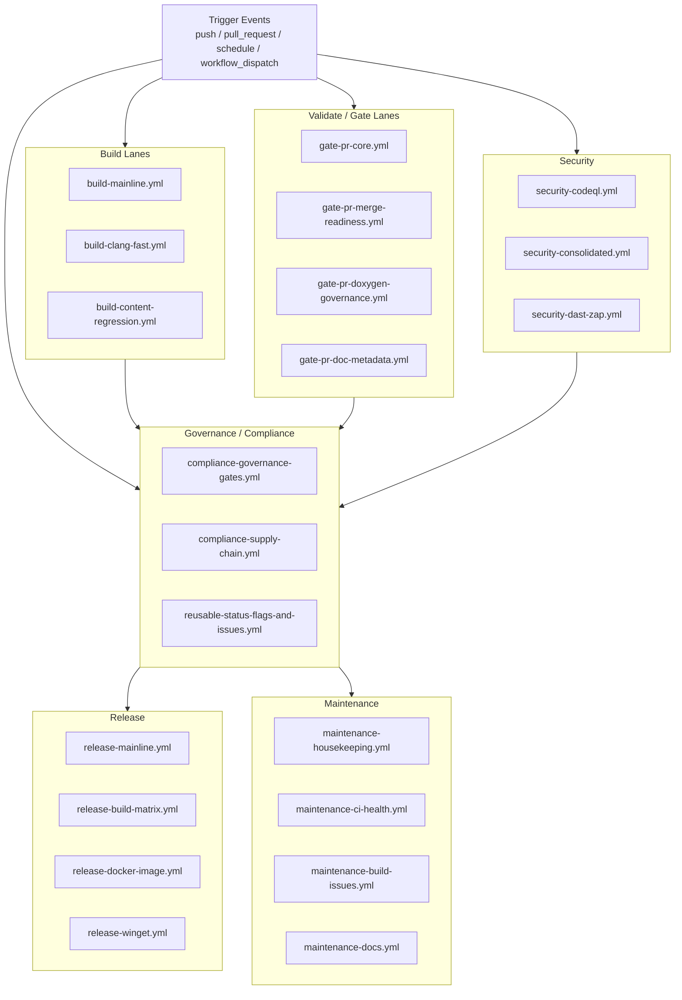

# Workflow Guidelines

> Author: ThemisDB Contributors
> Created: 2026-09-09
> Last Updated: 2026-11-12
> Status: active
> AI_Used: true
> AI_Models: unknown
> AI_Contributor: GitHub Copilot
> Human_Review: false
> Human_Author: ThemisDB Team
>
> Exact model backend not verifiable from final document text alone.

## Scope
Diese Richtlinie gilt fuer den schlanken, release-zentrierten Workflow-Kern.
Die kanonische Liste aktiver Workflows steht in `.github/WORKFLOW_REGISTRY.md`.

## Quick Navigation (Usability)
- **Ich will Workflow-Namen konsistent halten** → `## Naming Conventions`
- **Ich will Trigger/Concurrency korrekt setzen** → `## Best Practices` + `### Trigger-Policy für Workflows`
- **Ich will Labels korrekt setzen/entfernen** → `## Label Policy`
- **Ich will lokal vor PR pruefen** → `## Lokales Testsystem fuer GitHub Actions` + `## Troubleshooting`
- **Ich will wissen, welche Workflows kanonisch sind** → `.github/WORKFLOW_REGISTRY.md` (Source of Truth)

## Thematische Workflow-Orchestrierung (Mermaid)
Hinweis: Die Grafik ist eine thematische Übersicht der Lanes; die kanonische und vollständige Workflow-Liste bleibt `.github/WORKFLOW_REGISTRY.md`.



## Schnell-Checkliste vor Workflow-Aenderungen
1. Zweck bestaetigen: bestehender Workflow-Job statt neuer Datei, wenn moeglich.
2. Trigger enger schneiden (`branches` + `paths`), keine breiten Sammelmuster.
3. SOC pruefen: Build-Lane und Validate-Lane klar getrennt benennen.
4. Naming anwenden: `Build: ...` vs `Validate: ...` fuer job/step/summary.
5. Label-Operationen ueber kanonische Status-Action/State-Machine fuehren.
6. Lokal validieren (`pwsh ... test-github-actions-local.ps1 -Mode lint`).
7. Bei Struktur-/Governance-Aenderungen `WORKFLOW_REGISTRY.md` + diese Guideline synchron halten.

### Lokale Summary-Actions und Fehlerdiagnose

- Release-Artefakte brauchen einen blockierenden Loader-/Starttest nach dem Build:
  `release-build-matrix.yml` prueft jedes Paket in einem separaten Runtime-Job,
  Docker- und Nightly-Lanes pruefen Kandidaten vor dem Export finaler Digests/Tags.
  Die Ubuntu-Laufzeitbasis ist `scripts/release/runtime-dependencies-ubuntu-24.04.txt`;
  Build-Caches, vcpkg-Pfade und nachinstallierte Development-Libraries duerfen
  fehlende Paketabhaengigkeiten nicht verdecken. Details: `docs/deployment/RUNTIME_DEPENDENCIES.md`.
- Jeder Job mit `./.github/actions/write-run-summary` braucht zuvor einen eigenen,
  bedingungslosen Checkout ins Standard-Workspace; ein Checkout in einem anderen Job reicht nicht.
  Summary-Checkouts verwenden `persist-credentials: false` und `contents: read`.
- `tools/ci/check_workflow_boundaries.py` prüft diese Reihenfolge; Regressionstests:
  `python -m pytest tools/tests/test_check_workflow_boundaries.py -q`.
- Bei `startup_failure` zuerst die Workflow-Annotation prüfen: aufrufende Jobs müssen
  benötigte Berechtigungen verschachtelter Workflows explizit erlauben. Berechtigungen
  nur am betroffenen Aufruf erweitern, nicht pauschal für den gesamten Workflow.
- RAG-Phasen brauchen für Labels/Kommentare an Pull Requests `pull-requests: write`
  im Caller und Reusable; erfolgreiche Compiler-Prüfungen schließen einen
  nachgelagerten HTTP-403-Fehler nicht aus.
- Der Reusable-CMake-Build verwendet den dateibasierten vcpkg-Cache, ohne automatisch
  einen NuGet-Feed und dessen Tool-/Authentifizierungsanforderungen zu registrieren.
  Sein sccache-Retry muss `THEMIS_ENABLE_COMPILER_CACHE=OFF` setzen, die vorhandene
  Toolchain erhalten und Reconfigure-Fehler weiterreichen. Ein erneuter Preset-Aufruf
  darf die deaktivierte Cache-Option nicht wieder einschalten.
  Custom-Configure-Aufrufe geben ihr tatsächliches Binärverzeichnis mit
  `build_directory` an, damit Cache und Recovery dasselbe Verzeichnis verwenden.
  Recovery konfiguriert das vorhandene Cache-Verzeichnis, nicht pauschal die Root-Quelle.
  Configure- und Build-Recovery entfernen außerdem beide Launcher-Umgebungsvariablen,
  damit verschachtelte Dependency-Builds keinen deaktivierten Launcher rediscovern.
  Die apt-basierte Release-Critical-Quality-Lane in `gate-pr-core.yml` setzt
  `CMAKE_TOOLCHAIN_FILE` explizit leer und verwendet lokalen sccache-Speicher.
  So bleibt Systempaket-Modus auch beim Reconfigure erhalten, ohne einen
  fehlenden vcpkg-Submodulpfad als Toolchain zu aktivieren.
- Fehlgeschlagene Läufe ohne Jobs können abgelaufene Ausführungsfreigaben sein.
  Dies ist kein Testfehler; Maintainer müssen die Ausführung freigeben.
- Beim Wave-4-Gate wird das CMake-Preset explizit ausgeführt. Der Benchmark läuft
  im Build-Job mit seinen gemeinsam genutzten Laufzeitbibliotheken; nur die
  JSON-Ergebnisse werden zum separaten Baseline-Vergleich übertragen.
- Gemischte PR-/Wartungs-/Release-Workflows dürfen
  `cancel-in-progress: ${{ github.event_name == 'pull_request' }}` verwenden:
  PR-Synchronisierungen werden abgebrochen, manuelle Release- und Wartungsläufe nicht.
- Verschachtelte Docker-Workflows verwenden getrennte Concurrency-Namensräume
  (`docker-image-`, `docker-platform-`, `llm-model-cache-`); Plattformgruppen enthalten
  zusätzlich `inputs.platform`. `github.workflow` bezeichnet auch im aufgerufenen
  Workflow den Aufrufer und trennt verschachtelte Aufrufe daher nicht.
  Modell-Cache-Aufrufe dürfen untereinander serialisieren, aber niemals den
  wartenden Plattform-Aufrufer sperren. `cancel-in-progress: false` allein verhindert
  keine Kollisionen: GitHub kann ältere wartende Aufrufe derselben Gruppe ersetzen.
- Reusable Status-Workflows mit Fan-out-Aufrufen müssen ihre Concurrency-Gruppe pro
  Operation und stabilem Ziel bilden (z. B. Issue-Nummer, ersatzweise Marker/Titel),
  nicht nur aus `github.workflow` und Ref: Im aufgerufenen Workflow bezeichnet
  `github.workflow` den Caller, sodass parallele Status-Aufrufe sonst kollidieren
  können. `cancel-in-progress: false` beibehalten; es verhindert nicht das Ersetzen
  eines älteren wartenden Aufrufs derselben Gruppe.
- Der Core-Preflight akzeptiert repository-lokale `uses` ohne Versionssuffix und
  SHA-Pins mit Inline-Kommentaren. Er prüft neue externe Pins, Self-Push-Kommandos
  und `continue-on-error: true` auf hinzugefügten Diff-Zeilen, statt unveränderte
  Release-/Diagnose-Schritte bei einem Summary-Fix erneut zu beanstanden.

## Do / Don't (Quick Reference)
### Do
- Nutze `Build: ...` fuer Build-/Packaging-/Build-Status-Lanes.
- Nutze `Validate: ...` fuer Test-/Policy-/Plattform-Validierung.
- Setze enge `paths:` + `branches:` und dokumentiere den Lane-Zweck kurz im Workflow.
- Verwende die kanonische Status-/Label-Action statt ad-hoc Label-Mutationen.

### Don't
- Keine gemischten oder uneindeutigen Namen (`CI`, `Checks`, `Validation`) ohne `Build:`/`Validate:` Prefix.
- Keine breiten Trigger-Muster als einzige Selektion (`src/**`, `include/**`, `**/*.md`).
- Keine doppelten Push+PR Trigger fuer denselben Branch-Fall ohne klare Begruendung.
- Keine neuen Labelnamen direkt in Workflows einführen; zuerst `.github/labels.yml` pflegen.

## Minimales Job-Template (SOC-konform)
```yaml
jobs:
  <job-id>:
    name: "Build: <kurzer lane-name>" # oder "Validate: <kurzer lane-name>"
    runs-on: ubuntu-latest
    timeout-minutes: 15
    permissions:
      contents: read
    concurrency:
      group: <workflow-key>-${{ github.event.pull_request.number || github.ref }}
      cancel-in-progress: true
    steps:
      - name: Checkout
        uses: actions/checkout@v5
      - name: <Build|Validate>: <klare step-verantwortung>
        run: echo "..."
```

## PR Reviewer Checklist (Quick Gate)
- [ ] **Naming/SOC korrekt**: Jobs, Steps und Summaries nutzen konsistent `Build:` oder `Validate:` passend zur Verantwortung.
- [ ] **Trigger sauber geschnitten**: `branches:` + `paths:` sind eng genug; keine verbotenen Broad-Patterns als alleinige Selektion.
- [ ] **Concurrency korrekt**: kein `run_id` in `concurrency.group`, passendes `cancel-in-progress` je Workflow-Typ.
- [ ] **Label-Governance eingehalten**: neue Labels zuerst in `.github/labels.yml`; Status-Änderungen über kanonische Status-/Label-Action.
- [ ] **Least-Privilege**: minimale `permissions` gesetzt, keine unnötigen Schreibrechte.
- [ ] **Registry/Guideline-Sync**: bei Strukturänderungen `WORKFLOW_REGISTRY.md` und Guideline gemeinsam aktualisiert.
- [ ] **Comment commands documented**: Für Workflows mit PR-Kommentar-Interaktion muss ein kanonischer Befehl und eine Help-Referenz (`/gate-help` / `/approve-with-waiver ...`) dokumentiert sein.
- [ ] **Lokale Vorprüfung dokumentiert**: mindestens `pwsh -NoProfile -File ./scripts/test-github-actions-local.ps1 -Mode lint`.

### Sanitizer- und Parser-Fuzz-Gates
- `build-sanitizer-nightly.yml` führt bei Änderungen in den Storage-, Transaction-,
  Query/AQL-, Server-, Auth-, Network- und Sharding-Modulen nur die betroffenen
  fokussierten ASan+UBSan-Tests aus (Jobbudget höchstens 45 Minuten). Änderungen
  an der Root-CMake-Konfiguration wählen die volle Testsuite; Zeitplan/Dispatch
  führen die volle ASan+UBSan-Suite sowie TSan für Transaction, Sharding und LLM aus.
- Der Sanitizer-Run-Beleg enthält URL, getesteten SHA, Ziele, Laufzeit und rohes
  Job-Ergebnis. Fehlgeschlagene oder abgebrochene Läufe sind kein PASS; mögliche
  Runner-/Infrastrukturfehler müssen anhand der Logs separat klassifiziert werden.
- Sanitizer-Lanes bauen ohne Compiler-Cache und mit explizit leeren CMake-Launchern.
  Ein nicht erreichbares sccache-Backend darf den instrumentierten Build nicht
  ersetzen oder einen Toolchain-Wechsel im Retry ausloesen. Die initiale
  Konfiguration waehlt explizit Systempakete ohne vcpkg-Toolchain; ein geerbtes
  `VCPKG_ROOT` darf keinen fehlenden Toolchain-Pfad im Cache hinterlassen.
- AQL-, HTTP-, Wire-Protocol- und Importer-Parseränderungen wählen nur die
  betroffenen deterministischen Corpus-Smoke-Ziele. Jeder einzelne Parserlauf
  hat ein hartes 300-Sekunden-Limit. Fehlendes Harness, fehlende Pflicht-Seeds,
  Crash oder ASan/UBSan-Diagnose muss fehlschlagen. Corpus-Smoke verwendet keine
  AFL-Ausgabecache; die eingecheckten Pflicht-Seeds sind der minimale Corpus-Vertrag.
- Der Importer-Harness verlinkt den Produktparser mitsamt Logger/Error-Contracts.
  Der `release_critical`-Regressionstest `test_postgres_insert_token_progress`
  prueft dessen Vorwaertsschritt an schliessenden Klammern sowie unveraenderte
  String-/Quote-Tokenisierung, ohne nachgebaute Parserlogik.
- Für Änderungen an diesen Gates lokal ausführen:
  `python3 -m unittest tools.tests.test_fuzz_smoke tools.tests.test_sanitizer_targets -v` und
  `pwsh -NoProfile -File ./scripts/test-github-actions-local.ps1 -Mode lint`.

### Transaction-Evidence-Gate
- `build-wave-b-transaction.yml` ermittelt Build-Targets und Binaerpfade aus den
  registrierten CTest-Kommandos. Smoke-, Full- und Chaos-Jobs bauen ihre Auswahl
  auf demselben Runner vor der Ausfuehrung; On-Demand-Builds sind deaktiviert.
- Die Pflicht-Suites muessen aktiviert vorhanden sein. Die Full-Auswahl umfasst
  zusaetzlich alle aktivierten `module:transaction`-Registrierungen. Fehlende
  Binaerdateien, leere GTest-Suites, GTest-Skips sowie fehlende, fehlgeschlagene
  oder uebersprungene JUnit-Testfaelle lassen den Gate fehlschlagen.
- Bash-Pipelines verwenden `pipefail`. Der Ergebnis-Gate verlangt erfolgreiche
  Configuration-, Compile-, Smoke-, Full-, Chaos- und Artefakt-/Report-Jobs;
  Pflicht-Jobs mit `skipped` oder `cancelled` sind kein PASS.
- Alle Dispatch-Phasen laufen mindestens durch die verpflichtenden Test-Jobs.
  `all`, `phase4` und Zeitplan fuehren zusaetzlich die Benchmark-Baseline aus.
  PRs und andere Phasen liefern ohne Baseline nur partiellen Nachweis; das
  Closure-Paket bleibt `open`. Hosted-Runner-Messungen ersetzen weder
  Repraesentativ-Hardware-Abnahme noch Release-Sign-off.
- Rohlogs, ausgewaehltes Inventar, echtes JUnit und SHA-/Run-verknuepfte
  Zusammenfassungen werden 90 Tage aufbewahrt. Erfolgreiche Upstream-Jobs ohne
  ihre Pflichtartefakte duerfen kein vollstaendiges Paket erzeugen.
- Lokal pruefen:
  `python3 -m unittest discover -s tools/tests -p test_transaction_evidence.py -v`.
  Die CMake/CTest-Fixture testet die Gate-Mechanik, nicht die Produkt-Suites.

## Quick Acceptance Criteria (Workflow-/Guideline-PRs)
- Die Verantwortung ist im Actions-UI klar lesbar (Build vs Validate ohne Mischbegriffe).
- Keine unbeabsichtigte Trigger-Ausweitung (keine zusätzlichen Branch-/Path-Flächen ohne Begründung).
- Label-/Status-Verhalten bleibt kompatibel zur dokumentierten State-Machine.
- Änderungen sind fokussiert und enthalten nur den notwendigen Scope (Naming/Governance/Usability).

## Machine-readable GitHub Compliance Guidelines
Die maschinenlesbaren Governance-Policy-Dateien unter `.github/` sind der Index- und Handover-Punkt fuer issue-, PR-, Dokumentations- und Security-Compliance:
- `.github/compliance-guidelines.json`
- `.github/issue-compliance.json`
- `.github/pr-compliance.json`
- `.github/documentation-compliance.json`
- `.github/security-compliance.json`

Diese Dateien sollen die menschlich lesbaren Governance-Regeln und CI-Policies ergänzen, nicht ersetzen. Aenderungen dort muessen mit den Workflow-Guidelines und den dokumentierten Governance-Sources synchron gehalten werden.

## Aktive Workflows (Verweis auf Source of Truth)
- Die kanonische, gepflegte Liste steht in `.github/WORKFLOW_REGISTRY.md`.
- Die tatsächliche aktuelle Dateimenge liegt in `.github/workflows/`.
- Diese Guideline führt **keine** statische Workflow-Dateiliste mehr, um Drift (z. B. veraltete/duplizierte Einträge) zu vermeiden.
- Bei Workflow-Änderungen müssen Registry und diese Guideline synchron aktualisiert werden.

## Harte Grenzen fuer neue oder reaktivierte CI
- Default ist `kein neuer Workflow`. Bevorzuge einen neuen Job in einem bestehenden Workflow.
- Jeder reaktivierte Workflow braucht einen klar benannten Owner, ein Ablaufdatum fuer die naechste Review und einen Abschaltplan.
- Pull-Request-Trigger sind nur zulaessig, wenn `branches:` und `paths:` beide eng begrenzt sind.
- `paths:` duerfen nur datei- oder modulspezifische Bereiche enthalten. Globale Trigger wie `src/**`, `include/**`, `**/*.md` oder Repo-weit wirksame Sammelmuster sind fuer neue PR-Workflows nicht zulaessig.
- `push:` auf `develop` oder `community` ist nur fuer Release-, Packaging- oder explizit nicht-blockierende Nachtlaeufe zulaessig.
- Schwere Jobs muessen `workflow_dispatch` oder `schedule` bevorzugen. Sie duerfen nicht bei jedem PR-Sync anlaufen.
- Jeder PR-Workflow braucht `concurrency` mit workflow/ref-Gruppierung und `cancel-in-progress: true`.
- Jeder Workflow muss minimale `permissions` setzen und darf keine impliziten Default-Rechte nutzen.
- Reaktivierungen oder neue Workflow-Dateien muessen den `Workflow Boundary Guard` passieren, bevor sie aktiv bleiben duerfen.

## Repository artifact-size policy
- `gate-pr-artifact-size.yml` runs on every pull request because any path may introduce an oversized tracked file; a path filter would create a bypass.
- Added Git blobs strictly larger than 5 MiB (5,242,880 bytes) fail. Existing files are not retroactively rejected, and Git history is not rewritten.
- Exceptions require a reviewed exact repository-relative path and a non-empty rationale in `tools/ci/large_file_allowlist.json`; globs and directory-wide entries are rejected. Keep the allowlist empty unless an intentional fixture is approved.
- Generate Doxygen XML, scan reports, and benchmark run outputs in temporary/build locations and publish them as workflow artifacts. Current retention is workflow-specific: Doxygen XML 21 days, GS3 scan output 30 days, benchmark results 30 days, and Soll-Ist issue reports 14 days. The producing workflow and artifact name are recorded in `audit/evidence/repo-hygiene/HYG-01-inventory-2026-11-09.md`.
- The reproducible inventory command is `python3 tools/ci/repo_artifact_policy.py inventory`; it records Git blob sizes and the measured Git-directory footprint. Current tree deletion does not prune historical Git blobs.

## Reaktivierungs-Checkliste
- Der fachliche Nutzen ist branch-gate-relevant, release-relevant oder compliance-pflichtig.
- Die Logik passt nicht sinnvoll als Job in einen bestehenden aktiven Workflow.
- Trigger sind auf konkrete Dateien, ein einzelnes Modul oder einen klaren Release-Pfad begrenzt.
- Der Workflow enthaelt eine Kostenbremse: `paths`, `branches`, `concurrency`, kurze `timeout-minutes` und moeglichst fruehe Exit-Bedingungen.
- Der Workflow wurde lokal mit `scripts/test-github-actions-local.ps1` geprueft.
- Die Reaktivierung ist in `.github/WORKFLOW_REGISTRY.md` dokumentiert.
- Fuer den ersten Rollout ist der Workflow entweder `workflow_dispatch`-only oder nicht-blockierend (`continue-on-error` bzw. kein Required Check), bis die Triggerqualitaet verifiziert ist.

## Verbotene Muster
- Ein Spezialworkflow, der denselben Dateibaum wie ein bestehender Workflow ueberwacht.
- Ein Benchmark-, Audit- oder Nightly-Workflow als Required PR Check.
- Trigger auf Dokumentationsaenderungen fuer Build-, Security- oder Performance-Jobs.
- Neue Schatten-CI in Form von fast identischen Kopien bestehender Build- oder Testlogik.

## Naming Conventions
- Behalte das kanonische, prefixfreie `<domain>-<purpose>[-<scope>].yml`-Schema aus `WORKFLOW_FRAMEWORK_DESIGN.md` bei.
- Dateinamen muessen den Zweck klar beschreiben, lane-neutral bleiben und zu den registrierten Domain-Werten passen.
- Neue oder reaktivierte Workflows bekommen nur nach Registry- und Guidelines-Update einen Dateinamen.
- Workflow-/Job-/Summary-Namen müssen die Verantwortung klar trennen:
  - `Build: ...` fuer Compile-/Package-orientierte Lanes
  - `Validate: ...` fuer Test-/Policy-/Plattform-Validierungslanes
- In Reusable-Workflows müssen `name:` und zugehörige `summary_title` konsistent dieselbe Verantwortungs-Prefix-Konvention nutzen.

Kurzbeispiele:
- **Build-Lane**: `Build: Mainline (Linux)`, `Build: Step 2 · Windows AMD64`, `Build: Update build-status labels`
- **Validate-Lane**: `Validate: 🍎 macOS kqueue paths`
- **Nicht mehr verwenden**: gemischte/unscharfe Titel wie `CI — Build` neben `... Validation` ohne gemeinsames Prefix-Schema

## Best Practices
- Trigger nur fuer reale Gates/Release-Lanes definieren (keine Schatten-CI).
- `paths:` und `branches:` eng schneiden; im Zweifel enger statt "vorsichtshalber breit".
- `concurrency` mit `cancel-in-progress` auf Push/PR-Workflows setzen.
- Berechtigungen minimal halten (`permissions` least privilege).
- Schwere Benchmark-, GPU- und Sweep-Jobs standardmaessig ueber `schedule` oder `workflow_dispatch` isolieren.
- **Schedule-Frequenz-Regel (Sprint 8)**: Nicht-Nightly `schedule`-Workflows sind auf maximal 2× wöchentlich begrenzt.
  Nightly-Workflows (täglich) sind nur für echte Nightly-Builds/Sanitizer/Sicherheitsläufe zulässig.
  Maintenance-Workflows (Labels, Milestones, Housekeeping) laufen maximal wöchentlich.
  Mehrere täglich laufende Crons in einem Workflow sind nicht zulässig; Konsolidierung auf wöchentliche Granularität erzwingen.
- **Schedule-Staffelung**: Schedules müssen über das 24h-Fenster gestaffelt sein, um Runner-Contention zu vermeiden.
  Referenz-Staffelung: Nightly 01:00 (wiki), 02:20 (sanitizer), 03:00 (llm/release-mainline), 04:00 (release-nightly), 05:30 (maintenance).

### Fail-Closed Gates und CTest-Evidenz
- Gate-Workflows duerfen Fehler nicht mit `continue-on-error` oder `|| true` verbergen. Jede verbleibende Ausnahme muss in `tools/ci/workflow_fail_open_allowlist.json` exakt nach Workflow/Job/Step und Muster mit Begruendung, Owner und Ablaufdatum klassifiziert sein.
- `tools/ci/check_workflow_fail_open.py` prueft den vollstaendigen Gate-Workflow-Bestand; neue, abgelaufene, geaenderte oder veraltete Ausnahmen blockieren den Workflow.
- `pull_request_target` darf weder PR-Head-Code auschecken noch PR-Head-Daten an ausfuehrbare Schritte oder Actions weitergeben. Der Workflow Boundary Guard erlaubt explizite Base-Ref-Checkouts.
- Der Develop-Volllauf in `Build: Mainline` baut die registrierten Testziele vor CTest. `THEMIS_CTEST_DISABLE_ON_DEMAND_BUILD=1` macht fehlende Executables zu einem eindeutigen Fehler statt zu einem parallelen Build.
- Der CTest-Evidenzbericht muss die JUnit-Testmenge mit dem registrierten CTest-Inventar abgleichen; fehlende, fehlgeschlagene oder uebersprungene Tests sind kein Pass. Linux- und Windows-JUnit samt Modulsummary bleiben 90 Tage erhalten und werden in die Release-Evidenzkette aufgenommen.
- **Push-vs-PR-Doppelfeuer vermeiden**: Wenn ein Workflow sowohl `push:` (auf Branches) als auch `pull_request:` hat,
  feuert er doppelt für denselben Commit. Entweder `push:` oder `pull_request:` verwenden, nicht beide für Branch-Events.
- **Concurrency-Pflicht (Sprint 9)**: Jeder Workflow MUSS einen `concurrency:`-Block haben.
  Kanonische Muster je Workflow-Typ:
  - **PR/Push-Gates**: `group: <name>-${{ github.event.pull_request.number || github.ref }}`, `cancel-in-progress: true`
  - **Release-Orchestratoren**: `group: ci-release-${{ github.ref_name || github.ref }}`, `cancel-in-progress: false` (laufenden Release nie abbrechen)
  - **Reusable Workflows** (`workflow_call`): `group: ${{ github.workflow }}-${{ github.ref }}`, `cancel-in-progress: false`; Fan-out-Statusaufrufe ergänzen Operations- und Zielidentität (Issue-Nummer/Marker/Titel).
  - **Nightly/Schedule** (einmalig täglich): `group: <name>-develop` (statisch, da immer gleicher Branch), `cancel-in-progress: false`
  - **Sicherheits-/Pentest-Workflows**: `cancel-in-progress: false` (laufende Security-Scans nie abbrechen)
  - **Dispatch-only Safety** (WinGet, Rollback): `cancel-in-progress: false`
  - **`run_id`-basierte Gruppen sind verboten**: Jede `group:` die `github.run_id` enthält, bietet null Schutz (jede Ausführung erhält eine neue run_id). Stattdessen `github.ref` oder `github.event.pull_request.number` verwenden.
- **Gate-Feedback-Pflicht (Sprint 9)**: Blocking PR-Gates MÜSSEN bei Fehlern Label und PR-Kommentar setzen.
  Standardpattern: Job `gate-feedback` mit `needs: [<primary-jobs>]`, `if: failure() && github.event_name == 'pull_request'`,
  `permissions: { pull-requests: write, issues: write }` und `actions/github-script@v7` zum Setzen von `ci/failure` + Kommentar.
- **Human-in-the-loop-Pflicht (Sprint 10)**: Jeder Workflow MUSS eine Run-`$GITHUB_STEP_SUMMARY` schreiben
  (mindestens Scope, Ergebnis, nächster Schritt). Wenn eine Maintainer-/Produktentscheidung erforderlich ist
  (z. B. Gate-Blocker, Hold/Reject/Rollback, Waiver), MUSS der Workflow ein dediziertes Tracker-Issue via
  kanonischer Status-Action (`reusable-status-flags-and-issues.yml` / `.github/actions/status-flags-and-issues`) erstellen oder aktualisieren
  und `status/needs-approval` setzen.
- Copilot-Review-Runner-Konfigurationen muessen als selbstbegrenzte Workflows
  mit dem Jobnamen `copilot-setup-steps` und einem expliziten Ubuntu
  `runs-on` deklariert werden.

## Generalisierte Dateityp-Selektion (inkl. Ordner Include/Exclude)
- Fuer PR-Workflows bevorzugt Dateityp-Muster statt Ordner-Glob:
  - Gut: `.github/workflows/**/*.yml`, `tools/ci/**/*.py`, `cmake/**/*.cmake`
  - Vermeiden: `.github/actions/**`, `tools/**`, `src/**` ohne weitere Eingrenzung
- `paths:` fuer Include nutzen und nur bei Bedarf mit `paths-ignore:` kombinieren.
- Build-/Security-/Performance-Workflows duerfen nicht auf reine Doku-Aenderungen reagieren.
- Typische Excludes fuer nicht-fachliche Trigger:
  - `docs/**`
  - `ai_context/**`
  - `ai_working/**`
  - `**/*.md` (nur wenn der Workflow keine Doku-Governance prueft)
- Wenn ein Workflow Doku oder Governance explizit validiert, gelten dessen SOT-Pfade als Ausnahme.

## Security Guidelines
- Keine Secrets im YAML oder in Shell-Skripten hardcoden.
- Publish-Workflows nur ueber Tag- oder Environment-Gates freigeben.

### Action Pinning Policy (Tiered Strategy)
Third-party Actions sind nach Sicherheits- und Kompatibilitaetsanforderungen in 4 Kategorien eingeteilt. 
Siehe `.github/ACTION_PIN_POLICY.md` fuer vollstaendige Dokumentation und Allowlist.

**Tier 1 (MUST PIN - Sicherheit kritisch):** 
- Vollständige SHA-Pins erforderlich
- Bsp: codeql-action, fortify-action, action-gh-release (signings/credentials)
- Enforcement: `gate-pr-core.yml` Preflight-Checks

**Tier 2 (SHOULD PIN - Zuverlaessigkeit kritisch):** 
- Semantische Version Tags (z.B. `@v4`) oder gebrochene SHA-Pins erlaubt
- Bsp: checkout, upload-artifact, download-artifact, setup-python
- Rationale: Aktualisierungen innerhalb Major-Version sind typischerweise compatible

**Tier 3-4 (OPTIONAL/DYNAMIC - Cross-Compilation-freundlich):**
- Semantic Version Tags oder `latest` erlaubt
- Bsp: trivy-action, syft, actionlint, Linter-Tools
- Rationale: Plattformuebergreifende Kompatibilitaet (Docker/Linux/macOS/MS) bevorzugt

- Compliance-Gates fuer Dependencies muessen branch- und pfadbegrenzt sein und ein downloadbares Audit-Artefakt erzeugen.
- OIDC-basierte Authentifizierung (kein long-lived PAT) fuer ghcr.io und neue Registry-Ziele.

## Composite Actions
- `.github/actions/setup-cpp-build/`  — C++ Build-Setup (sccache, toolchain, deps)
- `.github/actions/setup-python-script/`  — Reusable checkout→python→script→upload pattern (ersetzt 21× Duplizierung)
- `.github/actions/status-flags-and-issues/`  — Kanonische Schnittstelle für Issue-/PR-Kommentare, Labels und Status-Tracker; ersetzt direkte `github.rest.issues.*`/`createComment`-Blöcke in Workflows.
- `.github/actions/manage-governance-issue/`  — Kanonische create/update Issue-Action (close-if-empty ist policy-bedingt no-op; aktuell noch nicht von Workflows verwendet)
- `build-mainline.yml` nutzt `mozilla-actions/sccache-action` mit `SCCACHE_GHA_ENABLED=true`.
- CMake muss mit `-DCMAKE_C_COMPILER_LAUNCHER=sccache -DCMAKE_CXX_COMPILER_LAUNCHER=sccache` konfiguriert werden.
- Der wiederverwendbare CMake-Workflow persistiert vcpkg-Downloads und Binary-Archive;
  diese Archive sind der portable Cache für manifest-basierte Build-Lanes. Keine
  Cachepfade auf ein nicht verwendetes Workspace-Root-`vcpkg_installed` richten.
  Der klassische MSVC-Analyse-Lane nutzt `vcpkg/installed` und bindet seinen Cache-Key
  an den vcpkg-Submodul-Commit plus Manifest/Configuration. Cache-Hit-Status,
  Archivanzahl und sccache-Statistik müssen im Lauf sichtbar bleiben.
- Windows-Release-Matrix-Lanes nutzen den GHA-sccache-Backend-Schalter des Reusable
  Workflows. Lane-Befehle dürfen `SCCACHE_GHA_ENABLED` nicht wieder auf `false` setzen.

### Build-Cache-Betrieb und Diagnose

Kanonische Implementierungen: [reusable-cmake-build.yml](workflows/reusable-cmake-build.yml),
[release-build-matrix.yml](workflows/release-build-matrix.yml) und
[msvc.yml](workflows/msvc.yml). Die Workflow-Inventur steht im
[Registry](WORKFLOW_REGISTRY.md#build-cache-aktualisierung-2026-11-01).

| Cache-Ebene | Persistierter Inhalt | Schlüssel und Backend |
|---|---|---|
| Reusable-Abhängigkeiten | `.cache/vcpkg-downloads/<tag>`, `.cache/vcpkg-binary/<tag>` und lokaler sccache-Speicher | `cmake-cache-<OS>-<tag>-<Dependency-Hash>-<vcpkg-Revision>-<Compilerkennung>-snapshot-<run_id>-<run_attempt>`; Restore nur innerhalb desselben `<tag>` (OS, Architektur, Compiler und Triplet) |
| CMake-Konfiguration | CMakeCache, CMakeFiles und Ninja-Metadaten im deklarierten `build_directory` | Separater `cmake-build-tree`-Key mit Lane, Build-Modus, Binärverzeichnis und CMake-/Manifest-Hash; kein vollständiger Objektdatei-Cache |
| MSVC-Analyse | `.vcpkg-downloads`, `.vcpkg-binary-cache`, `vcpkg/installed` | `msvc-vcpkg-<OS>-<vcpkg-Commit>-<Dependency-Hash>-snapshot-<run_id>-<run_attempt>`; Restore-Präfix bleibt beim gleichen vcpkg-Commit |

Der Dependency-Hash umfasst Manifest, Configuration, `ports/**` und `triplets/**`.
Die Reusable-vcpkg-Revision stammt aus dem Gitlink des ausgecheckten Source-Commits,
auch wenn das Submodul vor Restore noch nicht initialisiert ist. MSVC-Setup erfolgt
vor der Compilerkennung: Windows verwendet `VCToolsVersion`, GCC seine ausgewählte
Versionskennung und Clang seinen eigenen Versionsbanner. GCC aus Git Bash darf
nicht als MSVC-Kennung verwendet werden.
Bei `source_sha`-Builds wird nur das Cache-Hilfsskript separat aus
`github.workflow_sha` ausgecheckt. Damit hängt Cache-Diagnose nicht davon ab,
ob ein älterer Release-Source-Commit das neue Skript bereits enthält; der
eigentliche Build-Source bleibt unverändert auf den angeforderten Commit gepinnt.

`VCPKG_BINARY_SOURCES=clear;files,<Binary-Cache>,readwrite` aktiviert den
dateibasierten vcpkg-Cache explizit, ohne NuGet-Feed. vcpkg entscheidet anhand
der Paket-ABI, welche Archive zur aktuellen Toolchain passen. Ein vorhandenes
Archiv ist deshalb noch kein Beleg, dass das benötigte Paket wiederverwendet wird.
Die Linux-Release-Lanes verwenden lokalen sccache-Speicher
(`enable_sccache_gha=false`), die Windows-Release-Lane das GHA-Backend
(`enable_sccache_gha=true`). Windows behält die bestehenden Parallelitätslimits
von zwei Jobs bei; eine Erhöhung ist nicht Bestandteil der Cache-Reparatur.

Für die Auswertung diese Signale getrennt erfassen:

- **Actions-Restore:** `cache-hit=true` bedeutet einen exakten Schlüssel-Treffer.
  `false` kann ein Restore über ein Präfix sein; den tatsächlich restaurierten
  Schlüssel im Cache-Step prüfen. Ein fehlender exakter Treffer ist nicht
  gleichbedeutend mit einem leeren Cache.
- **vcpkg-Wiederverwendung:** Archivanzahl/-größe aus dem Reusable-Log und die
  Paket-Restore-/Build-Meldungen der Configure-Phase vergleichen. Im MSVC-Log
  zusätzlich `vcpkg installed tree restored` prüfen.
- **Compiler-Wiederverwendung:** sccache-Treffer, Misses und nicht cachebare
  Aufrufe aus der Build-Summary prüfen. Configure- und Build-Laufzeiten getrennt
  von Runner-Wartezeit messen.

Die Abhängigkeiten verwenden getrennte `actions/cache/restore`- und
`actions/cache/save`-Schritte. Snapshots erhalten Run-ID und Versuch im Schlüssel,
damit neue Pakete nicht hinter einem unveränderlichen exakten Cache-Treffer
verloren gehen. Restore erfolgt normalerweise über das Lane-Präfix;
`cache-matched-key` zeigt im Reusable den tatsächlich verwendeten Snapshot.
Ein plattformunabhängiger Python-Fingerprint aus relativen Dateinamen und Größen erkennt Inventaränderungen
ohne das erneute Lesen mehrerer GiB. Unveränderte Inventare werden nicht hochgeladen;
der Fingerprint ist keine Integritätsprüfung und erkennt gleich große Änderungen
unter gleichem Dateinamen nicht.

Der Reusable speichert nach Configure/Build und vor Validation, auch nach einem
Configure-/Build-Fehler, aber nicht nach Abbruch. Er persistiert Archive/Downloads
und Compiler-Cache, keinen unvollständigen Installationsbaum. MSVC speichert seinen
Installationsbaum nur nach erfolgreicher Dependency-Vorbereitung, noch vor der
Analyse. Test-, Analyse- und Packaging-Fehler verhindern diese Saves somit nicht.
MSVC setzt die vcpkg-Cache-Variablen bereits im Dependency-Schritt selbst;
Einträge in `GITHUB_ENV` allein gelten erst für folgende Schritte. Native
vcpkg-Fehler werden als PowerShell-Fehler behandelt, damit der Retry greift und
ein fehlgeschlagener Installationsschritt keinen erfolgreichen Snapshot auslöst.
Die CMake-Konfigurationscache-Automatik bleibt unverändert. Neue Snapshots können
weiterhin Speicherdruck und Eviction verursachen; Cachegrößen und Retention beobachten.
Ein eigener wöchentlicher C++-Cache-Warming-Workflow ist aktuell nicht definiert.
Die frühere Angabe von 60–80% Treffern ist keine gemessene Zusicherung.
Eine Laufzeitverbesserung erst nach vergleichbaren erfolgreichen Wiederholungsläufen
mit unveränderter Toolchain, Manifest und vcpkg-Revision bestätigen.

Die spezialisierten GPU-, Transaktions- und Benchmark-Lanes bilden sccache-Keys
als `<Namespace>-<OS>-<Architektur>-<Job>-<Source-Hash>`; Benchmark-Matrix-Lanes
nehmen zusätzlich den Flow-Namen auf. Restore-Präfixe enden unmittelbar vor dem
Source-Hash und passen dadurch auch nach Source-Änderungen. Der Job-Anteil
verhindert konkurrierende Saves verschiedener Jobs unter demselben Schlüssel.
Diese Lanes behalten ihre vorhandene automatische Save-Policy bei; die erste
Ausführung mit der korrigierten Schlüsselstruktur beginnt mit einem kalten Cache.

Fokussierte Vertragsprüfung:
`python -m pytest tools/tests/test_check_workflow_boundaries.py -q`.
Sie prüft Cachepfade und Backend-Auswahl, nicht die tatsächliche Online-Trefferrate.

## Issue-/PR-Kommentar-Standard
- GitHub-Workflows dürfen Fehler, Statusänderungen und Recovery-Hinweise nicht direkt per ad-hoc `github.rest.issues.createComment` oder PR-Kommentar-Blocks schreiben, wenn dies als trackerbasierte Status- oder Fehlerkommunikation modelliert ist.
- Die gemeinsame Action `.github/actions/status-flags-and-issues` ist die Standard-Implementierung für:
  - `upsert_issue`
  - `set_status` / `clear_status` / `replace_status_group`
  - `comment_issue`
  - `close_issue` (policy-disabled/no-op; keine automatische Issue-Schließung)
- `comment_issue` darf auf Issues und PRs kommentieren; in GitHub ist ein PR als Issue mit `issue_number` adressierbar. Für klaren Zweck sollte der Workflow den `target-type` explizit auf `issue`, `pr` oder `auto` setzen.
- Empfehlungskommentare mit dynamischer Evidenz (z. B. `merged PR`/`timeline`-Analyse) sind eine erlaubte Sonderform, sofern sie comment-only bleiben und keine Tracker-Status-Mutation, kein `close_issue`, kein Label-Override und keine Branch-Mutation ausführen. In solchen Workflows muss der Marker-Mechanismus strikt idempotent bleiben.
- Kommentare müssen idempotent sein: Marker wie `<!-- ci-build:type:build-status -->` oder `<!-- ci-error:... -->` verhindern Spam und doppelte Fehlerposts.
- Fehler-Kommentare sollten immer mindestens enthalten: Workflow-Name, Run-Link, Commit/SHA, betroffenen Job und zentrale Fehlermeldung oder Testname.
- Für `pull_request`-Workflows ist der Kommentar auf den PR zu senden; für `push`/`schedule`-Workflows wird typischerweise der Tracker-Issue-Kommentar verwendet.

## CI Health Dashboard
- `maintenance-ci-health.yml` aggregiert wöchentlich (sonntags 06:00 UTC) pass/fail-Raten je Workflow.
- Schwellwert für chronische Fehler: >30% Fehlerrate bei ≥3 Fehlern → öffnet `ci/chronic-failure`-Issue.
- Das `workflow_dispatch`-Input `lookback_days` akzeptiert ganze Zahlen von 1 bis 90 (Standard: 7); ungültige Werte brechen die Analyse vor dem API-Aufruf ab.
- Manuelle Läufe starten standardmäßig mit `dry_run=true`: Analyse, Zusammenfassung und Report-Artefakt laufen weiter; Issue- und Label-Änderungen werden nur in einem Live-Lauf ausgeführt. Geplante Läufe bleiben live.

## Compendium Sync
- `maintenance-compendium-sync.yml` resolves its default target version from the top-level `target_version` in `docs/compendium/CHAPTER_ROADMAP_MAPPING.yml`; an optional manual override is validated before scanning and is carried into tracker identity and content.
- Manual dispatch defaults to `dry_run=true`: the scan and report artifacts still run, but tracker issue writes are suppressed. Scheduled runs remain live.
- The drift scanner returns `1` for valid findings and `0` for no findings; the workflow validates those outcomes against generated reports and fails on scan/configuration errors instead of suppressing them.
- Issue-write permissions are limited to tracker jobs; the scan job has read-only repository access.

## Architecture CI
- `maintenance-architecture-ci.yml` generates and validates architecture outputs in a read-only job with checkout credentials disabled, then transfers validated files as a run artifact.
- A separate publication job receives write permissions and runs only when outputs changed and the dispatch is not a dry-run. Scheduled and `develop` push runs retain automatic publication behavior.
- Manual runs default to `dry_run=true`; generation, validation, artifact upload, and summaries still run while branch/PR writes are skipped.

## Issue and Security Triage
- `maintenance-issues.yml` manual runs default to `dry_run=true`. GS3 scans, security-alert queries, Doxygen autofixes, artifacts, and summaries still run; issue, label, comment, branch, and PR changes are previewed or suppressed.
- Scheduled runs remain live. Setting `dry_run=false` on a manual run enables the selected job's existing tracker or PR updates.
- Doxygen autofixes in a manual dry-run modify only the runner workspace; the summary previews the branch/PR publication without pushing.
- Security SLA input is passed through the environment and validated as a positive integer. Recovery issue updates require a successful alert query.

## Manually Triggering Workflows
Empfohlen via GitHub CLI:

```bash
gh workflow run .github/workflows/edition-hyperscaler-ci.yml --repo makr-code/ThemisDB --ref hyperscaler
gh workflow run "release-mainline.yml" --repo makr-code/ThemisDB --ref develop --field edition=community --field build_matrix=community-only
```

## Lokales Testsystem fuer GitHub Actions

Der Repository-Standard fuer lokale Validierung ist das Script
`scripts/test-github-actions-local.ps1`. Es kapselt die drei wesentlichen
Pruefschritte fuer GitHub Actions im lokalen Repo-Kontext:

1. `actionlint`-Linting fuer YAML-/Workflow-Syntax
2. `act`-Dry-Run fuer ausgewählte Events wie `push`, `pull_request`, `workflow_dispatch`, `schedule`
3. Protokollierung in einem dedizierten Log-Ordner mit nachvollziehbaren Artefakten

### Verwendete Tools

- `docker` fuer den `rhysd/actionlint:latest` Container
- `act` fuer lokale Dry-Run-Ausfuehrung ohne echten GitHub Runner
- PowerShell (`pwsh`) als Wrapper-Shell fuer das Repo-Skript

### Skript-Interface

```powershell
pwsh -NoProfile -File ./scripts/test-github-actions-local.ps1 -Mode lint
pwsh -NoProfile -File ./scripts/test-github-actions-local.ps1 -Mode dryrun
pwsh -NoProfile -File ./scripts/test-github-actions-local.ps1 -Mode all
```

Optionale Parameter:

```powershell
pwsh -NoProfile -File ./scripts/test-github-actions-local.ps1 -Mode dryrun -Events push,pull_request,workflow_dispatch
pwsh -NoProfile -File ./scripts/test-github-actions-local.ps1 -Mode lint -Workflow .github/workflows/build-mainline.yml
pwsh -NoProfile -File ./scripts/test-github-actions-local.ps1 -Mode all -LogDir tmp
```

### `lint`-Modus

Der `lint`-Modus startet `actionlint` als Docker-Container:

```powershell
docker run --rm -v "${PWD}:/repo" -w /repo rhysd/actionlint:latest -color
```

Ziel:
- syntaktische Workflow-Pruefung
- Validierung von `on:`, Jobs, `uses`, `runs`, Outputs, Expressions und generischer GitHub-Action-Syntax
- fruehzeitige Erkennung von YAML-/Semantikfehlern vor dem Push oder PR

Typische Fehlerquellen:
- ungueltinge YAML-Struktur
- falsche Ausdruckssyntax in `${{ ... }}`
- ungueltige `uses:`-Referenzen
- falsche Job-/Step-Definitionen
- falsche Trigger oder Secrets-Referenzen

### `dryrun`-Modus

Der `dryrun`-Modus verwendet `act` mit `-n`, also ohne echte Ausfuehrung im GitHub-Runner:

```powershell
act -n push
act -n pull_request
act -n workflow_dispatch
act -n schedule
```

Das Script ruft `act` fuer die Standard-Events auf:

```powershell
@('push', 'pull_request', 'workflow_dispatch', 'schedule')
```

Ziel:
- Job-/Step-Struktur lokal plausibilisieren
- pruefen, ob die Workflows als Runner-Graph und Job-Sequenz interpretierbar sind
- typische YAML-/Workflow-Fehler frueh erkennen, bevor ein PR gemerged wird

Wichtig:
- `act` ist ein Dry-Run, kein echter GitHub-Runner-Lauf.
- Wenn `act` bei einem Event keine passenden Stages findet, behandelt das Skript das als Hinweis-/Skip statt als fatale Fehlermeldung.
- Reale Runtime-Problems (Secrets, hosted runner, `workflow_run`, `release`-Integration) lassen sich lokal nicht vollstaendig simulieren.

### Log- und Artefakt-Handling

Das Skript legt Protokolle im angegebenen Log-Ordner an, standardmaessig unter `tmp/`:

- `actionlint_<timestamp>.log`
- `act_dryrun_<event>_<timestamp>.log`

Damit bleiben Ergebnisse reproduzierbar und lassen sich nach dem Lauf mit
`Get-Content` oder `Tee-Object` weiter analysieren.

### Erfolgs-/Fehlerkriterium

- `lint`/`dryrun`/`all` geben `ExitCode 0` aus, wenn alle durchgefuehrten Checks okay waren.
- Ein Fehler in einem der Tests setzt den Gesamtstatus auf `1`.
- Die Zusammenfassung meldet eindeutig, welche Phase fehlerhaft war und welcher Logpfad relevant ist.

### Zusätzliche Hinweise zur Umgebung

- In einer WSL-Umgebung ohne `pwsh` oder ohne laufenden Docker-Daemon kann das lokale Testsystem nicht ausgefuehrt werden.
- In solchen Faellen ist der richtige Nachweis eine echte GitHub-Actions-Ausfuehrung auf GitHub selbst, nicht nur die lokale Syntaxverifikation.
- Das Repo-Skript ist daher ein notwendiges lokales Gate, aber kein Ersatz fuer einen echten Remote-Lauf.

## Troubleshooting
- Lokal zuerst linten: `pwsh -NoProfile -File ./scripts/test-github-actions-local.ps1 -Mode lint`
- Danach Dry-Run: `pwsh -NoProfile -File ./scripts/test-github-actions-local.ps1 -Mode dryrun`
- Registry, Guidelines und Reaktivierungsbegruendung bei Struktur-Aenderungen immer zusammen aktualisieren.
- Geplante Dateinamen-Migrationen sind in `.github/docs/WORKFLOW_FILENAME_RENAME_MATRIX.md` dokumentiert.

## Doxygen Coverage Threshold (Maintainer)
- Der Doxygen-Coverage-Gate liest den Schwellwert zentral aus `.github/ci-scope-config.yaml` unter `quality_gates.docs_coverage_threshold`.
- Kanonische CI-Konfiguration ist `Doxyfile.audit`; der PR-Gate-Workflow verwendet eine daraus abgeleitete, modul-scoped Laufkonfiguration.
- Aktueller Standardwert ist `95`.
- Empfohlene stufenweise Anhebung ab diesem Stand: `95 -> 97 -> 99`.
- Strukturfehler (`@brief`, `@param`, `@return`, fehlender Doxygen-Block, Doxygen-Warnungen, fehlendes XML`) sind im PR-Gate blocking; Coverage < Threshold ist auf `develop` beobachtbar und auf Release-/Phase-6-Scope eskalationspflichtig.
- Ein genehmigter Tier-1-Override fuer `T1-DOXYGEN-COVERAGE` muss ueber `.github/workflows/compliance-governance-gates.yml` per `/approve-with-waiver ...` kommentarbasiert freigegeben werden; `gate-pr-doxygen-governance.yml` wertet dazu den kanonischen PR-Kommentar-Marker aus und synchronisiert das Label `governance/doxygen-waiver`.
- Nach jeder Anhebung zuerst mehrere PR-Laeufe beobachten und nur bei stabiler Signalqualitaet weiter erhoehen.
- Bei hoher False-Positive-Rate den Schwellwert voruebergehend zuruecksetzen und Doku-Luecken gezielt abbauen.

## Label Policy

### Kanonische Label-Definitionen
Alle Repository-Labels sind in `.github/labels.yml` definiert (Name, Farbe, Beschreibung, Typ).
Der Workflow `maintenance-housekeeping.yml` synchronisiert diese Labels wöchentlich sowie bei Änderungen an `.github/labels.yml`.
Labels dürfen nur in `.github/labels.yml` hinzugefügt oder geändert werden.
`maintenance-labels.yml` wurde in Sprint-8-Konsolidierung ersetzt und ist nicht mehr als aktive Workflow-Datei im Repository vorhanden.

Usability-Hinweis:
- Labelnamen sind stable API fuer Automationen (Gates, Maintenance, Dashboards).
- Vor Label-Änderungen immer prüfen: `labels.yml` + betroffene Workflow-Regeln + diese Guideline.

### Milestone-Automation (kanonisch)
Milestones werden analog zentral verwaltet:

- Kanonische Definitionen in `.github/milestones.yml`
- Automatische Synchronisierung durch `.github/workflows/maintenance-housekeeping.yml`
- Automatische Zuordnung für Issues/PRs über Label-Regeln und optionales `Target Version`-Override

Damit werden fehlende Milestones nicht mehr nur protokolliert, sondern optional automatisch angelegt
(`auto_create_missing_milestones`) und direkt zugewiesen. Enthalten sind u. a. eigene Lanes für
`HOTPATCH` und `LONG-TERM`.

### Label-Typen
- **blocker** — blockiert Merge oder erfordert sofortige Maßnahme
- **warning** — Aufmerksamkeit erforderlich, kein harter Merge-Blocker
- **info** — informativ, keine Aktion erforderlich

### Blocker-Labels (blockieren Merge via Branch Protection Rules)
| Label | Gesetzt von | Gelöscht von |
|---|---|---|
| `ci/build-failed` | `build-mainline.yml` (push → develop, Build-Stage Failure Marker) | `build-mainline.yml` bei nächstem Erfolg |
| `ci/test-failed` | `build-mainline.yml` (push → develop, Test-Failure; non-blocking fuer Build-Preflight) | `build-mainline.yml` bei nächstem Erfolg |
| `ci/failure` | `maintenance-build-issues.yml`, `maintenance-ci-health.yml` | manuell / nach Behebung |
| `ci/chronic-failure` | `maintenance-ci-health.yml` (>30% Fehlerrate) | `maintenance-ci-health.yml` bei Erholung |
| `ci/build-error` | `maintenance-build-issues.yml` | manuell |
| `ci/compiler-linker-failed` | `build-mainline.yml`, `maintenance-build-issues.yml` | `build-mainline.yml` bei nächstem Erfolg oder Maintenance bei Erholung |
| `ci/failure-rate-high` | `maintenance-ci-health.yml` | `maintenance-ci-health.yml` bei Erholung |
| `governance/drift` | `compliance-governance-gates.yml` | `compliance-governance-gates.yml` nach Korrektur |
| `governance/wave-gate-fail` | `compliance-governance-gates.yml` | `compliance-governance-gates.yml` nach Gate-Erfüllung |
| `security` | `maintenance-issues.yml` | nach Schließung des Issues |
| `security/critical` | `maintenance-issues.yml` (critical findings) | nach Schließung des Issues |
| `status/needs-approval` | `maintenance-ci-health.yml`, `maintenance-issues.yml` | manuell durch Maintainer |
| `status/blocked` | manuell, `maintenance-build-issues.yml` | manuell |
| `breaking-change` | `automation-community.yml` (AI-Analyse) | manuell |
| `release_critical` | `actions/labeler` (path-basiert) | manuell |

### Kanonische CI Label State Machine

Automatisierte CI-Issues und Status-Tracker nutzen folgende Prozesszustände:

- `status/needs-triage` → finding erkannt, Ersttriage ausstehend
- `status/in-progress` → Bearbeitung laeuft
- `status/needs-attention` → follow-up erforderlich, aber kein harter Gate-Blocker
- `status/needs-approval` → maintainer approval erforderlich (blockierend)
- `status/resolved` → finding behoben/verifiziert
- `status/recovered` → zuvor fehlerhafter Lauf ist wieder stabil

Domänenregeln:

- **Build-Preflight:** Nur `ci/build-failed` + `ci/compiler-linker-failed` blockieren.
- **Tests/Gaps/Warnungen:** markieren via eigene Labels (`ci/test-failed`, `scanner/*`, `quality/*`), blockieren Preflight nicht automatisch.
- **Governance Waiver:** `governance/waiver-requested` → `governance/doxygen-waiver` (approved) oder `governance/needs-attention` (rejected/expiring).
- **Security/GS3:** Findings-Labels (`security*`, `scanner/*`) und Prozess-Labels (`status/*`) werden getrennt geführt.

Implementierungshinweis:

- Pro Domäne muss ein fester `status-group` mit `replace_status_group` verwendet werden, damit alte Zustandslabels atomar entfernt werden (kein Label-Drift).

### Trigger-Policy für Workflows
- **Schwere Build-Workflows** (C++ compile, test, scan, > 15 min) triggern **nur auf `push` zu kanonischen Branches**, nicht auf `pull_request`.
  - Betrifft: `build-mainline.yml`, `compliance-supply-chain.yml`
- **Leichtgewichtige PR-Gate-Workflows** (Policy-Checks, Lint, < 5 min) triggern auf `pull_request`.
  - Betrifft: `gate-pr-core.yml`, `gate-pr-*.yml`, `compliance-governance-gates.yml`, `gate-*.yml`
- Jeder PR-Workflow muss `concurrency` mit `cancel-in-progress: true` setzen.
- `paths:` muss für PR-Workflows eng begrenzt sein — kein `src/**` oder `include/**` als einziges Muster.
- Einzige all-path Ausnahme: `gate-pr-file-size.yml` muss jeden PR prüfen, damit neue große Dateien unabhängig von Pfad und Dateiendung erkannt werden; der Job bleibt leichtgewichtig und sein Status ist branch-protection-pflichtig.

## PR Governance for AI-Generated Changes
- Pull Requests labeled `ai-generated` require maintainer review before merge.
- Copilot PR summary/review support should be enabled in repository settings to assist human review, but does not replace maintainer approval.
- `ai-generated` PRs should explicitly document validation scope and documentation synchronization status.
- Auto-merge for `ai-generated` PRs should remain disabled unless a maintainer explicitly authorizes it.