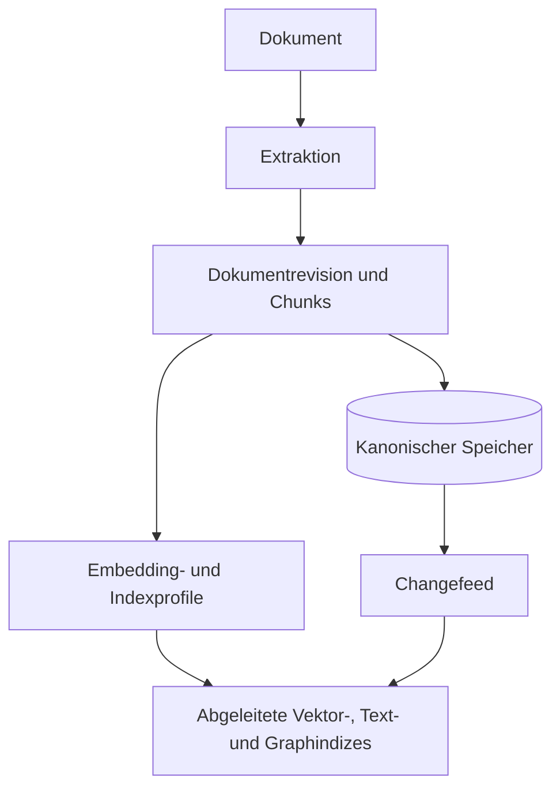
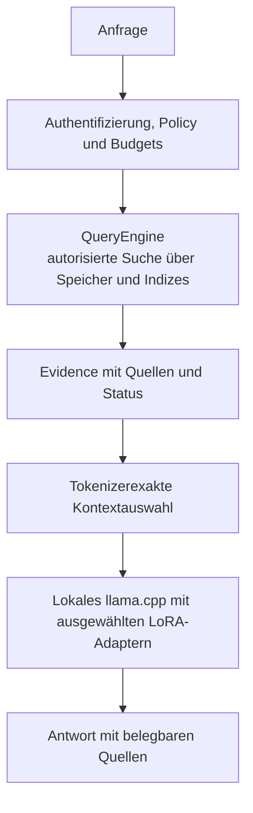
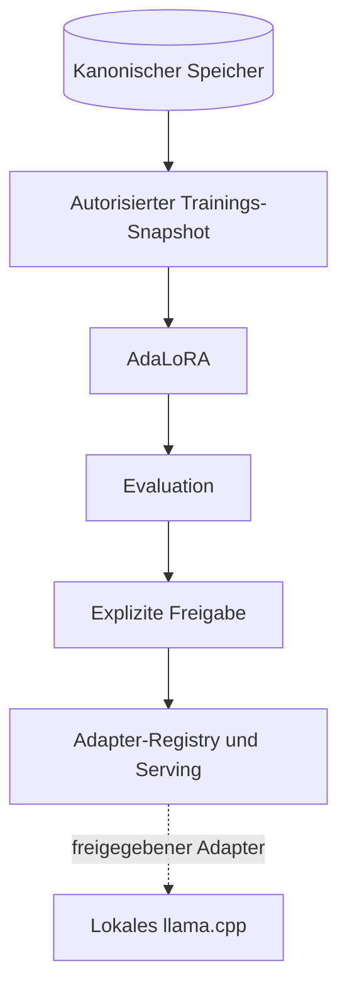
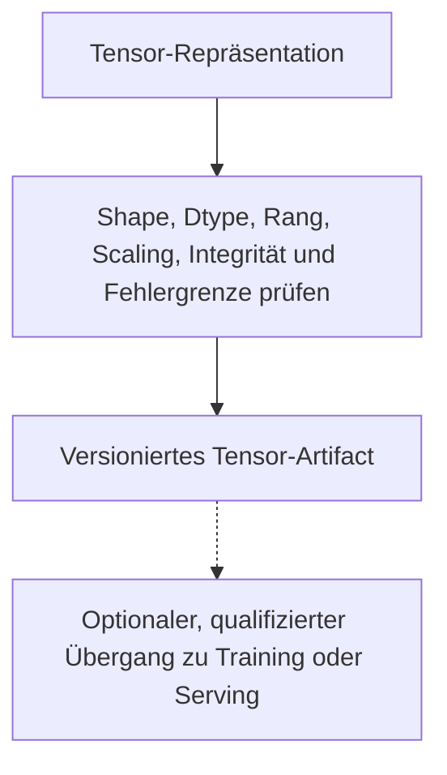

> Exact model backend not verifiable from final document text alone.

# ThemisDB als datenbankzentriertes LLM-Hybrid: Ist-Analyse und Zielstruktur

**Stand:** 2026-11-13  
**Status:** Quellengestützte Analyse und Architekturvorschlag, nicht normativ  
**Scope:** Datenverträge und End-to-End-Datenfluss für Ingestion, Retrieval,
lokale llama.cpp-Inferenz, AdaLoRA/Multi-LoRA und Tensor-Abstraktionen.

Dieser Bericht fasst eine statische Quellcodeanalyse und externe
Dokumentationsrecherche zusammen. Er beschreibt beobachtete Implementierung
getrennt von Vorschlägen. Er ist weder eine Release-Zusage noch ein Ersatz für
die maßgeblichen [Roadmaps](ROADMAP.md), [Modulverträge](src/rag/ARCHITECTURE.md)
oder den Quellcode. Wo Integrationen nicht Ende-zu-Ende nachgewiesen sind, wird
das ausdrücklich markiert.

## Kurzfassung

**ThemisDB sollte eine datenbankzentrierte Wissens- und Inferenzplattform
bleiben.** Die Datenbank ist für Identität, Berechtigungen, Konsistenz,
Transaktionen und autoritative Daten zuständig. Lokales Retrieval,
llama.cpp-Inferenz, AdaLoRA und Tensor-Verarbeitung sind integrierte
Fähigkeiten darüber – keine Ersetzung des Datenbankkerns.

Viele Bausteine existieren bereits. Die größte Lücke liegt an ihren
Übergängen: Identitäten, Indexmaterialisierung, Fehlersemantik, Modell- und
Adapteridentität sowie Wiederherstellung sind nicht durchgängig abgesichert.
Für kleinere lokale Modelle ist besonders wichtig, relevante, aktuelle und
quellengebundene Evidenz innerhalb des tatsächlichen Kontextbudgets
auszuwählen.

## Zielstruktur und Datenfluss

Die folgenden Diagramme beschreiben das **Zielbild**, nicht den Nachweis einer
bereits durchgängig implementierten Pipeline. Sie sind bewusst vertikal und
nach Teilprozessen getrennt, damit sie auch in schmalen Dokumentansichten
lesbar bleiben.

### Dokumentaufnahme und Indexierung



### Retrieval und lokale Antwortgenerierung



Authentifizierung, Policy und Budgets gelten über alle Schritte hinweg, nicht
nur für den eingezeichneten Anfragepfad. Die QueryEngine kombiniert dabei
autorisierte Zugriffe auf kanonische Dokumente und abgeleitete Suchindizes.

### Optionaler AdaLoRA-Trainings- und Serving-Lebenszyklus



### Optionale Tensor-Repräsentation und qualifizierter Handoff



Gestrichelte Verbindungen markieren optionale oder noch zu qualifizierende
Übergänge. Das Tensor-Diagramm beschreibt Anforderungen an einen möglichen
Übergang, nicht einen bereits durchgängigen Tensor- oder KV-Handoff.

Leitprinzipien:

- Indizes sind abgeleitete Sichten auf autoritative Daten; ein Vektortreffer
  allein ist kein vollständiger Dokumentvertrag.
- Ein Modell darf begrenzte Recherche- oder Tool-Schritte vorschlagen. **Rechte
  vergibt es nicht**; QueryEngine und Autorisierung entscheiden über Zugriff
  und Änderungen.
- Kleine lokale Modelle profitieren vor allem von relevanter, aktueller und
  knapper Evidenz – nicht automatisch von mehr Kontext oder mehr
  Agentenschritten.
- Lang laufende Trainings, Inferenz und menschliche Freigaben dürfen keine
  Datenbank-Locks halten.

## Ist-Befunde: Vertragsbrüche an Übergängen

| Übergang | Quellbefund und Risiko |
|---|---|
| **Dokument -> Chunk** | Die [RAGIngestionBridge](src/rag/rag_ingestion_bridge.cpp#L205) setzt vor dem Workflow keine `file_id`. [chunk_embed](src/ingestion/steps/chunk_embed_step.cpp#L84) bildet daraus die Chunk-ID. Wenn kein Workflow-Schritt die ID setzt, können verschiedene Dokumente IDs wie `:0` erhalten. Der separate Fallback-Pfad ist davon zu unterscheiden. |
| **Vektorindex -> Dokument** | Der [VectorIndexSinkAdapter](src/ingestion/ingestion_sinks.cpp#L667) persistiert je Chunk zuerst einen Quelldatensatz in `ingestion_sources` und schreibt danach den Vektoreintrag mit `source_ref_*`-Feldern. [RAGProvider](src/rag/rag_provider.cpp#L88) löst diese Referenz über [`QueryEngine::readIngestionSourceText`](src/query/query_engine.cpp#L4652) inklusive Provenienzprüfung auf und verwirft Treffer ohne gültige Quelle. Offen bleibt: Beide Schreibvorgänge sind nicht atomar (Quelle ohne Vektor bzw. Teilbatch möglich), und `ingestion_sources` ist ein globaler Schlüsselraum über der `chunk_id`, deren Kollisionsfreiheit vom Ingestion-Pfad abhängt (siehe Zeile „Dokument -> Chunk“). |
| **Ingestion -> Status** | Die Bridge meldet nach einem Vektor-Schreibfehler weiterhin Erfolg; Graph-Schreibergebnisse werden ignoriert. Siehe [rag_ingestion_bridge.cpp](src/rag/rag_ingestion_bridge.cpp#L315). Der separate [Sink-Bundle-Pfad](src/ingestion/ingestion_sinks.cpp#L359) schreibt sequenziell; ein gemeinsamer Rollback ist dort nicht belegt. |
| **SDK -> Vektorsuche** | Der synchrone [Python-Client](clients/python/themis/__init__.py#L449) sendet `metadata_filter`, aber der untersuchte [HTTP-Handler](src/server/vector_api_handler.cpp#L95) wertet ihn nicht aus. Bei mehreren Endpunkten werden Distanztreffer zudem absteigend sortiert; Nicht-200-Antworten können als leeres Ergebnis enden. Caller-Metadatenfilter dürfen nicht mit einer Autorisierungspolicy gleichgesetzt werden. |
| **Retrieval -> Prompt** | [RAGProvider](include/rag/rag_provider.h#L27) liefert typisierte Kandidaten und Grenzen; seine Deadline-/Abbruchprüfung ist kooperativ und unterbricht keinen blockierenden Backend-Aufruf. Der [HTTP-RAG-Pfad](src/server/http_server.cpp#L5919) prüft Collection-Zugriff und reicht das Request-Timeout als Retrieval-Deadline weiter (504 bei Ablauf), liefert aber keinen vollständigen strukturierten Evidence-Vertrag. Eine allgemeine Zeilen-/Tenant-Policy ist dadurch nicht nachgewiesen. |
| **Kontextbudget** | [prepareRAGRequest](src/llm/rag_helpers.cpp#L12) reserviert Antwortbudget und rahmt Quellen, verwendet in diesem Pfad aber eine zeichengestützte Tokenschätzung. `tensor_hybrid` und `tensor_prefix` erzeugen dort Text-Slots, keine nachgewiesene Tensor- oder KV-Injektion. Siehe [context_window_budget.h](include/llm/context_window_budget.h#L22). |
| **AdaLoRA-Wiederaufnahme** | Der [Checkpoint-Code](src/training/ada_lora_adapter.cpp#L954) schreibt Version 1 und ein synthetisches `alpha=8`; beim Laden wird der gespeicherte aktive Rang nicht wiederhergestellt. Der [Header](include/training/ada_lora_adapter.h#L437) beschreibt dagegen Version 2 und vollständige Wiederherstellung. Außerdem werden bestehende Layer vor vollständiger Dateiprüfung gelöscht. |
| **Trainingsauswahl -> DB-Loader** | Die [TrainingPipeline](src/training/training_pipeline.cpp#L310) übergibt ausgewählte Sample-IDs an den [DB-LoRA-Trainer](src/training/incremental_lora_trainer.cpp#L1201). Dessen Abfrage wendet jedoch erst `LIMIT max_training_samples` an und filtert danach nach den ausgewählten IDs. Daher ist nicht garantiert, dass jede ausgewählte ID in der begrenzten Abfrage enthalten ist; betroffen ist dieser DB-gestützte Pfad. |
| **Modell- und Adapteridentität** | Die [Trainingspipeline](src/training/adalora_training_pipeline.cpp#L300) prüft bei einem bereits geladenen Modell nicht dessen Übereinstimmung mit dem konfigurierten Modellpfad, berechnet den Fingerprint aber aus diesem Pfad. Im separaten [Multi-LoRA-Batchpfad](src/llm/multi_lora_manager.cpp#L1155) läuft Inferenz nach fehlgeschlagenem Apply weiter und meldet dennoch die Adapter-ID. |
| **Tensor-Übergang** | [AdaLoraTTBridge](src/training/adalora_tt_bridge.cpp#L216) setzt beim Export Scaling auf `1.0` und `orthogonal_validated` auf `true`; eine entsprechende Prüfung ist im untersuchten Exportpfad nicht sichtbar. `store()`/`loadAdapter()` verwenden dort einen Instanz-Cache, keinen nachgewiesenen persistenten Speicher. |

Die Befunde sind auf die genannten Pfade begrenzt und stammen überwiegend aus
statischer Quellprüfung. Sie sind nicht pauschal auf alle ThemisDB-APIs
übertragbar.

## Vorgeschlagene Datenverträge

Die folgenden versionierten Verträge sind ein Zielbild, keine Behauptung über
bereits vorhandene APIs.

| Vertrag | Inhalt und Invariante |
|---|---|
| **Request-/Trust-Context** | Authentifizierter Principal, Tenant, Berechtigungsumfang, Policy-Version, Deadline und kumulative Ressourcenbudgets. Caller-Metadaten dürfen keine Rechte erzeugen. |
| **DocumentRevision** | Stabile logische Dokument-ID, unveränderliche Revision, Inhalts-Hash, Quelle und Löschstatus. Eine Inhaltsänderung erzeugt eine neue Revision, nicht eine neue logische Identität. |
| **ChunkRecord** | Identität aus Tenant, Dokument-ID, Revision, Chunking-Profil und Position; dazu klar definierte Offsets und Herkunft. Zwei Dokumente dürfen auch bei gleicher Chunk-Nummer nicht kollidieren. |
| **Embedding-/Indexprofil** | Embedding-Modell und Version, Dimension, Datentyp, Normalisierung, Distanzmetrik, Chunking-Profil und Indexgeneration. Gleiche Dimension bedeutet nicht automatisch denselben Vektorraum. |
| **EvidenceBundle** | Kandidaten mit Dokumentrevision, Chunk und Quellenposition; Score-Typ und Sortierrichtung; Retrievalpfad, Index-Watermarks, Kürzung und Status `complete`, `partial` oder `error`. `complete` darf bei ANN nicht als Garantie exakten Recalls missverstanden werden. |
| **InferencePlan** | Tatsächlich geladenes Basismodell samt Fingerprint, Tokenizer/Template, angeforderte und tatsächlich angewendete Adapter, endgültiges Prompt- und Antwortbudget sowie Ressourcenlimits. |
| **TrainingSnapshot / AdapterManifest** | Autorisierte Sample-IDs und Revisionen, Snapshot-Geltungsbereich, tatsächlich verwendetes Basismodell, Hyperparameter, Checkpoint- und Evaluationsstand sowie expliziter Freigabestatus. |
| **TensorArtifact** | Shape, Dtype, Layout, Rang, Scaling, Fehlergrenze, Integrität, Besitz/Lifetime, Backend und nachgewiesener Übergabepfad. Eine vorhandene Tensorrepräsentation ist noch kein ausführbarer llama.cpp-Adapter. |
| **CDC-/Indexzustand** | Partition, Ereignis-ID/Sequenz, Watermark, Tombstone und Replay-Status. Bei einer Retention-Lücke muss Reconciliation bzw. Rebuild erfolgen; Changefeed allein garantiert kein globales Snapshot oder Exactly-once. |

## Beispiel: ein Dokument bis zur Antwort

1. Ein Dokument erhält `doc_id=D42`, Revision `7`; Chunk `12` ist zusätzlich
   an das Chunking-Profil gebunden.
2. Dokument und Chunks werden kanonisch geschrieben. Indexierung erhält einen
   nachvollziehbaren Status und verarbeitet Änderungen idempotent.
3. Eine Anfrage wird authentifiziert. Vektor-, Text- und gegebenenfalls
   Graph-Retrieval liefern nur freigebbare Evidenz.
4. Das Ergebnis enthält etwa Quelle `D42 / Revision 7 / Chunk 12`,
   Score-Semantik und den Indexstand.
5. Der finale Prompt wird mit dem Tokenizer des tatsächlich verwendeten Modells
   geprüft. Bei 4.096 Tokens Fenster, 512 reservierten Antworttokens und 128
   Sicherheitstokens bleiben nach beispielhaft 384 Tokens Grundaufwand zunächst
   rund 3.072 Tokens für Evidenz. Entscheidend ist anschließend die
   Tokenisierung des **vollständig gerenderten** Prompts.
6. llama.cpp generiert lokal mit dem tatsächlich erfolgreich gebundenen
   Adapter. Die Antwort verweist auf die verwendeten Quellen.
7. Bei Löschung oder Rechteentzug werden Indizes, Caches und Evidenz
   invalidiert. Bereits gestreamte Tokens lassen sich nicht zurückziehen; das
   Widerrufsfenster muss daher ausdrücklich definiert werden.

## AdaLoRA, Multi-LoRA und Tensoren

Die vorhandene [AdaLoRA-Pipeline](src/training/adalora_training_pipeline.cpp#L340)
trainiert derzeit blockweise die **Ausgabeprojektion** mit eingefrorenen
Modellzuständen. Das ist nicht automatisch gleichbedeutend mit AdaLoRA über
beliebige Transformer-Layer. Die
[PEFT-AdaLoRA-Dokumentation](https://huggingface.co/docs/peft/package_reference/adalora)
zeigt, warum Zielmodule, Rangallokation, Scaling und Trainingsphasen ausdrücklich
zum Vertrag gehören.

Für das Zielbild sind vier Serving-Fähigkeiten getrennt nachzuweisen:

1. Mehrere Adapter sind geladen bzw. resident.
2. Ein bestimmter Adapter wird pro Anfrage ausgewählt.
3. Mehrere Adapter werden gleichzeitig mit definierten Gewichten angewendet.
4. Adapter werden offline fusioniert.

Keine dieser Fähigkeiten folgt automatisch aus einer anderen.
KV-/Prefix-Caches müssen mindestens Modell, Tokenizer, relevante Promptdaten,
Adapteridentitäten/-skalen und Berechtigungskontext berücksichtigen oder beim
Wechsel verworfen werden.

Trainingsdaten bleiben nachvollziehbare Datenbankdaten: **Ein Adapter ersetzt
weder aktuelles Retrieval noch Autorisierung.** Nach Datenlöschung ist
selektives Unlearning nicht garantiert. Betroffene Adapter müssen anhand ihrer
Provenienz identifizierbar und gegebenenfalls gesperrt und neu trainiert werden.

Für Tensoren gilt entsprechend: Erst ein getesteter Roundtrip mit korrektem
Scaling, definierter Fehlertoleranz, Persistenz über Neustarts und echtem
Backend-Handoff rechtfertigt eine entsprechende Capability-Aussage.

## Erkenntnisse aus Frameworks und Datenbanken

- **[Azure AI Search – Vector Query Filters](https://learn.microsoft.com/en-us/azure/search/vector-search-filters):**
  Pre- und Postfilter haben unterschiedliche Recall- und Kostenwirkungen.
  ThemisDB sollte Filtermodus und mögliche Unterfüllung sichtbar machen – und
  Sicherheitsfilter unabhängig davon durchsetzen.
- **[Azure Cosmos DB – Hybrid Search](https://learn.microsoft.com/en-us/azure/cosmos-db/gen-ai/hybrid-search):**
  Vektor- und Volltextsuche lassen sich datenbanknah über Reciprocal Rank
  Fusion (RRF) kombinieren. Das passt besser zu ThemisDB als eine Verlagerung
  der gesamten Suchlogik in ein Agent-Framework.
- **[LangChain – Standard Tests](https://docs.langchain.com/oss/python/contributing/standard-tests-langchain):**
  Integrationen sollten deklarierte Fähigkeiten mit Standardtests prüfen.
  Nicht unterstützte Fähigkeiten müssen sichtbar bleiben, statt aus einem
  grünen Gesamtlauf abgeleitet zu werden.
- **[LangGraph – Checkpointers](https://docs.langchain.com/oss/python/langgraph/checkpointers):**
  Wiederaufnahme, Pending Writes und Gesprächszustand sind eigene Verträge.
  ThemisDB kann dafür Speicher anbieten; daraus folgt nicht, dass lang laufende
  Orchestrierung zum Datenbankkern werden muss.
- **[W3C PROV-DM](https://www.w3.org/TR/prov-dm/):**
  Dokumente, Ableitungsschritte und verantwortliche Akteure bilden ein
  geeignetes Modell für die Provenienz von Chunks, Evidenz und
  Trainingsartefakten.

## Prioritäten und überprüfbare Abnahme

### P0 – bevor betroffene Pfade als verlässlich gelten

- Chunk-Identitäten und kanonische Materialisierung Ende-zu-Ende reparieren.
- Filter, Score-Richtung und Fehler-/Teilergebnisse zwischen Server und SDK
  angleichen.
- Fehlgeschlagene Adapteranwendung eindeutig als Fehler behandeln.
- Tatsächlich geladenes Basismodell gegen den Trainings-/Serving-Fingerprint
  prüfen.
- Checkpoint-Format und Wiederherstellung an einen nachweisbaren Vertrag
  angleichen.

### P1 – durchgängiger Produktvertrag

- Revisionen, Tombstones, Watermarks und idempotentes Replay einführen bzw.
  verbinden.
- EvidenceBundle und tokenizerexakte Promptzulassung schaffen.
- Trainingsmanifest, Evaluation, explizite Promotion und Rollback verbinden.
- Tensor-Persistenz, Scaling und Backend-Handoff mit Roundtrip-Tests
  qualifizieren.
- Gemeinsame CPU-/RAM-/VRAM-, Zeit-, Fan-out- und Tokenbudgets festlegen; keine
  implizite Cloud-Eskalation.

### Abnahmekriterien

- Zwei unterschiedliche Dokumente dürfen keine Chunk-ID teilen.
- Nach Restart, Update und Delete darf kein veralteter Treffer freigegeben
  werden.
- Unberechtigte Daten dürfen nicht in den Prompt gelangen.
- Kein finaler Prompt darf das effektive Modellfenster überschreiten.
- Fehlgeschlagene Adapterbindung darf keinen erfolgreichen Adaptereinsatz
  melden.
- AdaLoRA- und Tensor-Adapter müssen zusätzlich Modell-/Adapter-Roundtrip- und
  Restart-Tests bestehen.
- Retrievalqualität wird bei **festem Kontextbudget** anhand von Recall,
  Quellenqualität, Antwortqualität, Latenz und Ressourcen gegen eine
  festgelegte Baseline gemessen.

### Kompatibilitäts- und Rollout-Hinweis

Die Zieländerungen sind nur bedingt kompatibel: wirksame Filter und explizite
Fehler ändern bisheriges Verhalten. Checkpoints, deren Rang oder Scaling nie
gespeichert wurde, lassen sich nicht verlustfrei rekonstruieren; hierfür sind
Ablehnung oder erneutes Training einzuplanen. Neue öffentliche Verträge
benötigen Versionierung und synchronisierte API-/Doxygen-Dokumentation.

## Validierung und Evidenzgrenzen

Die folgende lokale Prüfung wurde vor Erstellung dieses Berichts ausgeführt:

```powershell
$env:THEMIS_CTEST_DISABLE_ON_DEMAND_BUILD='1'; ctest --test-dir C:\Projects\ThemisDB\build-msvc-windows-bench -C Release -R "^(ada_lora_adapter|adalora_training_pipeline|docs_db_training_sample_provider)$" --output-on-failure
```

Ergebnis: Exitcode 0, drei CTest-Einträge bestanden. Der zusätzliche
Detailaufruf des CTest-Eintrags `adalora_training_pipeline` zeigte jedoch
**zwei intern übersprungene und null ausgeführte Google-Testfälle**. Beide
verlangten `THEMIS_TEST_MODEL_PATH` mit einem TinyLlama-GGUF-Modell. Ein
modellbasierter Trainings-/Serving-Ende-zu-Ende-Lauf ist damit nicht
nachgewiesen. Die Testprogramme waren zudem neuer als die geprüften
Hauptquellen; das allein belegt keinen vollständig aktuellen Build.

Die festgestellten Vertragsbrüche sind überwiegend statische Quellbefunde. Vor
einer Umsetzung sind sie durch fokussierte Regressionstests zu reproduzieren.
Es wurden für diesen Bericht keine Codeänderungen vorgenommen.

## Issue-Nachverfolgung

Die folgenden GitHub-Issues halten die Befunde und ihre nächsten Prüfschritte
nach. Issue-Status und Merge-Status sind Verwaltungsinformationen, kein
Nachweis einer Laufzeitkorrektur. Die neuen Befund-Issues verweisen auf eine
statische Quellprüfung des Commits
`cb0763b514070a3951937f17261663cdaefd2072`; Regressionstests stehen noch aus.

| Befund | Nachverfolgung |
|---|---|
| Ingestion-Identität und sichtbarer Teilerfolg in der RAG-Bridge | [#7491](https://github.com/makr-code/ThemisDB/issues/7491) – ergänzende Evidenz und Tests für `file_id`, Chunk-Kollisionen sowie Vector-/Graph-Schreibfehler |
| Sequenzielle Sink-Schreibvorgänge ohne belegten gemeinsamen Rollback | [#7525](https://github.com/makr-code/ThemisDB/issues/7525) – Fehler-Injektion und expliziter Vertrag für partielle Persistenz |
| Vector-SDK-Filter, Trefferreihenfolge und Shard-Fehler | [#8089](https://github.com/makr-code/ThemisDB/issues/8089) |
| AdaLoRA-Checkpoint-Roundtrip und Fehleratomarität | [#8090](https://github.com/makr-code/ThemisDB/issues/8090) |
| Abgleich des tatsächlich geladenen Modells mit dem Trainings-Fingerprint | [#8091](https://github.com/makr-code/ThemisDB/issues/8091) |
| Fail-closed-Verhalten bei fehlgeschlagener Adapterbindung im Multi-LoRA-Batchpfad | [#8092](https://github.com/makr-code/ThemisDB/issues/8092) |
| DB-Trainingsauswahl und AdaLoRA-TT-Scaling, Orthogonalität und Persistenz | [#7551](https://github.com/makr-code/ThemisDB/issues/7551), ergänzt um die konkreten Checkpoint- und Modellidentitäts-Folgeaufgaben [#8090](https://github.com/makr-code/ThemisDB/issues/8090) und [#8091](https://github.com/makr-code/ThemisDB/issues/8091) |

Die frühere Materialisierungsarbeit ist in [#8054](https://github.com/makr-code/ThemisDB/issues/8054) dokumentiert und wurde mit dem gemergten [PR #8055](https://github.com/makr-code/ThemisDB/pull/8055) abgeschlossen. Das belegt den GitHub-Abschluss dieser Arbeit, ersetzt aber keinen aktuellen Ende-zu-Ende-Nachweis für alle in diesem Bericht beschriebenen Ingestion- und Retrievalpfade.

## Quellen

### ThemisDB-Quellen

- [RAG-Ingestion-Bridge](src/rag/rag_ingestion_bridge.cpp)
- [Chunk-Embedding-Schritt](src/ingestion/steps/chunk_embed_step.cpp)
- [Ingestion-Sinks](src/ingestion/ingestion_sinks.cpp)
- [RAGProvider API](include/rag/rag_provider.h)
- [RAGProvider Implementierung](src/rag/rag_provider.cpp)
- [Vektor-API-Handler](src/server/vector_api_handler.cpp)
- [Python-Client Vektorsuche](clients/python/themis/__init__.py)
- [HTTP-RAG-Endpunkt](src/server/http_server.cpp)
- [RAG-Promptvorbereitung](src/llm/rag_helpers.cpp)
- [AdaLoRA-Adapter und Checkpoint](src/training/ada_lora_adapter.cpp)
- [AdaLoRA-Trainingspipeline](src/training/adalora_training_pipeline.cpp)
- [Multi-LoRA-Batchpfad](src/llm/multi_lora_manager.cpp)
- [AdaLoRA-Tensor-Bridge](src/training/adalora_tt_bridge.cpp)
- [RAGProvider-Tests](tests/rag/test_rag_provider.cpp)
- [AdaLoRA-Pipeline-Tests](tests/training/test_adalora_training_pipeline.cpp)
- [Root-Roadmap](ROADMAP.md)

### Externe Dokumentation

- [Hugging Face PEFT: AdaLoRA](https://huggingface.co/docs/peft/package_reference/adalora)
- [Azure AI Search: Vector Query Filters](https://learn.microsoft.com/en-us/azure/search/vector-search-filters)
- [Azure Cosmos DB: Hybrid Search](https://learn.microsoft.com/en-us/azure/cosmos-db/gen-ai/hybrid-search)
- [LangChain: Standard Tests](https://docs.langchain.com/oss/python/contributing/standard-tests-langchain)
- [LangGraph: Checkpointers](https://docs.langchain.com/oss/python/langgraph/checkpointers)
- [W3C: PROV-DM](https://www.w3.org/TR/prov-dm/)