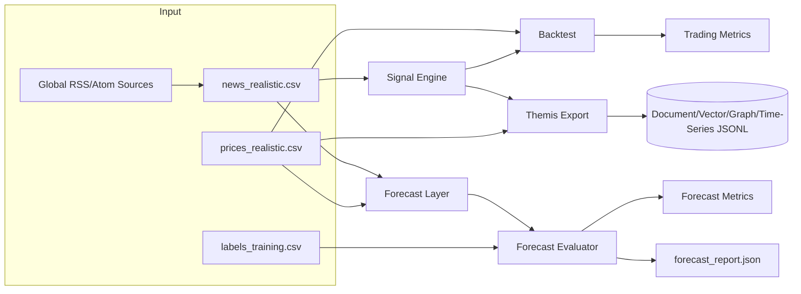

Exact model backend not verifiable from final document text alone.

# ARCHITECTURE — 25_infobroker_trading

## Kontext

Dieses Example zeigt einen **hybriden Entscheidungsweg**:
- semantisches Event-Scoring (Signal Engine)
- numerische Preis-/Trendprognose (Forecast Layer)
- historische Validierung (Backtest + Label-Evaluierung)

## Komponenten

- `main.py`: orchestriert den Gesamtfluss
- `news_ingestion.py`: automatisierter Abruf globaler RSS/Atom-Feeds inkl. Regionenfilter und CSV-Contract.
- `signal_engine.py`: BUY/SELL/HOLD-Ableitung aus News-Text
- `forecast_layer.py`: ForecastPrediction aus Event-Sentiment + Preisverlauf
- `backtest.py`: Trades und Portfolio-Metriken
- `forecast_eval.py`: Vergleich Forecast vs. Label-Datensatz
- `themis_export.py`: JSONL-Pakete für ThemisDB-Importpfade

## Datenfluss (Mermaid)

## Schnittstellen

- News-Contract: `id,timestamp,source,symbol,exchange,headline,body,source_reliability`
- Price-Contract: `symbol,exchange,timestamp,close`
- Label-Contract: `news_id,symbol,exchange,event_timestamp,horizon_days,future_return_pct,label,confidence,rationale`

## Failure-Pfade

- Fehlende Symbol-Zeitreihen -> Forecast/Backtest überspringt Datensatz.
- Fehlende Label-Matches -> sinkende Coverage in Forecast-Evaluierung.
- Niedrige Signal-Confidence -> HOLD-Signale statt Ausführung.
- Kein `--labels-csv` -> kein Forecast-Qualitätsvergleich und kein JSON-Report.
