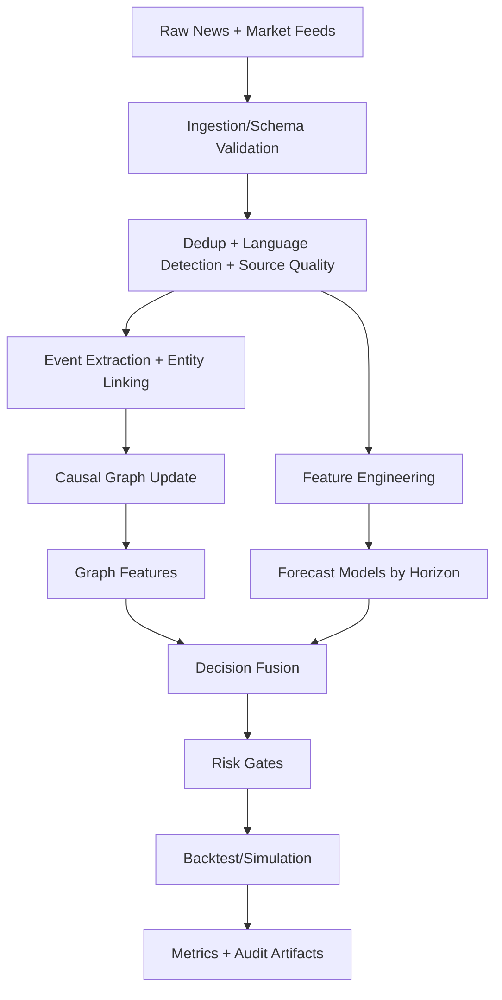

Exact model backend not verifiable from final document text alone.

# DEEP RESEARCH ARCHITECTURE — Global News-Causal Infobroker

## 1. Zweck und Einsatz

Dieses Dokument ist der **technische Startpunkt für Deep Research mit Gemini** für ein ThemisDB-basiertes Infobroker-System, das:

- globale Nachrichtenströme verarbeitet,
- kausale Wirkpfade auf Märkte modelliert,
- horizon-spezifische Prognosen erzeugt,
- und daraus risiko-adjustierte Handelsentscheidungen ableitet.

Ziel ist **nicht** ein reiner Sentiment-Bot, sondern ein kausal erklärbares, auditierbares und validierbares System.

## 2. Zielbild und Kern-Differenzierung

### 2.1 Strategisches Ziel

Ein System, das systematisch erkennt, wie Ereignisse aus Bereichen wie:

- Wetter und Naturereignisse,
- Unternehmensentscheidungen,
- staatliche/regulatorische Maßnahmen,
- Geopolitik, Logistik, Energie, Rohstoffe

zu erwartbaren Kurswirkungen auf Aktien, ETFs, Fonds, Sektoren und Regionen führen.

### 2.2 Moat gegenüber Standardlösungen

Klassische Systeme optimieren oft nur auf Preis-/Technikdaten oder oberflächliches News-Sentiment.  
Unser Ansatz kombiniert:

1. **Document Layer** (Rohnachrichten, strukturierte Events),
2. **Vector Layer** (semantische Ähnlichkeit/Clustering),
3. **Graph Layer** (Kausalbeziehungen und Propagation),
4. **Time-Series Layer** (horizon-spezifische Preis-/Volatilitätsmodelle).

Damit entsteht ein erklärbarer End-to-End-Entscheidungsweg.

## 3. Scope und Non-Goals

### Scope (Phase Research/MVP)

- Multi-Source News Ingestion (global, multilingual)
- Event-Normalisierung und Entitätenauflösung
- Kausalgraph für direkte/indirekte Wirkpfade
- Horizon-Modelle (1d/3d/7d/30d)
- Backtesting mit realistischen Kosten-/Execution-Annahmen
- Risiko-Gates und Fail-Closed-Verhalten

### Non-Goals (in dieser Stufe)

- ungeprüfter Live-Vollautomatismus
- ungegated Orderrouting
- black-box Entscheidungslogik ohne kausale Traceability

## 4. Systemkontext (C4 Level 1/2)

```mermaid
flowchart LR
    subgraph External
        N[Global News Feeds]
        M[Market Data Feeds]
        R[Reference Data\n(Symbols/Sectors/Country)]
    end

    subgraph ThemisDB Infobroker
        I[Ingestion + Normalization]
        E[Event & Entity Resolver]
        G[Causal Graph Engine]
        F[Forecast Engine]
        D[Decision & Risk Engine]
        B[Backtest & Evaluation]
        O[Observability & Audit]
    end

    N --> I
    M --> I
    R --> E
    I --> E
    E --> G
    I --> F
    G --> D
    F --> D
    D --> B
    B --> O
```

## 5. Datenmodell und Ontologie

## 5.1 Primäre Datenobjekte

1. **NewsDocument**
   - `doc_id`, `source`, `published_at`, `language`, `title`, `body`, `url`, `source_reliability`
2. **EventRecord**
   - `event_id`, `event_type`, `event_time`, `entities`, `geo_scope`, `urgency`, `novelty_score`
3. **MarketBar**
   - `symbol`, `exchange`, `timestamp`, `open`, `high`, `low`, `close`, `volume`, `vwap`
4. **DerivedLabel**
   - `horizon`, `future_return_pct`, `direction_label`, `volatility_shift_label`
5. **DecisionRecord**
   - `action`, `confidence`, `expected_range`, `risk_flags`, `causal_trace`

## 5.2 Event-Klassen (Mindesttaxonomie)

- Earnings / Guidance
- M&A / Kapitalmaßnahme
- Regulatory / Policy / State Action
- Weather / Natural Hazard
- Supply Chain / Logistics
- Energy / Commodity Shock
- Security / Cyber / Legal

## 5.3 Entitäten und Graph-Knoten

- Unternehmen, Ticker, Sektor, Land/Region, Rohstoff, Infrastrukturknoten (Hafen, Route), Regulator.

Kantenbeispiele:

- `AFFECTS_MARGIN`
- `AFFECTS_DEMAND`
- `AFFECTS_SUPPLY`
- `AFFECTS_REGIME_RISK`
- `PEER_PROPAGATION`

## 6. Verarbeitungspipeline (End-to-End)



## 7. Modellarchitektur (Hybrid)

## 7.1 Semantik-Ebene (LLM/Adapter)

Aufgaben:

- Event-Klassifikation (bullish/bearish/neutral + horizon_hint)
- Relevanz-Scoring pro Entität
- Konflikterkennung bei widersprüchlichen Quellen
- Rationale-Extraktion für kausale Traceability

Empfohlene Outputs:

- `event_sentiment_score`
- `event_confidence`
- `event_type`
- `impacted_entities`
- `causal_claims[]`

## 7.2 Numerische Ebene (Forecast)

Pro Horizon (`1d`, `3d`, `7d`, `30d`) separates Modell:

- erwarteter Return (`expected_return_pct`)
- Volatilitätsprognose
- Unsicherheitsintervall
- Anomalie-/Regimeindikatoren

## 7.3 Fusions-Ebene (Decision Engine)

Beispielhafte Scoring-Funktion:

`decision_score = f(expected_return, event_confidence, source_quality, regime_alignment, risk_penalty)`

Ausgabe:

- `action ∈ {long, short, hold}`
- `position_size`
- `confidence`
- `expected_range`
- `risk_flags`
- `causal_trace`

## 8. Research-Hypothesen für Gemini

## H1: Kausalgraph verbessert Genauigkeit

**These:** Graph-Features erhöhen Directional Accuracy gegenüber reinem Sentimentmodell signifikant.

## H2: Horizon-spezifische Modelle schlagen One-Model-Ansatz

**These:** Separate Modelle je Zeithorizont reduzieren Fehler und verbessern Kalibrierung.

## H3: Source-Quality-Gewichtung reduziert False Positives

**These:** Dynamische Gewichtung nach Quellenqualität/Novelty verbessert Risk-Adjusted Returns.

## H4: Weather/State Events liefern Alpha in bestimmten Sektoren

**These:** Nicht-finanzielle Global-Events liefern vor allem sektorale Vorhersagekraft (Energie, Logistik, Agriculture, Industrials).

## 9. Evaluationsframework

## 9.1 Datensplits

- Rolling Window / Walk-Forward Validation
- strikt zeitlich (kein random split)
- Leak-Checks verpflichtend

## 9.2 Kernmetriken

- Directional Accuracy je Horizon
- MAE / RMSE der Return-Prognose
- Calibration Error (Confidence vs Outcome)
- Coverage (matchbare Events)
- Net Sharpe nach Kosten
- Max Drawdown / Tail Risk
- Turnover / Capacity

## 9.3 Ablation-Plan

Vergleiche mindestens:

1. Price-only Baseline
2. Sentiment-only Baseline
3. Hybrid ohne Graph
4. Hybrid mit Graph (Zielarchitektur)

## 10. Risk, Compliance, Governance

## 10.1 Fail-Closed Regeln

- Kein Trade bei:
  - unvollständigen Kernfeatures,
  - niedriger Modellkonfidenz,
  - inkonsistenter Entitätsauflösung,
  - stark divergierenden Quellen ohne Auflösung.

## 10.2 Risiko-Gates

- Exposure Caps (Asset/Sector/Country)
- Volatility-Adjusted Position Limits
- Max Daily Loss / Kill-Switch
- News-Source Health Monitoring
- Drift Detection (data/model/concept)

## 10.3 Auditierbarkeit

Jede Entscheidung erhält:

- Modellversionen
- Feature Snapshot
- Datenherkunft
- kausale Begründung
- Risikoflags

## 11. MLOps und Betriebsmodell

## 11.1 Pipelines

- Offline Training (periodisch)
- Daily/Intraday Inference
- Drift/Performance Monitoring
- Artifact Registry (Model + Eval Reports)

## 11.2 Reproduzierbarkeit

- versionierte Datasets
- deterministische Preprocessing-Schritte
- fixierte Evaluations-Configs pro Run
- persistierte Reports (JSON/Markdown)

## 12. Technische Schnittstellen (Soll-Contracts)

## 12.1 Inbound

- News API / RSS / Wire / Filing Feed
- Market Data API (OHLCV + corporate actions)
- Reference Data (Mapping/Identifiers)

## 12.2 Outbound

- Decision API (research mode)
- Risk Report API
- Backtest/Eval Artifact Export
- ThemisDB JSONL Packets (Document/Vector/Graph/Time-Series)

## 13. Implementierungs-Roadmap (Research → Production Candidate)

## Phase A (0-30 Tage)

- Event-Normalisierung stabilisieren
- Entitätenauflösung + Basis-Kausalgraph
- Baseline Horizon Forecasts

## Phase B (31-60 Tage)

- Fusionslogik + Risiko-Gates
- realistische Backtest-Kostenmodelle
- Ablation-Studien H1/H2/H3

## Phase C (61-90 Tage)

- Walk-Forward und Drift-Monitoring
- Portfolio Policy (Sizing/Constraints)
- Paper-Trading mit Audit-Trail

## 14. Offene Forschungsfragen für Gemini

1. Welche Event-Granularität liefert den besten Trade-off aus Recall und Präzision?
2. Wie stark verbessert Graph-Propagation sektorübergreifende Signale?
3. Welche multilingualen Embeddings sind robust bei geopolitischen News?
4. Wie kalibriert man Konfidenz für seltene, hoch-impact Events?
5. Welche Drift-Signale sind Frühindikatoren für Modellversagen?

## 15. Gemini Research Kickoff Packet (direkt nutzbar)

**Research Prompt (Start):**

> Analyze and propose a production-grade architecture for a global news-causal trading intelligence system built on a hybrid stack (document/vector/graph/time-series). Focus on event-to-market causality, horizon-specific forecasting (1d/3d/7d/30d), confidence calibration, risk gating, and execution-realistic evaluation. Provide ablation design, leakage controls, and measurable acceptance criteria.

**Expected Deliverables from Gemini:**

1. Architecture critique + improvements
2. Prioritized experiment matrix (hypothesis-driven)
3. Data contract refinements
4. Model candidate set per horizon
5. Risk-control blueprint and failure analysis
6. 90-day execution plan with milestones and KPIs

---

Dieses Dokument ist bewusst als **technischer Forschungsvertrag** formuliert: klarer Scope, messbare Hypothesen, reproduzierbare Evaluierung und operationalisierbare Architektur.
