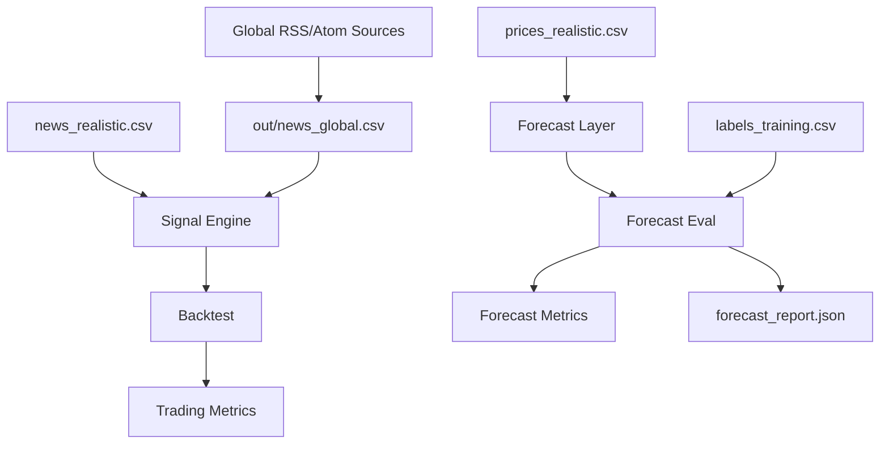

Exact model backend not verifiable from final document text alone.

> **Aktueller Build-Flow:** `cmake --preset linux-ninja-release && cmake --build --preset linux-ninja-release`

# HOW_TO – Infobroker Trading Example

## 1) Setup

```bash
cd examples/25_infobroker_trading
python3 -m venv .venv
source .venv/bin/activate
pip install -r requirements.txt
```

## 2) Weltweite Nachrichtenquellen automatisiert abrufen

```bash
python main.py \
  --fetch-global-news \
  --global-news-output-csv out/news_global.csv \
  --fetch-only
```

Optional regional eingrenzen:

```bash
python main.py \
  --fetch-global-news \
  --global-news-regions apac,europe,americas \
  --global-news-max-items 15 \
  --global-news-output-csv out/news_global_regional.csv \
  --fetch-only
```

## 3) Long-Term-Validierung (20 Tage)

```bash
python main.py --profile long_term --min-confidence 0.45
```

## 4) Visual Dashboard als PNG exportieren

```bash
python dashboard.py --profile long_term --dashboard-output out/infobroker_dashboard.png
```

## 5) HFT-Validierung (30 Minuten)

```bash
python main.py --profile hft --min-confidence 0.45
```

## 6) ThemisDB-Importpakete erzeugen

```bash
python main.py \
  --profile long_term \
  --export-themis-jsonl out/themis_packets
```

Erzeugte Dateien:
- `news_documents.jsonl` (Document + Vector)
- `price_series.jsonl` (Time-Series)
- `signals_graph_edges.jsonl` (Graph)

## 7) Forecast-Qualität gegen Labels prüfen

```bash
python main.py \
  --profile long_term \
  --labels-csv labels_training.csv
```

Zusätzliche CLI-Metriken:
- `Forecast compared`
- `Forecast coverage`
- `Directional accuracy`
- `Forecast MAE (pct)`

Optionales JSON-Artefakt:

```bash
python main.py \
  --profile long_term \
  --labels-csv labels_training.csv \
  --forecast-report-json out/forecast_report.json
```

## 8) Pipeline-Übersicht (Mermaid)



## 9) Eigene historische Daten verwenden

Ersetze die Pfade:

```bash
python main.py \
  --profile long_term \
  --news-csv /pfad/zu/news.csv \
  --price-csv /pfad/zu/prices.csv
```

Erforderliche CSV-Spalten:

- `news.csv`: `id,timestamp,source,symbol,exchange,headline,body,source_reliability`
- `prices.csv`: `symbol,exchange,timestamp,close`

## 10) Tests

```bash
python -m unittest discover -s tests -p "test_*.py"
```
