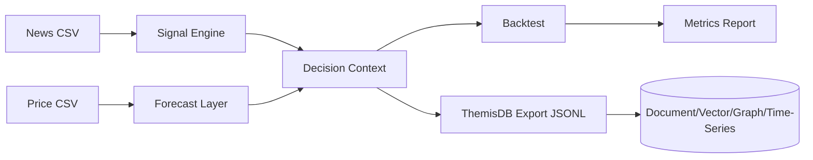
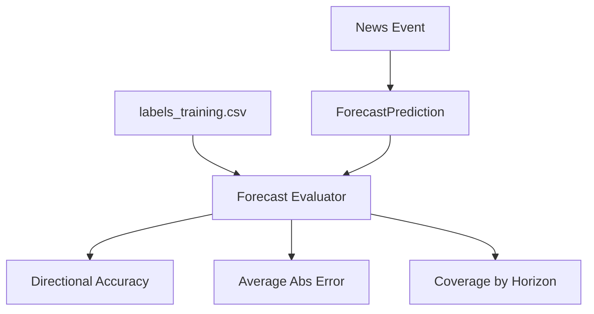
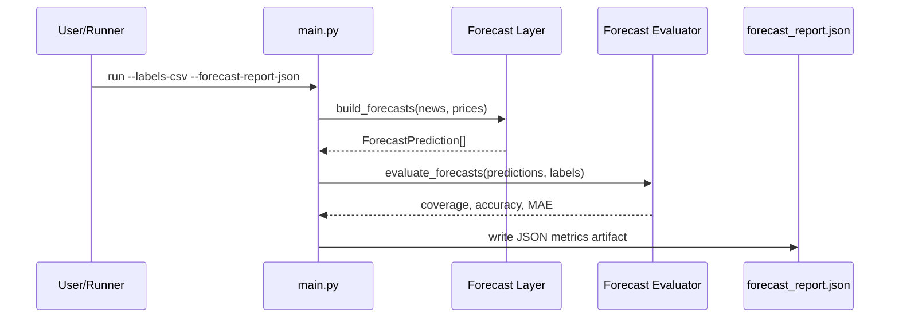

Exact model backend not verifiable from final document text alone.

> **Build:** `cmake --preset linux-ninja-release && cmake --build --preset linux-ninja-release`

# 25_infobroker_trading

News-getriebener Infobroker für Aktien/ETFs/Fonds mit LLM-ähnlicher Signalableitung, historischer Validierung und ThemisDB-Multi-Model-Export.

## Zielbild

Dieses Beispiel zeigt einen produktionsnahen Ablauf:
1. **News-Ingestion** für mehrere Börsenplätze.
2. **Semantische Auswertung** (Signal-Score + Confidence).
3. **Kauf-/Verkaufssignale** für zwei Modi:
   - `hft` (30-Minuten-Haltefenster)
   - `long_term` (20-Tage-Haltefenster)
4. **Historisches Backtesting** gegen Kursdaten.
5. **Visuelle Event-/Preis-Dashboard-Ausgabe** mit Signalmarkern und News-Event-Linien.
6. **ThemisDB-Exportpakete** für Document/Vector/Graph/Time-Series.

## Architektur (Mermaid)



## Forecast-Validierung (Mermaid)



## Rolling Validation Loop (Mermaid)



## ThemisDB-Fähigkeiten im Beispiel

- **Document Model**: News-Texte mit Metadaten.
- **Vector Search**: deterministische Feature-Vektoren je Nachricht.
- **Property Graph**: Kanten von News-Events zu Tickersymbolen inkl. Signalstärke.
- **Time-Series**: Kurspunkte je Symbol/Börse für Backtesting.

## Dateien

- `main.py` – CLI für Signalgenerierung, Backtest, Export und Dashboard.
- `dashboard.py` – PNG- und Window-basierte Visualisierung mit Kursverlauf und Eventmarkern.
- `signal_engine.py` – LLM-inspirierte Scoring-Logik (lexikalisch + Eventgewichtung).
- `backtest.py` – Ausführung und Kennzahlen (Win-Rate, Drawdown, Sharpe-like).
- `themis_export.py` – JSONL-Export für ThemisDB-Ingestion.
- `forecast_layer.py` – Hybridprognosen aus Event-Sentiment und Zeitreihenkontext.
- `models.py` – Datenmodelle.
- `DEEP_RESEARCH_ARCHITECTURE.md` – umfassendes Architektur- und Hypothesenpapier als Gemini-Startpunkt.
- `sample_data/news_realistic.csv` – realistischere historische News-Beispiele.
- `sample_data/prices_realistic.csv` – zeitlich abgestimmte Preisreihen.
- `labels_training.csv` – Event-zu-Return-Labels zur Forecast-Qualitätsprüfung.
- `tests/` – fokussierte Unit-Tests inklusive Dashboard-Check.

## Schnellstart

```bash
cd examples/25_infobroker_trading
python3 -m venv .venv
source .venv/bin/activate
pip install -r requirements.txt
python main.py --profile long_term
python main.py --profile hft
```

Automatisierter Abruf globaler Nachrichtenfeeds:

```bash
python main.py \
  --fetch-global-news \
  --global-news-output-csv out/news_global.csv \
  --fetch-only
```

Mit Forecast-/Label-Evaluierung:

```bash
python main.py \
  --profile long_term \
  --labels-csv labels_training.csv
```

Mit persistierbarem Forecast-Report:

```bash
python main.py \
  --profile long_term \
  --labels-csv labels_training.csv \
  --forecast-report-json out/forecast_report.json
```

Regionale Feed-Filterung (Beispiel APAC + Europe):

```bash
python main.py \
  --fetch-global-news \
  --global-news-regions apac,europe \
  --global-news-max-items 10 \
  --global-news-output-csv out/news_global_apac_eu.csv \
  --fetch-only
```

Mit Export für ThemisDB-Import:

```bash
python main.py --profile long_term --export-themis-jsonl out/themis_packets
```

Mit PNG-Visualisierung:

```bash
python dashboard.py --profile long_term --dashboard-output out/infobroker_dashboard.png
```

## Erwarteter Output

Die CLI liefert u. a.:
- Anzahl erzeugter und ausgeführter Signale
- Anzahl erzeugter Forecast-Datensätze
- Strategie-Return vs. Benchmark-Return
- Win-Rate, Average Trade Return, Max Drawdown, Sharpe-like Ratio
- Forecast-Metriken (Directional Accuracy / MAE), wenn `--labels-csv` genutzt wird
- Optionales Audit-Artefakt `forecast_report.json` für reproduzierbare Runs

## Hinweis zu automatisiertem Handel

Dieses Example ist ein **Research-/Validierungs-Setup**. Für vollautomatisierten Live-Handel sind zusätzlich Risiko-Limits, Exchange-Adapter, Regulatorik, Latenz-Monitoring und manuelle Freigabegates notwendig.
