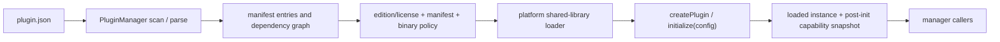
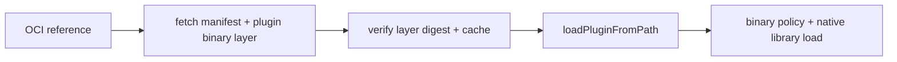

> Exact model backend not verifiable from final document text alone.

# Public plugin header architecture

`include/plugins/` declares contracts used by plugin hosting and domain
extensions. It does not itself guarantee that every declared extension has an
implementation, is linked into a build, or is routed through `PluginManager`.
The runtime implementation is under [`../../src/plugins/`](../../src/plugins/);
the main module architecture and load-path distinctions are in
[`../../src/plugins/ARCHITECTURE.md`](../../src/plugins/ARCHITECTURE.md).

## Public contract groups

| Group | Headers | Responsibility |
|---|---|---|
| Core lifecycle | `plugin_interface.h`, `plugin_manager.h`, `plugin_api.h`, `plugin_registry.h`, `plugin_dependency_resolver.h`, `plugins_api_contract.h` | Plugin interface and manifest types; manager API; independent typed factory registry; dependency helpers; error vocabulary. |
| Monitoring | `plugin_health_monitor.h`, `plugin_hot_plug_monitor.h`, `plugin_metrics.h`, `self_healing_plugin.h` | Optional health/recovery, filesystem monitoring, metrics, and self-healing contracts. |
| Distribution and trust | `oci_registry_client.h`, `signed_plugin_repository.h`, `oci_manifest_signing.h` | OCI transport/client and separate signature/catalog declarations. Do not equate OCI digest verification with publisher authentication. |
| Domain APIs | `rpc_plugin_interface.h`, `image_analysis_interface.h`, `image_analysis_manager.h`, `image_generation_interface.h`, `audio_backend_interface.h`, `huggingface_ingestion_plugin.h` | Domain-specific extension interfaces and manager declarations. |
| WASM | `wasm_host_api.h`, `wasm_component_model.h` | WASM host bridge/component declarations with runtime-dependent availability. |
| Concrete/helper declarations | `edition_policy_plugin.h`, `tesseract_ocr_plugin.h`, `yolov8_onnx_plugin.h` | Edition-policy and image-backend declarations; implementations and build wiring must be checked separately. |

## Manifest-backed native load dataflow

`loadPlugin(name)` follows the manifest-backed path. Dependency loading,
edition/license checks, manifest checks and plugin-binary verification occur
before activation. The exported `createPlugin` / `destroyPlugin` symbols are
provided by `THEMIS_PLUGIN_IMPL`.

Other paths have distinct policy boundaries:

OCI/path loading does not parse `plugin.json` and therefore does not apply its
edition/license restrictions. `SignedPluginRepository` performs its own
pinned-key catalog verification and is not automatically invoked by these
loading paths. See [`../../src/plugins/TRUST.md`](../../src/plugins/TRUST.md).

`PluginRegistry` is a distinct, type-indexed factory store; it is not the
manager's loaded-instance registry. On the built-in WASM path, the loader checks
its expected hash and license gate. A registered `WasmPluginLoadFn` is consulted
first and owns its own validation/runtime behavior. Runtime support depends on
the build configuration; the source does not establish a general sandbox
guarantee.

## Dependencies and consumers

The implementation directly includes plugin-local APIs plus utility logging
and tracing, edition/runtime-license gates, the acceleration plugin security
verifier, libcurl, OpenSSL, and JSON support. This list describes visible
implementation dependencies, not a complete link graph.

**TODO — verify downstream consumers:** the public headers alone do not prove
which server or domain modules instantiate these APIs. Do not treat older
consumer lists as current integration contracts without checking the actual
call sites.
