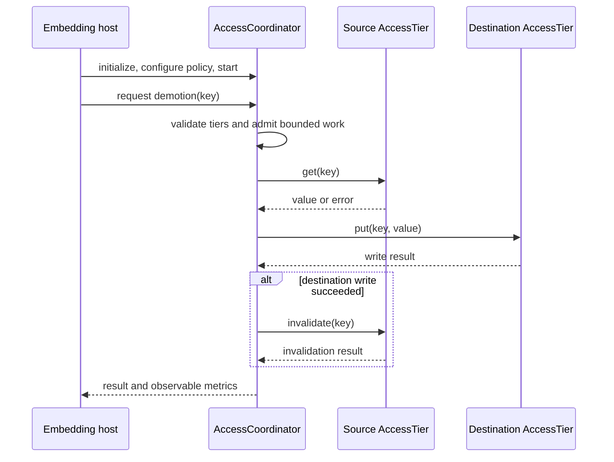

# Architecture - Access Model Module

**Version:** 1.0.0 
**Status:** Active; this document describes the implemented boundaries
**Validated:** 2026-10-30

## Kontext

`access_model` is a coordination layer between cache and storage tiers. The
embedding application owns adapter construction, adapter lifetime, and listener
registration. The coordinator owns policy evaluation, work admission, transfer
ordering, and in-memory observability. Separate adapters are not a shared
transaction boundary.

## Komponenten

| Component | Contract and responsibility |
|---|---|
| `AccessTier` | Adapter interface for tier identity, health, read, write, invalidation, and item state. |
| `AccessCoordinator` | Validates tier registration, accepts listener events and explicit requests, schedules bounded work, and exposes metrics/history. |
| `AgeBasedPolicy` | Validates age/access thresholds used by coordinator decisions; invalid policy updates are rejected. |
| `AccessMetrics` | Tracks counters and latency histograms; coordinator key counters and transition records have retention bounds. |
| Logging and trace context | Emits diagnostic transition records and correlation context; these are not durable audit evidence. |

## Schnittstellen

- Public declarations are in `include/access_model/`; implementation is in
  `src/access_model/`.
- The host calls `initialize(tiers)`, configures a policy, and then calls
  `start()`. The tier registry must contain healthy, non-null, correctly
  identified cache and storage tiers.
- Cache eviction and storage hot-access adapters notify listener implementations
  supplied by the host. `AccessCoordinator` does not derive from
  `EvictionListener` or `PromotionListener`; a host-owned bridge forwards to its
  `onCacheEvicted()` / `onStorageAccess()` methods. These callbacks return
  `void`; they do not return queue-admission status.
- Explicit asynchronous promotions return a future with a success/error result.
  Promotion reads the source and writes the destination while retaining the
  source. Demotion writes the destination before invalidating the source.
- The default worker count is four and the default queue capacity is 10,000;
  the capacity can be set through the factory overload.

## Datenfluss

1. A listener event or explicit request identifies a key, source tier,
   destination tier, and size.
2. The coordinator validates tier registration and evaluates the applicable
   policy before queue admission.
3. A worker calls source `get()` and destination `put()`. For demotion, source
   invalidation follows only after destination placement succeeds.
4. The coordinator records success/failure counters, latency, and a bounded
   transition record.

## Sequenz (kritischer Ablauf)

Kurzinterpretation: The source is not invalidated until the destination write
has succeeded. Because the adapters are independent, this ordering reduces
loss risk but cannot provide atomic cross-tier movement.

## Fehlerpfade und Resilienz

- Initialization rejects empty/incomplete registries, null or unhealthy
  adapters, unknown levels, and adapter/tier identity mismatches.
- Invalid policy changes throw `std::invalid_argument` without replacing the
  active policy.
- A full work queue rejects admission. Listener callbacks cannot return that
  result; inspect failure counters and transition history. Explicit promotions
  report failure through their future.
- Source read or destination write failure stops the transition. If destination
  placement succeeds but source invalidation fails, both copies may remain and
  the demotion reports failure; there is no cross-adapter rollback or retry.
- Shutdown drains accepted work and joins workers. A blocked adapter call can
  delay shutdown, so stop event producers and unregister listeners before
  destroying the coordinator.
- Transition history is limited to 1,000 records, and per-key metrics retain up
  to 10,000 recently touched keys. Neither is durable audit storage.

## Nicht-Ziele

- Atomic transactions, rollback, retry, or deduplication across tier backends.
- Adapter creation, persistent storage, listener ownership, or a runtime
  configuration-file parser.
- Durable audit logging or unbounded per-key/history retention.
- Frequency-based policy, per-key/tag policy overrides, or automatic adapter
  recovery.

## Verweise

- [`README.md`](./README.md) — build, setup, integration, and known limitations
- [`IMPLEMENTATION.md`](./IMPLEMENTATION.md) — source ownership and runtime contracts
- [`API.md`](./API.md) — caller-facing interfaces and error behavior
- [`RUNBOOK.md`](./RUNBOOK.md) and [`OPERATIONS.md`](./OPERATIONS.md) — diagnosis and recovery
- [`TRUST.md`](./TRUST.md) and [`SECURITY.md`](./SECURITY.md) — trust boundaries and controls
- [`ROADMAP.md`](./ROADMAP.md) — delivery status and remaining evidence
- [`../../docs/architecture/UNIFIED_ACCESS_MODEL.md`](../../docs/architecture/UNIFIED_ACCESS_MODEL.md)
- [`../../docs/architecture/CACHE_STORAGE_INTEGRATION.md`](../../docs/architecture/CACHE_STORAGE_INTEGRATION.md)
- [`../cache/ARCHITECTURE.md`](../cache/ARCHITECTURE.md) and [`../storage/ARCHITECTURE.md`](../storage/ARCHITECTURE.md)

**AI provenance:** Exact model backend not verifiable from final document text alone.
