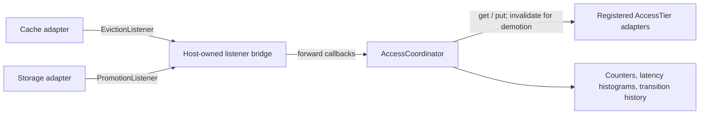

# Access-Model in ThemisDB

## Überblick

`access_model` stellt einen gemeinsamen `AccessTier`-Vertrag und einen
`AccessCoordinator` bereit, der Cache- und Storage-Adapter für angeforderte
Tier-Übergänge koordiniert. Der Host besitzt die Adapter und entscheidet,
welche Listener er registriert.

## Fähigkeiten

- **Einheitliche Tier-Adapter:** `AccessTier` definiert stringbasierte
  `get`-/`put`-/`invalidate`-Operationen sowie Identitäts-, Gesundheits- und
  Kapazitätsabfragen. `CacheTier` und `StorageTier` ergänzen optionale
  Eviction- beziehungsweise Hot-Access-Meldungen.
- **Gesteuerte Übergänge:** Der Coordinator validiert die Tier-Registrierung,
  nimmt Listener-Ereignisse und explizite Requests an und verarbeitet
  zugelassene Arbeit über einen begrenzten Worker-Queue-Pfad.
- **Policy und Diagnose:** `AgeBasedPolicy` stellt globale Alters- und
  Zugriffsschwellen bereit; Metriken und strukturierte Logs liefern
  Diagnoseinformationen zu Beobachtungen und Übergangsversuchen.

## Operativer Nutzen und Einsatzszenarien

Ein Host mit mehreren Cache- und Storage-Adaptern kann Übergangslogik über einen
gemeinsamen Vertrag bündeln, statt jedes Adapterpaar direkt miteinander zu
verknüpfen. Das erleichtert die zentrale Konfiguration von Schwellen und die
Diagnose von Übergangsversuchen anhand gemeinsamer Metriken und Logs. Es ersetzt
weder die Adapterverwaltung des Hosts noch liefert es ein SLA oder einen
Nachweis, dass die definierten Performance-Ziele erreicht werden.

## Einsatz und Grenzen

- Die Integration ist hostseitig opt-in: Es gibt keinen Modul-Feature-Flag und
  keine Konfigurationsdatei.
- Promotion kopiert per Quell-`get()` und Ziel-`put()` und lässt die Quelle
  bestehen. Demotion invalidiert die Quelle erst nach erfolgreichem Ziel-`put()`.
- Die Adapteroperationen bilden keine gemeinsame Transaktion. Fehler bei der
  Quellinvalidierung können daher doppelte Kopien hinterlassen; automatische
  Wiederholung oder Deduplizierung bietet das Modul nicht.
- Vor dem Registrieren von Event-Produzenten muss der Host einen gültigen
  Policy-Wert setzen. Ereignisse ohne gesetzte Policy werden gezählt, lösen aber
  keine Policy-Entscheidung aus.

## Einordnung und Quellen

Normative API- und Ablaufdetails stehen in [API.md](./API.md) und
[ARCHITECTURE.md](./ARCHITECTURE.md). Betriebsgrenzen und Anforderungen sind in
[OPERATIONS.md](./OPERATIONS.md), [SECURITY.md](./SECURITY.md) und
[PRODUCTION_REQUIREMENTS.md](./PRODUCTION_REQUIREMENTS.md) beschrieben.

**AI provenance:** Exact model backend not verifiable from final document text alone.
