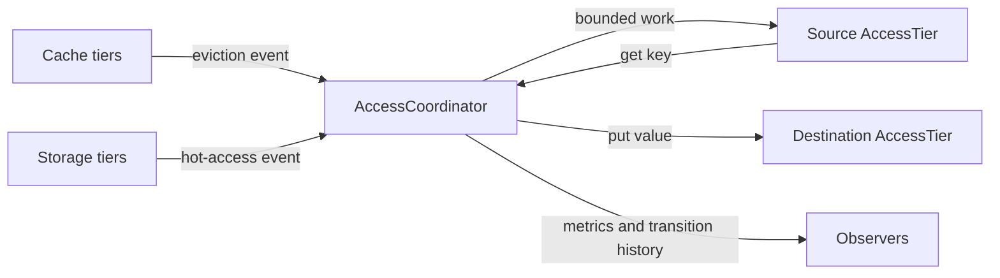

# Access Model Module

**Version:** 1.0.0  
**Status:** Active; see [`ROADMAP.md`](./ROADMAP.md) for program status and [`IMPLEMENTATION.md`](./IMPLEMENTATION.md) for source-verified limits
**Validated:** 2026-10-30

---

## Zweck

The `access_model` module coordinates data movement between cache and storage
tiers through a common adapter contract. It owns transition scheduling and
policy decisions; adapter implementations and their underlying persistence
remain owned by the embedding cache/storage modules.

## Scope

- **In scope:** tier registration and validation, promotion/demotion requests,
  bounded background work, policy thresholds, transition metrics and recent
  transition history.
- **Out of scope:** adapter construction or persistence, atomic transactions
  across independent tiers, automatic retries, and application-specific
  listener lifecycle.

### Key Components

| Component | File | Purpose |
|-----------|------|---------|
| **AccessTier** | `access_tier_interface.h` | Abstract tier interface (base contract) |
| **AccessCoordinator** | `access_coordinator.h` | Broker for promotion/demotion |
| **Promotion/Demotion** | `promotion_demotion.h` | Data structures for tier transitions |
| **AgeBasedPolicy** | `age_based_policy.h` | Unified aging policy |
| **AccessMetrics** | `access_metrics.h` | Observability metrics |

---

## Design Principles

1. **Single Responsibility:** Cache manages memory; Storage manages persistence; Coordinator manages transitions
2. **Dependency Inversion:** Both layers use abstract `AccessTier` interface
3. **Backward Compatible:** Integration is opt-in through listener registration; existing cache/storage APIs remain unchanged
4. **Observable:** Coordinator decisions and transitions are logged with correlation IDs where the event path emits a record
5. **Testable:** Mock coordinator for unit tests; deterministic integration tests

---

## Architecture

## Integrationsueberblick



Kurzinterpretation: Cache and storage adapters emit events to the coordinator.
For accepted transitions, the coordinator reads from the source and writes to
the destination; adapter ownership and persistence are unchanged.

## Quickstart (Build/Run)

Configure with the repository's existing CMake setup and tests enabled, then
build and run a focused coordinator test:

```bash
cmake -S . -B build -DTHEMIS_BUILD_TESTS=ON
cmake --build build --target module_access_model_test_access_coordinator_focused
ctest --test-dir build -R 'module_access_model_test_access_coordinator_focused' --output-on-failure
```

The application must construct and initialize the coordinator with healthy
cache and storage adapters before starting workers. See
[`IMPLEMENTATION.md`](./IMPLEMENTATION.md) for lifecycle and adapter contracts.

---

## API/CLI Einstieg

There is no module-specific CLI. The public C++ entry points are declared in
`include/access_model/access_coordinator.h`; tier adapters implement
`include/access_model/access_tier_interface.h`.

### 1. Initialize the Coordinator

```cpp
#include "access_model/access_coordinator.h"

auto coordinator = themis::access_model::createAccessCoordinator(4);  // 4 workers

std::map<TierLevel, std::shared_ptr<AccessTier>> tiers = {
    {TierLevel::L1_WORKING, cache_l1},
    {TierLevel::L2_EPISODIC, cache_l2},
    {TierLevel::L3_SEMANTIC, cache_l3},
    {TierLevel::STORAGE_HOT, storage_hot},
    {TierLevel::STORAGE_WARM, storage_warm},
    {TierLevel::STORAGE_COLD, storage_cold},
};

coordinator->initialize(tiers);
```

### 2. Set Unified Policy

```cpp
#include "access_model/age_based_policy.h"

AgeBasedPolicy policy;
policy.hot_to_warm_days = 30;
policy.warm_to_cold_days = 90;
policy.l1_promotion_threshold = 10;

coordinator->setAgePolicy(policy);
```

### 3. Start and Register Listeners

```cpp
coordinator->start();

// Cache tier notifies on eviction
cache_l1->setEvictionListener(coordinator.get());

// Storage tier notifies on hot access
storage_hot->setPromotionListener(coordinator.get());
```

### 4. Initiate Promotion (Optional)

```cpp
auto result = coordinator->promoteAsync("key_abc",
                                        TierLevel::STORAGE_COLD,
                                        TierLevel::L3_SEMANTIC,
                                        4096).get();
```

Promotion reads the source and writes the destination while retaining the
source. Check `result.success` and `result.error_message`; adapter-level
verification remains necessary.

## Known Limitations

- Separate tier adapters do not participate in an atomic transaction. A failed
  source invalidation after a successful destination write can leave duplicate
  copies and reports the demotion as failed.
- Queue admission is bounded, but a blocked adapter call can delay shutdown.
  Event listener callbacks are `void`; queue rejection is visible through
  coordinator metrics/history rather than a callback return value.
- Per-key counters and transition history are bounded and are not durable audit
  records. See [`TRUST.md`](./TRUST.md) and [`OPERATIONS.md`](./OPERATIONS.md).

---

## Observability

### Metrics

```cpp
// Per-key metrics are retained for up to 10,000 recently touched keys.
auto key_metrics = coordinator->getKeyMetrics("key_abc");

// Get aggregate coordinator metrics
auto tier_metrics = coordinator->getTierMetrics(TierLevel::L1_WORKING);
auto model_metrics = coordinator->getAccessModelMetrics();
```

### Structured Logging

Structured coordinator log records include correlation IDs where emitted.
Logging is best-effort; do not treat it as a durable audit record:

```text
access_model::tier_transition | key=query_result_x | from=STORAGE_COLD |
to=L3_SEMANTIC | reason=explicit_promotion | latency_ms=0 | status=SUCCESS |
correlation_id=promo-task-1 | thread_id=...
```

---

## Configuration

### Build integration

The module source is registered in the core build and its local CMake file
defines a standalone `themis_access_model` target when needed. The module does
not define a CMake or runtime feature-flag option; integration is enabled by
constructing the coordinator and registering its listeners.

The module does not parse a runtime configuration file. Map application
settings to `createAccessCoordinator(thread_pool_size)` and the
`AgeBasedPolicy` fields before starting the coordinator.

---

## Testing

### Unit Tests

```bash
ctest -R "module_access_model_.*_focused" -V
```

Labels: `access_model`, `tier`, `promotion`, `demotion`

### Integration Tests

```bash
ctest -R "test_access_model_e2e" -V
```

---

## Dependencies

- **cache module** — For cache tier implementations
- **storage module** — For storage tier implementations
- **core/logger** — For structured logging
- **core/metrics** — For telemetry collection

---

## Verweise

- [`ARCHITECTURE.md`](./ARCHITECTURE.md) — Component and data-flow details
- [`ROADMAP.md`](./ROADMAP.md) — Delivery phases and readiness checklist
- [`CHANGELOG.md`](./CHANGELOG.md) — Version history
- [`FUTURE_ENHANCEMENTS.md`](./FUTURE_ENHANCEMENTS.md) — Planned enhancements
- [`AUDIT.md`](./AUDIT.md) — Code quality audit baseline
- [`SECURITY.md`](./SECURITY.md) — Threat model and security controls
- [`PERFORMANCE_EXPECTATIONS.md`](./PERFORMANCE_EXPECTATIONS.md) — Benchmark gates
- [`PRODUCTION_REQUIREMENTS.md`](./PRODUCTION_REQUIREMENTS.md) — Production readiness requirements
- [`MODULE_GAPS.md`](./MODULE_GAPS.md) — Open gap tracking
- [`MODULE_GUIDE.md`](./MODULE_GUIDE.md) — Integration and developer-document map
- [`docs/architecture/UNIFIED_ACCESS_MODEL.md`](../../docs/architecture/UNIFIED_ACCESS_MODEL.md) — Architectural overview
- [`docs/architecture/CACHE_STORAGE_INTEGRATION.md`](../../docs/architecture/CACHE_STORAGE_INTEGRATION.md) — Integration patterns
- [`src/cache/ROADMAP.md`](../cache/ROADMAP.md) — Cache module roadmap
- [`src/storage/ROADMAP.md`](../storage/ROADMAP.md) — Storage module roadmap

---

## Roadmap

The canonical phase status, open hardware evidence, and release dependencies
are maintained in [`ROADMAP.md`](./ROADMAP.md). Do not use this summary to
override that source of truth.

---

## Maintainers

- Copilot (Initial implementation)
- Community (Contributions welcome)

---

**AI provenance:** Exact model backend not verifiable from final document text alone.
