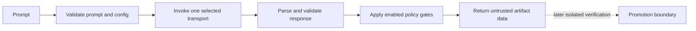

> Exact model backend not verifiable from final document text alone.

# Architecture - AI Module

<!-- Status: current | validated: 2026-05-31 -->
<!-- Links: README.md · ROADMAP.md · FUTURE_ENHANCEMENTS.md -->

## Kontext

The AI module currently centers on `AIPluginGenerator` as a focused service for plugin code generation.
It follows a validation-first and fail-closed pipeline.
The separate `CAIEthicsIntegration` adapter combines constitutional reasoning
with ethics scoring. Runtime gates in `LLMAQLHandler` belong to the `llm` module
and are outside this module's implementation boundary.

## Komponenten

| Component | Responsibility | Evidence boundary |
|---|---|---|
| `AIPluginGenerator` | Validates prompts and configuration, invokes one selected transport, parses output, and applies enabled gates. | Does not establish provider capability support or execute generated code. |
| `CAIEthicsIntegration` | Runs constitutional critique/revision and ethics scoring. | Marks rule-based fallback and evaluator failure; acceptance rejects either. |
| Provider transport | Uses configured callback or curl to obtain a response. | No route failover; callback deadline enforcement depends on callback implementation. |
| Artifact materialization | Writes and reads generated artifact files when sandbox gating is enabled. | Round-trip verification is not operating-system isolation. |

## Schnittstellen

| Contract | Behavior |
|---|---|
| `AIPluginGenerator::Config` | defines endpoint URL, timeout, sandbox/output artifact paths, and optional transport/policy hooks |
| `validatePrompt` | local guardrail against malformed/oversized request text |
| `generatePlugin` | end-to-end orchestration and error normalization |
| `GeneratedPlugin` mapping | converts endpoint payload into typed plugin artifacts |

## Datenfluss

1. `generatePlugin(prompt)` receives the request.
2. `validatePrompt(prompt)` enforces local constraints.
3. Request payload is serialized to JSON.
4. Endpoint selection is `endpoint_invoke_fn`, instance `setLlmHttpPostFn()`,
   then curl. The selected route is retried at most three times for non-HTTP
   failures; retries never switch routes.
5. Response JSON is parsed and mapped into `GeneratedPlugin`.
6. Optional sandbox gating materializes a per-run artifact bundle into `sandbox_dir`, verifies round-trip readability, copies the bundle into `output_dir`, and then invokes any configured callback policy.
7. Mandatory fields and optional policy gates are checked before success is returned.

**Kurzinterpretation:** Validation and enabled gates can reject a request or
result, but the successful return value remains untrusted source data. The
illustrated promotion boundary is not implemented by this module.

## Sequenz (kritischer Ablauf)

The critical path is validation → transport → response validation → optional
gates. Invalid local state fails before endpoint I/O. Transport retries are
bounded to three attempts with two inter-attempt delays, and the same selected
route is used for each attempt. A failed gate returns an error rather than a
success-shaped partial artifact.

## Dependency Direction

- ai -> utils (`expected`, error registry)
- ai -> curl/json/spdlog for transport, parsing, and diagnostics
- plugin consumers -> ai public API
- aql runtime (`LLMAQLHandler`) -> optional Wave C C1/C2 callbacks with fail-closed enforcement when enabled

## Fehlerpfade und Resilienz

- Empty endpoint, transport errors, and non-2xx HTTP codes fail with structured errors.
- Invalid JSON fails closed with parse-error context.
- Missing mandatory `implementation_code` fails closed.
- Validation errors are returned before any endpoint call.
- Invalid endpoint, timeout, size-limit, enum, or enabled-gate configuration is
  rejected before endpoint I/O. C1 thresholds and returned scores must be
  finite values in `[0,1]`.
- Sandbox materialization or callback verification failures reject the generated plugin fail-closed.
- Capability tokens are syntax-validated and sent to the endpoint, but no
  provider capability acknowledgement or generated-manifest capability
  verification exists. A syntactically valid request is not proof of support.
- `CAIEthicsIntegration` labels deterministic critique/revision fallback and
  ethics-evaluation failure in `CAIEvaluationResult`; its acceptance helper
  rejects either state and invalid score thresholds.

## Nicht-Ziele

- Provider capability negotiation or proof that requested capabilities are
implemented.
- Compilation, execution, or independent security verification of generated
code.
- OS-level isolation from writing artifacts to configured directories.
- Cross-route failover or guaranteed wall-clock deadline enforcement for
callback transports without their own deadline.
- General inference serving, RAG, streaming, or model lifecycle management.

## Verweise

- [Module README](./README.md)
- [Public API contract](./API.md)
- [Implementation and focused validation](./IMPLEMENTATION.md)
- [Security and trust boundaries](./SECURITY.md), [operations](./OPERATIONS.md)
- [Roadmap and evidence gates](./ROADMAP.md)

## Sourcecode Verification (Module: ai/architecture)

- Verified implementation:
  - src/ai/ai_plugin_generator.cpp
- Verified API surface:
  - include/ai/ai_plugin_generator.h
- Verified architecture claims:
  - validation-before-I/O
  - bounded timeout usage on endpoint calls
  - fail-closed response handling

## Planning Traceability

- Strategic Wave C roadmap tracking: `#5040`
- Upstream dependency planning issues: Wave A `#5038`, Wave B `#5039`
  - Wave B tracking issue: `https://github.com/makr-code/ThemisDB/issues/5039`
  - dependent Wave A issue: `https://github.com/makr-code/ThemisDB/issues/5038`
  - follow-on Wave C issue: `https://github.com/makr-code/ThemisDB/issues/5040`

---

### Direct Downstream Consumers (modules that use this module)

> **Production consumer route: INTEGRATION-READY**
> Handler header `include/server/ai_plugin_api_handler.h` has been created as the
> production integration point. Wiring into `HttpServer` constructor and CMake
> target linkage are the remaining steps before GA.

| Module | Via | Notes |
|--------|-----|-------|
| `server` | `include/server/ai_plugin_api_handler.h` → `AiPluginApiHandler` | Planned production route: `POST /ai/plugins/generate`, `GET /ai/plugins/list`, `GET /ai/plugins/{id}/status`. Handler header is implemented; `HttpServer` constructor wiring and CMake target linkage pending. |
| _(tests)_ | `include/ai/ai_plugin_generator.h`, `include/ai/cai_ethics_integration.h` | `tests/test_ai_plugin_generator.cpp`, `tests/test_cai_safety_module.cpp` — current only verified consumers. |
