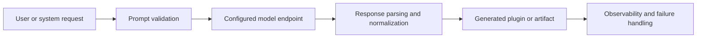

# AI in ThemisDB

The `ai` module currently provides `AIPluginGenerator` for creating plugin
artifact data from a configured endpoint and `CAIEthicsIntegration` for
constitutional critique/revision plus ethics scoring. It is not a general
inference-serving, storage, query, or orchestration layer.

The generator validates local prompt constraints, invokes one selected
transport, parses a structured response, and optionally applies configured
safety, sandbox-verification, and telemetry callbacks. These checks do not
prove that generated code is correct or safe to execute.

This module is tightly connected to the platform's wider architecture. It depends on the runtime model, validation rules, and infrastructure boundaries described in [README.md](./README.md), [ARCHITECTURE.md](./ARCHITECTURE.md), and [ROADMAP.md](./ROADMAP.md), and it is supported by the deeper cross-platform context in [docs/compendium/docs/index.md](./../../docs/compendium/docs/index.md). That is important, because AI features are only useful when they are reliable, auditable, and consistent with product constraints.

Before transport, the generator checks locally defined prompt and
configuration constraints, including enum values, capability/dependency token
syntax, endpoint selection, positive limits, and enabled-gate configuration.
These checks do not negotiate provider capability support or enforce a general
authorization policy.

The generator selects `endpoint_invoke_fn`, then the instance
`setLlmHttpPostFn()` callback, then curl; a failed selected route is not
replaced by another route. Non-HTTP transport failures get at most three
attempts with 100 ms and 200 ms inter-attempt delays. HTTP failures are not
retried. Curl enforces its configured timeout; injected callbacks must enforce
their own timeout, and the instance callback has no timeout parameter.

Transport, validation, response, and enabled-gate failures return errors.
`CAIEthicsIntegration` marks deterministic rule-based fallback when a needed
LLM callback is missing, empty, or throws, and its acceptance helper rejects
marked results. These semantics make degradation visible; they do not
establish factual correctness or universal safety.

The module returns untrusted generated artifacts and exposes per-instance
outcome counters. It does not compile, execute, statically analyze, or deploy
generated code; artifact file round-tripping is not operating-system
isolation. Provider performance and generation quality require separate
provider-backed validation.

ThemisDB keeps this boundary clear: the AI module owns validation, model invocation, output normalization, and artifact generation semantics, while lower-level runtime, storage, and execution concerns remain in their own subsystems. This separation is critical because AI output quality and system reliability are different concerns; the platform must not confuse the two.

The source basis for this page is primarily module-local and then checked against the wider system context: [README.md](./README.md), [ARCHITECTURE.md](./ARCHITECTURE.md), [ROADMAP.md](./ROADMAP.md), [FUTURE_ENHANCEMENTS.md](./FUTURE_ENHANCEMENTS.md), [PRODUCTION_REQUIREMENTS.md](./PRODUCTION_REQUIREMENTS.md), and [docs/compendium/docs/index.md](./../../docs/compendium/docs/index.md). These references explain the role of the AI module as a controlled integration capability without overstating claims beyond the verified module contract.
