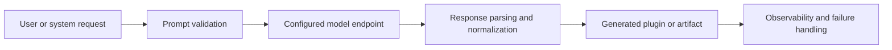

# AI in ThemisDB

AI is not a separate product layer in ThemisDB; it is an operating capability that sits on top of the platform's storage, query, orchestration, and runtime contracts. The AI module exists to make intelligent generation and integration predictable: it validates input, calls configured model endpoints, interprets structured responses, and turns model output into concrete plugin or system artifacts with defined boundaries.

The core challenge is not only “can a model answer,” but whether that answer can be trusted, converted into a valid implementation path, and governed by the platform's quality and safety constraints. ThemisDB addresses this by separating prompt validation, endpoint invocation, response parsing, artifact mapping, and operational diagnostics. This makes the AI layer more than a thin wrapper: it becomes a controlled integration path for generated functionality.

This module is tightly connected to the platform's wider architecture. It depends on the runtime model, validation rules, and infrastructure boundaries described in [README.md](./README.md), [ARCHITECTURE.md](./ARCHITECTURE.md), and [ROADMAP.md](./ROADMAP.md), and it is supported by the deeper cross-platform context in [docs/compendium/docs/index.md](./../../docs/compendium/docs/index.md). That is important, because AI features are only useful when they are reliable, auditable, and consistent with product constraints.

The first core capability is structured prompt evaluation and validation. Before a model call happens, the system checks that the request is well-formed, policy-compliant, and aligned with the expected integration context. This matters because unsafely generated or poorly constrained prompts can produce unstable outputs or incorrect plugin definitions. Validation is therefore a control mechanism, not just a pre-flight check.

The second core capability is model endpoint execution and response normalization. The AI module invokes configured providers, receives structured results, and maps them into platform-native objects such as generated plugins or artifacts. That conversion step is essential: without it, a raw model answer remains untrusted output rather than a product-ready delivery. It also makes the process more observable and easier to debug when a provider or response format changes.

The third core capability is operational trust and failure handling. AI systems are inherently noisy, and model responses can vary in format, quality, or policy compliance. ThemisDB treats that as a runtime concern: failed generations, invalid responses, and policy violations are handled as explicit failure states rather than silently accepted output. This turns AI invocation into an operationally manageable part of the platform instead of a black-box integration.

For customers and platform operators, the value is practical: faster implementation paths, more consistent integration quality, and clearer response-to-action boundaries. AI becomes useful when it reduces time-to-delivery without making the platform harder to reason about. ThemisDB's AI module supports that by keeping generation under explicit controls, rather than pretending that model output is inherently safe or deterministic.

ThemisDB keeps this boundary clear: the AI module owns validation, model invocation, output normalization, and artifact generation semantics, while lower-level runtime, storage, and execution concerns remain in their own subsystems. This separation is critical because AI output quality and system reliability are different concerns; the platform must not confuse the two.

The source basis for this page is primarily module-local and then checked against the wider system context: [README.md](./README.md), [ARCHITECTURE.md](./ARCHITECTURE.md), [ROADMAP.md](./ROADMAP.md), [FUTURE_ENHANCEMENTS.md](./FUTURE_ENHANCEMENTS.md), [PRODUCTION_REQUIREMENTS.md](./PRODUCTION_REQUIREMENTS.md), and [docs/compendium/docs/index.md](./../../docs/compendium/docs/index.md). These references explain the role of the AI module as a controlled integration capability without overstating claims beyond the verified module contract.
