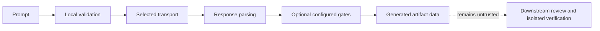

# ThemisDB AI Module

AI provenance note: Exact model backend not verifiable from final document text alone.

<!-- Status: current | validated: 2026-05-31 -->
<!-- Links: ARCHITECTURE.md · ROADMAP.md · FUTURE_ENHANCEMENTS.md -->

## Zweck

The AI module provides plugin code generation via `AIPluginGenerator`.
It validates prompts, calls a configured endpoint, parses JSON responses, and maps results to `GeneratedPlugin`.

## API/CLI Einstieg

| Interface / File | Role |
|---|---|
| ai_plugin_generator.cpp | runtime flow for validation, endpoint invocation, response parsing |
| include/ai/ai_plugin_generator.h | public API and configuration contract |
| AIPluginGenerator::validatePrompt | enforces required prompt constraints |
| AIPluginGenerator::generatePlugin | orchestrates request and response mapping |

## Developer Documentation

Use [MODULE_GUIDE.md](./MODULE_GUIDE.md) as the index for the API, implementation,
research, operations, and trust documentation.

## Scope

In scope:
- prompt validation for plugin generation requests
- endpoint invocation with curl-enforced timeouts or a timeout-aware injected transport
- structured error handling for transport, HTTP, and JSON failures
- response mapping to `GeneratedPlugin` plus manifest defaults

Out of scope:
- quality of endpoint model output beyond basic structural checks
- deployment-specific external sandbox engines beyond the built-in artifact materialization and callback gate
- higher-level plugin lifecycle orchestration outside the generator contract

## Quickstart (Build/Run)

Configure a diagnostic or development build with the repository's normal CMake
preset, then build the focused AI generator test:

```sh
cmake --preset linux-release
cmake --build --preset linux-release --target module_ai_test_ai_plugin_generator_focused
ctest --test-dir build/linux-release -R 'test_ai_plugin_generator_ai_FocusedTests'
```

The focused test exercises deterministic callbacks; it does not contact a live
provider or measure model latency.

## Integrationsueberblick

- `AIPluginGenerator` owns prompt validation, one selected provider transport,
  response parsing, and optional C1/C2/sandbox callback gates.
- `CAIEthicsIntegration` adapts constitutional critique/revision and ethics
  scoring; fallback and ethics-evaluation status are explicit in its result.
- Plugin compilation, execution, provider capability acknowledgement, and
  lifecycle/deployment remain outside this module's verified behavior.

## Known Limitations

- `validatePrompt` rejects empty descriptions and descriptions longer than 8192 bytes.
- `generatePlugin` always validates input before I/O.
- Endpoint configuration is checked before I/O: endpoint must be non-empty, timeout
  and request/response byte limits must be positive, and enabled gates must have
  valid thresholds/callbacks and required directories.
- Transport selection is `endpoint_invoke_fn`, then the instance
  `setLlmHttpPostFn()` callback, then curl. The selected route is retried at most
  three times for non-HTTP failures; failure does not fall through to another
  route. HTTP status failures are not retried.
- Curl enforces `timeout_ms`; injected `endpoint_invoke_fn` must enforce the
  timeout it receives. The instance `setLlmHttpPostFn()` route has no timeout
  parameter and can block indefinitely.
- Non-2xx responses and invalid JSON return structured `ERR_PLUGIN_LOAD_FAILED` errors.
- Responses must include non-empty `implementation_code`; otherwise generation fails.
- Prompt enums and capability/dependency tokens are validated. Capability names
  are syntax-checked and forwarded, but the provider does not acknowledge them
  and the returned manifest does not prove they were implemented.
- C1 accepts only finite callback scores in `[0,1]` and a configured threshold
  in `[0,1]`; invalid or absent gate configuration is rejected before endpoint
  I/O. Callback exceptions fail closed.
- Debug logs and traces do not include prompt text or callback error details;
  endpoint diagnostics retain only scheme, host, and port. The endpoint remains
  functional configuration and can contain credentials, so protect its source
  and avoid logging the raw configuration elsewhere.
- Optional Wave C runtime hooks can be enabled in `AIPluginGenerator::Config`:
  - C1 safety gate (`enable_c1_cai_safety_gate`) enforces a minimum CAI safety score via callback.
  - Sandbox gate (`enable_sandbox_gate`) materializes generated source bundles into `sandbox_dir`, verifies read/write integrity, persists an audit copy into `output_dir`, and optionally invokes `sandbox_verify_fn`.
  - C2 telemetry forwarding (`enable_c2_federated_telemetry`) forwards local generation metrics via callback.
- `CAIEthicsIntegration` records when its deterministic critique/revision
  fallback was invoked and whether the ethics evaluator returned scores.
  `passesAcceptanceCriteria()` rejects fallback results, evaluator failures,
  invalid scores and thresholds; the score remains a policy signal, not proof of
  correctness or safety.
- `LLMAQLHandler` inference, streaming, RAG, and chat gates belong to the
  separate `llm` module and are not evidence of in-scope `ai` runtime coverage.



**Kurzinterpretation:** The module returns validated artifact data, not a
verified or executable plugin. Provider capability support, artifact isolation,
and downstream promotion require separate evidence and controls.

## Verweise

- [Module guide](./MODULE_GUIDE.md)
- [Architecture](./ARCHITECTURE.md)
- [API contract](./API.md)
- [Operations and recovery](./OPERATIONS.md), [trust boundary](./TRUST.md)
- [Roadmap and evidence gates](./ROADMAP.md)

## Sourcecode Verification (Module: ai/readme)

- Verified files:
  - src/ai/ai_plugin_generator.cpp
  - include/ai/ai_plugin_generator.h
- Verified behavior surfaces:
  - validation-first execution path
  - endpoint call path with timeout and HTTP code checks
  - fail-closed JSON parsing and mandatory implementation payload check
- Note:
  - forward planning is tracked in ROADMAP.md and FUTURE_ENHANCEMENTS.md
  - strategic Wave C planning is tracked in issue `#5040` with dependency links to Wave A `#5038` and Wave B `#5039`
  - Wave B tracking issue: `https://github.com/makr-code/ThemisDB/issues/5039`
  - dependent Wave A issue: `https://github.com/makr-code/ThemisDB/issues/5038`
  - follow-on Wave C issue: `https://github.com/makr-code/ThemisDB/issues/5040`
  - historical completion remains in CHANGELOG.md