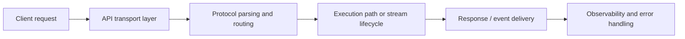

# API in ThemisDB

An application platform is only as useful as the interfaces it exposes to the outside world. The API module in ThemisDB is the boundary layer that turns internal system capabilities into usable service contracts for clients, operators, and higher-level applications. It covers request handling, protocol transport, live connection semantics, and the practical integration needs that appear in production systems.

The fundamental challenge is not only “can a client call the system,” but whether that access is reliable, observable, secure, and consistent across transports. ThemisDB therefore treats the API layer as both a product surface and an operational control layer. It supports multiple access patterns — including GraphQL, gRPC, and streaming-style client lifecycles — while keeping behavior predictable under load and failure.

This module sits between the platform logic and the outside world, so it is tightly coupled to both runtime behavior and operational trust. The local module context in [README.md](./README.md), [ARCHITECTURE.md](./ARCHITECTURE.md), and [ROADMAP.md](./ROADMAP.md) defines the intended boundaries, while the broader platform context in [docs/compendium/docs/index.md](./../../docs/compendium/docs/index.md) places the API layer in the wider service architecture.

The first core capability is protocol-facing request handling. The API layer parses incoming requests, normalizes transport-specific semantics, and routes them to the right internal execution path. This matters because clients expect a stable interface even when the underlying system is complex, distributed, or runtime-optimized.

The second core capability is live and subscription-style interaction. GraphQL over WebSocket and stream-aware transport patterns allow clients to receive updates, event changes, or partial results without resorting to repeated polling loops. This is especially relevant for interactive systems and operational dashboards, where latency and responsiveness directly affect user experience.

The third core capability is operational stability across lifecycle events. gRPC lifecycle handling, connection management, and request teardown must remain explicit under cancellations, disconnects, and partial failures. The API layer is where transport-level reliability becomes visible to the product, and where failed client connections or service interruptions become diagnosable instead of opaque.

For customers and operators, the practical benefit is simple: a platform that is easier to integrate, easier to monitor, and easier to operate under real client traffic. A stable API surface reduces integration friction, stream-aware access improves responsiveness for interactive workloads, and explicit lifecycle handling lowers the chance that connection churn turns into hidden production failures.

ThemisDB keeps the API boundary clear: the API module owns request handling, transport semantics, protocol lifecycle, and external contract behavior, while the actual persistence, execution, and data processing concerns remain in their respective subsystems. This separation matters because API reliability and business logic correctness are very different concerns, and they should be diagnosed independently.

The source basis for this page is primarily module-local and then cross-checked against the wider system context: [README.md](./README.md), [ARCHITECTURE.md](./ARCHITECTURE.md), [ROADMAP.md](./ROADMAP.md), [FUTURE_ENHANCEMENTS.md](./FUTURE_ENHANCEMENTS.md), [PRODUCTION_REQUIREMENTS.md](./PRODUCTION_REQUIREMENTS.md), and [docs/compendium/docs/index.md](./../../docs/compendium/docs/index.md). These references explain the API layer as a production-facing service boundary without exceeding the verified module contract.
