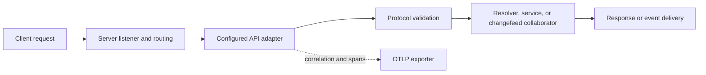

Exact model backend not verifiable from final document text alone.

# API in ThemisDB

The `api` module contains transport-facing interfaces and adapters used by the server runtime. It
does not own the primary HTTP listener or general route dispatch; those responsibilities live in
`src/server/`. The API module also does not own storage or query execution.

Current surfaces include GraphQL parsing/execution and AQL resolver integration, an optional gRPC
server/service adapter, GraphQL-over-WebSocket message handling, CDC WebSocket upgrade validation,
shared HTTP transport policy, request correlation, and OTLP span export. Optional transport
surfaces depend on their build flags; policy and rate-limiter components apply only when wired by
the host runtime.

GraphQL parsing returns an operation document and uses caller-supplied resolver callbacks for
execution. Named fragment definitions/spreads and `@include`/`@skip` field directives are
supported; inline fragments and other directives are not. `WsChangeHandler::validate()` returns
an upgrade decision but leaves the actual protocol upgrade to the server's HTTP adapter.

gRPC message size is configured through `GrpcServerConfig::max_message_size_bytes` (100 MiB
default); the implementation can read `grpc.max_message_size_mb` from
`config/networking/grpc.yaml`. `THEMIS_ENABLE_GRPC` and `THEMIS_ENABLE_WEBSOCKET` gate their
respective optional surfaces.

See [README.md](./README.md), [ARCHITECTURE.md](./ARCHITECTURE.md), and
[IMPLEMENTATION_SUMMARY.md](./IMPLEMENTATION_SUMMARY.md) for source maps, current limits, tests,
and benchmark paths. Broader service routing remains documented under `src/server/`.
