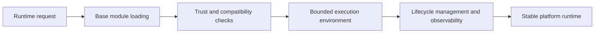

# Base in ThemisDB

Every database platform needs a stable runtime foundation that can integrate extensions, isolate failures, and preserve trust boundaries when new functionality is loaded. The base module in ThemisDB provides that foundation: it governs runtime lifecycle, module loading, dependency awareness, and controlled execution boundaries for higher-level capabilities.

The real challenge is not merely “can code be loaded,” but whether it can be loaded safely, observed clearly, and managed predictably across upgrades and operational changes. ThemisDB addresses this by separating loading, trust checks, lifecycle management, and execution isolation, so that extensions and runtime components do not become uncontrolled points of failure.

This module sits beneath many of the platform’s higher-level features. Its behavior is defined by the architecture and operations guidance in [README.md](./README.md), [ARCHITECTURE.md](./ARCHITECTURE.md), and [ROADMAP.md](./ROADMAP.md), and it is contextualized by the wider system story in [docs/compendium/docs/index.md](./../../docs/compendium/docs/index.md). That matters because a platform's runtime base is not just an implementation detail; it is the layer that determines whether change can be made safely in production.

The first core capability is secure module loading and trust evaluation. Components must be checked before they are admitted to the runtime, because runtime trust is a prerequisite for safe execution. This includes verifying compatibility, validation boundaries, and the expected lifecycle states of loaded modules.

The second core capability is execution isolation and bounded runtime behavior. The base layer ensures that a module or plugin runs within defined resource and lifecycle constraints instead of spreading uncontrolled state through the platform. This is important for reliability, because it limits blast radius when a component is misconfigured or fails under load.

The third core capability is lifecycle control and runtime repair. Operators need deterministic startup, reload, teardown, and failure semantics, especially in dynamic systems where modules are deployed, replaced, or reconfigured over time. The base layer makes those transitions explicit and traceable instead of leaving them implicit in process behavior.

For customers and operators, the value is straightforward: more predictable extension behavior, lower operational risk, and better ownership of runtime failures. A secure base runtime makes the broader platform easier to evolve without creating hidden instability. It also improves incident handling, because the system can identify where a runtime failure began instead of treating it as an opaque crash or integration problem.

ThemisDB keeps the boundary clear: the base module owns runtime loading, trust checks, isolation, and lifecycle behavior for modular execution, while application-level logic and feature-specific implementation remain in their respective subsystems. That separation is essential because the platform's stability depends on a clean distinction between runtime infrastructure and domain functionality.

The source basis for this page is primarily module-local and then checked against the wider systems context: [README.md](./README.md), [ARCHITECTURE.md](./ARCHITECTURE.md), [ROADMAP.md](./ROADMAP.md), [FUTURE_ENHANCEMENTS.md](./FUTURE_ENHANCEMENTS.md), [PRODUCTION_REQUIREMENTS.md](./PRODUCTION_REQUIREMENTS.md), and [docs/compendium/docs/index.md](./../../docs/compendium/docs/index.md). These references explain the base module as a reliability and platform-stability capability without overstating claims beyond the verified contract.
