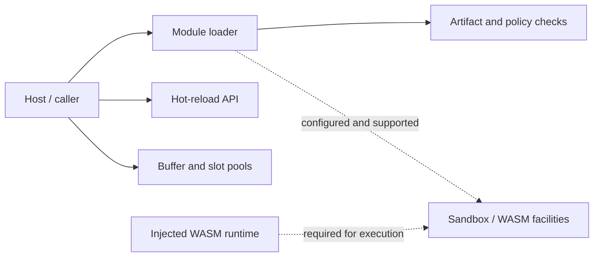

Exact model backend not verifiable from final document text alone.

# ThemisDB Base Module

## Zweck

The base area groups module lifecycle and sandbox facilities with general
resource-pool utilities. It does not own plugin-specific business behavior.
Runtime capabilities depend on the configured platform and registered optional
backends; this documentation does not imply that every loaded module is
sandboxed or that all controls are enabled.

## Scope

In scope: module loading/verification, dependency analysis, optional sandbox/WASM
execution, reload/rollback, remote-registry intake, A/B experiment support, and
generic buffer/connection-slot pool APIs.

Out of scope: plugin-specific business logic, a universal host-side policy,
application-specific management commands/metrics, or unverified production
guarantees.

## Quickstart (Build/Run)

For callers using the declared resource-pool API:

```cpp
#include "base/buffer_pool.h"

themis::resource::BufferPool pool;
auto buffer = pool.acquire(512);
if (!buffer.valid()) {
    // Handle allocation/shutdown failure.
}
```

`BufferHandle` is move-only and auto-releases by default. The pool implementation
files are registered in both the modular base target and the monolithic core
source list.

For the focused pool regression test, configure and build the registered target:

```sh
cmake -S . -B build -DCMAKE_BUILD_TYPE=Debug -DTHEMIS_BUILD_TESTS=ON
cmake --build build --target module_base_test_resource_pools_focused
ctest --test-dir build --output-on-failure -R '^test_resource_pools_base_FocusedTests$'
```

The root build may require the repository's configured third-party dependencies;
module-local registration does not guarantee that configuration or execution
will succeed.

## API/CLI Einstieg

The base module exposes lifecycle interfaces under `include/themis/base/` and
resource-pool interfaces under `include/base/`. There is no base-specific CLI.
The relevant public entry points and implementation boundaries are listed below.

## Source and interface map

| Surface | Current source / interface | Responsibility |
|---|---|---|
| Module loading | `include/themis/base/module_loader.h`; canonical implementation `src/themis/module_loader.cpp` and platform/security companions | Artifact loading, verification, lifecycle state, and errors. `src/base/module_loader.cpp` is a deprecated legacy copy, not the canonical implementation. |
| Sandbox and ABI | `include/themis/base/module_sandbox.h`; `src/base/module_sandbox.cpp` | Configurable OS constraints, ABI checks, warnings, and optional WASM integration. |
| WASM | `include/themis/base/wasm_plugin_sandbox.h`, `wasm_runtime_injector.h`; corresponding `src/base/*.cpp` | WASM validation, allowlisting, runtime selection, and execution when a runtime is registered. |
| Reload and dependencies | `include/themis/base/hot_reload_manager.h`, `plugin_dependency_graph.h`; corresponding `src/base/*.cpp` | Reload/rollback coordination, tracing hooks, dependency graph analysis. |
| Remote registry and experiments | `include/themis/base/remote_registry_client.h`, `ab_test_manager.h`; corresponding `src/base/*.cpp` | Registry intake and A/B test lifecycle support. |
| Resource pools | `include/base/buffer_pool.h`, `resource_pool_manager.h`; `src/base/buffer_pool.cpp`, `resource_pool_manager.cpp` | Slab-backed buffer handles and generic connection-slot/resource-pool coordination. |

## Integrationsueberblick

The module exposes lifecycle and resource-pool facilities to callers; optional
sandbox and WASM behavior depends on explicit configuration and runtime support.



**Interpretation:** The diagram shows available integration surfaces, not an
automatic end-to-end pipeline. Callers coordinate reload and pool operations;
sandbox and WASM execution are conditional, and WASM execution requires an
injected runtime.

`src/base/` currently contains ten `.cpp` files. In modular mode,
`cmake/ModularBuild.cmake` uses `THEMIS_BASE_SOURCES` to create the shared
`themis_base` target. That list includes the lifecycle, sandbox, registry,
WASM/dependency, and resource-pool implementations under `src/base/`, plus the
canonical loader at `src/themis/module_loader.cpp` and its platform/security
companions. It omits the deprecated `src/base/module_loader.cpp`. The monolithic
core registers the same two resource-pool sources through
`cmake/MiscellaneousFeatures.cmake`. In modular mode `themis_core` is an
interface target that links module targets; it is not the base source list.

## Known Limitations

### Runtime flow and limits

1. The loader checks a candidate artifact and its metadata/policy before
   activation; dependency graph analysis is available to callers as a separate
   ordering/checking surface.
2. Sandbox constraints are applied only when configured and supported. Missing
   platform mechanisms may be reported as warnings or degraded state.
3. WASM binaries can be validated without an injected runtime; execution through
   `callExport()` requires a runtime implementation.
4. Hot reload reports a `HotReloadResult` and retains rollback information
   according to its configuration. It loads a candidate under a temporary key,
   unloads the old and temporary modules, then reloads under the canonical key;
   this creates an availability gap. A failed final load triggers best-effort
   restoration from the previous path.
5. Registry requests accept HTTP or HTTPS; plain HTTP is permitted with a
   warning, so transport encryption is not universal.
6. Buffer-pool requests above 4 KiB use the system allocator and remain included
   in `current_live` until release; the pool must outlive all handles it issues.
   Both pool sources are registered in modular and monolithic builds.
7. `AdaptiveConnectionPool` represents integer slots rather than live
   connections. Its constructor rejects `min_size > max_size` and capacities
   outside the `int` slot-ID range; releasing a slot that is not currently
   acquired, including a duplicate release, throws `std::invalid_argument`.
   `ResourcePoolManager` owns connection and buffer pools only;
   the header's thread-pool/leak-detection design goals are not implemented in
   the inspected class/source (`leak_timeout` is unused).

### Build and test evidence

- `cmake/ModularBuild.cmake` declares the `themis_base` library target in
  modular mode; `cmake/CMakeLists.txt` makes `themis_core` a compatibility
  interface target in that mode. Benchmarks are conditionally registered from
  `benchmarks/CMakeLists.txt`.
- No separate base-only configure/build recipe was found. The root build
  defaults `THEMIS_BUILD_BENCHMARKS` to OFF and defaults
  `THEMIS_BUILD_TESTS` to ON for Debug and OFF otherwise (unless overridden).
  Use the repository's configured build profile; the focused pool tests under
  `tests/base/` exercise the public pool targets.
- `tests/CMakeLists.txt` discovers module `*/CMakeLists.txt` files with
  `CONFIGURE_DEPENDS` and adds `tests/base/`; the base file registers its
  `test_*.cpp` sources as focused unit tests and a separate soak test.
- `themis_register_module_focused_test()` adds `module:base`,
  `tier:unit`/`tier:soak`, `kind:focused`, and `focus` labels; the base file
  also adds `base` and, for the soak target, `soak`. The soak timeout is 7200
  seconds (two hours), and it is selectable with `ctest -L soak`.
- The root test CMake file separately registers a hot-reload regression test
  and a BaseEntity field test (the latter exercises the entity/storage path).
- `tests/base/test_resource_pools.cpp` is registered by the module's
  `test_*.cpp` glob. Registration establishes test discovery, not compilation
  or execution success.

## Verweise

See [API.md](API.md), [ARCHITECTURE.md](ARCHITECTURE.md),
[MODULE_GUIDE.md](MODULE_GUIDE.md), [ROADMAP.md](ROADMAP.md), and
[FUTURE_ENHANCEMENTS.md](FUTURE_ENHANCEMENTS.md). Header contracts are the
primary API evidence; use the build/test files linked above for registration
details.
