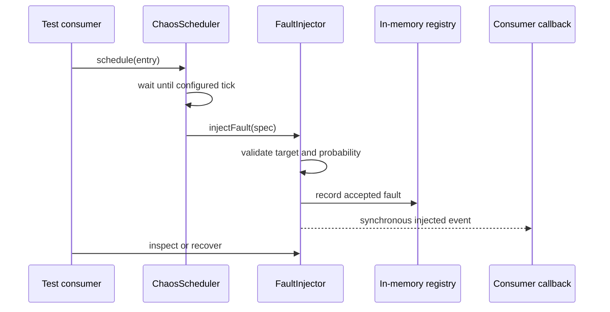

Exact model backend not verifiable from final document text alone.

# Chaos module architecture

## Kontext

The chaos module is an in-process test utility. It stores fault descriptors and
can schedule their registration; it does not cause real network, disk, process,
or cluster failures. Test or integration consumers are responsible for
observing the descriptors and implementing any simulated effect.

## Komponenten

| Component | Source | Responsibility |
|---|---|---|
| `FaultInjector` | [`chaos_framework.cpp`](chaos_framework.cpp) | Stores and expires process-local fault records; provides inspection, recovery, and synchronous callbacks. |
| `ChaosScheduler` | [`chaos_framework.cpp`](chaos_framework.cpp) | Scans pending entries on a configured tick and submits due descriptors to an injector. |
| Contract guidance | [`chaos_contract.h`](../../include/chaos/chaos_contract.h) | Defines recommended interoperability bounds; these bounds are not enforced by the runtime. |

## Schnittstellen

Public declarations are in
[`chaos_framework.h`](../../include/chaos/chaos_framework.h). `FaultInjector`
provides inject, inspect, and recover operations; `ChaosScheduler` accepts
absolute or relative scheduled entries and exposes start, stop, and pending
queue operations. The supported surface is process-local C++; there is no
standalone CLI or verified HTTP admin API.

## Datenfluss

1. A consumer submits a `FaultSpec` directly or schedules one for later.
2. `FaultInjector` rejects an empty target or a probability that is non-finite
   or outside `[0, 1]`; accepted specifications are stored by target and type.
3. The scheduler checks pending entries on each tick and calls the injector for
   each due entry.
4. Consumers query active state or receive synchronous callbacks, then perform
   their own scenario behavior and cleanup.

## Sequenz (kritischer Ablauf)

Kurzinterpretation: The scheduler only submits a descriptor; the injector
validates and stores it before dispatching synchronous consumer callbacks. No
external system is modified by this sequence.

## Fehlerpfade und Resilienz

- Injection rejects an empty target ID and non-finite or out-of-range
  probability values before registry mutation or callback dispatch.
  Probability is stored but not sampled.
- Recommended duration, tick, pending-entry, identifier, and callback limits in
  `chaos_contract.h` are not enforced by this runtime.
- The condition-variable strategy still processes entries at the tick cadence;
  its wait predicate wakes for stop, not for enqueue notifications.
- Callbacks are synchronous and exceptions are not caught. Recovery callbacks
  run while the injector mutex is held; callback registration is unsynchronized.
- `stop()` joins the worker but retains pending entries; `clearPending()` removes
  them. Registry and queue state are process-local.
- Zero and negative durations do not expire automatically; explicit recovery is
  required. A scheduler callback exception escaping its worker is not caught.

## Nicht-Ziele

- Performing real network, disk, process, or cluster fault injection.
- Enforcing the interoperability limits documented in `chaos_contract.h`.
- Claiming production resilience, latency, throughput, or benchmark results
  without reproducible runtime evidence.

## HTTP admin integration status

Server source contains a guarded `ChaosAdminApiHandler` and route dispatch for
`/admin/chaos/inject`, `/reset`, `/status`, and `/history`; the guarded route
calls `requireAccess(req, "admin", "admin.chaos", path)`. CMake defaults
`THEMIS_CHAOS_ADMIN` to `OFF` and conditionally adds the handler source when both
HTTP server support and the option are enabled.

The build wiring does not establish a working endpoint: CMake defines
`THEMIS_CHAOS_ADMIN` on `themis_server`, while the guarded HTTP server and
handler sources are compiled as module sources; the definition is not visibly
propagated to those source-owning targets. Additionally, `http_server.cpp`
constructs `ChaosScheduler` with no argument although its public constructor
requires an injector. Reconcile target compile definitions and constructor
setup, then build and test the enabled configuration before describing the
routes as supported. CMake warns against shipping the option in production.

## Test and benchmark evidence

`tests/chaos/CMakeLists.txt` globs `test_*.cpp`; eight chaos test sources are
present in this checkout. See
[`../../benchmarks/chaos/README.md`](../../benchmarks/chaos/README.md) for the
benchmark source/target discrepancy and the two separately registered benchmark
targets.

## Verweise

- [Module README](README.md)
- [Public API contract](API.md)
- [Developer guide](MODULE_GUIDE.md)
- [Operations](OPERATIONS.md)
- [Runbook](RUNBOOK.md)
- [Performance expectations](PERFORMANCE_EXPECTATIONS.md)
- [Benchmark evidence](../../benchmarks/chaos/README.md)
- [Focused tests](../../tests/chaos/CMakeLists.txt)
