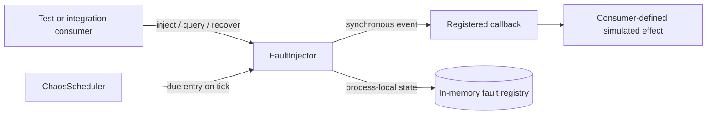

Exact model backend not verifiable from final document text alone.

# ThemisDB Chaos Module

## Zweck

The module provides an in-process fault registry and time-driven scheduler for
test consumers. A fault descriptor is state recorded by the module; consumer
code must implement and verify any associated simulated effect. The module does
not perform network or disk manipulation.

## Scope

In scope:
- in-process fault lifecycle registration and recovery controls
- configurable, tick-based scheduler-driven fault activation
- callback and event signaling for injected/recovered fault states

Out of scope:
- external cluster-wide orchestration beyond process-local chaos surfaces
- direct OS/network sabotage beyond modeled simulation semantics
- non-chaos business workflows outside resilience simulation boundaries

## Quickstart (Build/Run)

Configure a test-enabled debug build, then build and run the focused injector
test:

```sh
cmake -S . -B build-chaos -DCMAKE_BUILD_TYPE=Debug -DTHEMIS_BUILD_TESTS=ON
cmake --build build-chaos --target test_chaos_framework_focused
ctest --test-dir build-chaos --output-on-failure -R '^ChaosFrameworkFocusedTests$'
```

These commands exercise the in-process registry test; they do not enable or
validate the optional HTTP admin routes or perform real fault injection.

## API/CLI Einstieg

| Interface / File | Role |
|---|---|
| [`include/chaos/chaos_framework.h`](../../include/chaos/chaos_framework.h) | `FaultInjector`, `ChaosScheduler`, and fault/schedule types |
| [`include/chaos/chaos_contract.h`](../../include/chaos/chaos_contract.h) | v1.x contract and recommended interoperability bounds |
| `chaos_framework.cpp` | Registry and scheduler implementation |

There is no standalone chaos CLI. Consumers create a `FaultInjector`, inspect
or recover recorded states, and may compose it with `ChaosScheduler` for
tick-driven scenario activation. See [API.md](API.md) for validation,
callback, and exception semantics.

## Integrationsueberblick


Kurzinterpretation: The framework records fault state and emits synchronous
events; only consumer code can implement an associated simulated effect. It
does not manipulate network, disk, or other processes.

## Known Limitations

- active faults are process-local and keyed by configured fault identity dimensions.
- scheduler execution depends on configured wake strategy and tick behavior.
- `injectFault()` returns `false` for empty target IDs and non-finite or
  out-of-range probabilities; it does not sample probabilities.
- The runtime does not enforce the contract's recommended queue, duration, tick,
  identifier-size, or callback-count bounds.
- Callbacks run synchronously; recovery callbacks run while the injector mutex is
  held, and callback exceptions are not caught.
- The condition-variable strategy still processes entries on the configured
  tick; enqueue notifications do not bypass that wait. `stop()` joins the worker
  but retains pending entries until `clearPending()` is called.
- HTTP admin routes are not a verified supported integration. The source and
  build-definition limitations are recorded in [ARCHITECTURE.md](ARCHITECTURE.md).

## Source evidence

The implementation is in [`chaos_framework.cpp`](chaos_framework.cpp); public
declarations are in [`chaos_framework.h`](../../include/chaos/chaos_framework.h).
Focused test registration is in
[`tests/chaos/CMakeLists.txt`](../../tests/chaos/CMakeLists.txt). Benchmark
source and target status are recorded in
[`benchmarks/chaos/README.md`](../../benchmarks/chaos/README.md). Roadmap
completion statements are not evidence that tests or benchmarks were executed.

## Verweise

- [Architecture](ARCHITECTURE.md)
- [API contract](API.md)
- [Operations](OPERATIONS.md)
- [Runbook](RUNBOOK.md)
- [Developer guide](MODULE_GUIDE.md)
- [Roadmap](ROADMAP.md)
- [Performance expectations](PERFORMANCE_EXPECTATIONS.md)
- [Benchmark evidence](../../benchmarks/chaos/README.md)
