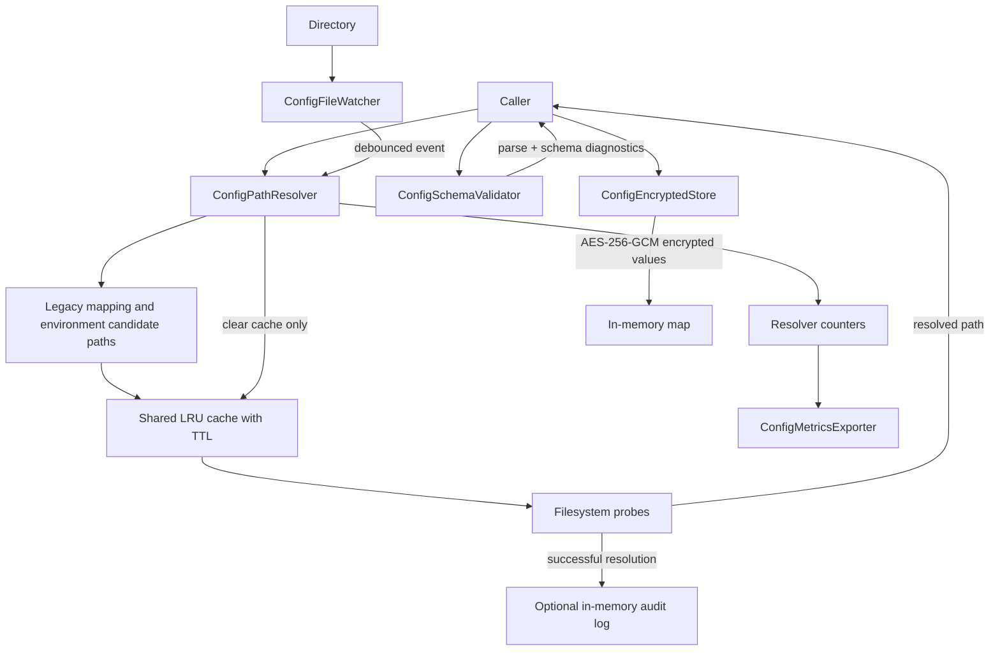

Exact model backend not verifiable from final document text alone.

# Architecture — Config Module

## Purpose and boundaries

This is the implementation architecture for `src/config`. Public declarations
are in `include/config/`; focused tests are under `tests/config/`. The module
offers independent support components, not an end-to-end settings transaction:
consumer services decide when to reload, validate, authorize and apply settings.

## Components and data flow

### Resolution

`ConfigPathResolver::tryResolve()` normalizes and validates a requested path,
consults the process-wide cache and tries candidate paths produced from the
legacy mapping and selected environment. The production environment has no
overlay; development and staging use their corresponding overlay candidates.
Successful paths are cached and can be added to the optional audit log.
`resolve()` wraps absence in `ConfigNotFoundException`.

### Parsing and validation

`ConfigSchemaValidator` converts JSON or YAML input to `nlohmann::json` and
walks the provided schema. File extension selects YAML for `.yaml` and `.yml`;
other file suffixes use JSON. `validateWithSchemaFile()` resolves the schema
path if the resolver finds it; the config path is loaded directly. The
validator supports only implemented schema keywords and local `#` references;
do not infer full Draft 7 support from the contract header.

### Watch and observability

`ConfigFileWatcher` uses platform-specific event APIs (Linux inotify, Apple
kqueue, Windows directory notifications) and a debounced callback. It filters
for `.yaml`, `.yml`, and `.json` file events. The resolver's callback invalidates
the path cache; settings are not automatically parsed or applied.
`ConfigMetricsExporter` renders resolver/cache counters in Prometheus text or
registers collectors. `ConfigAuditLog` is an optional bounded in-memory log of
successful path resolutions, not durable compliance evidence.

### Encrypted store

`ConfigEncryptedStore` owns a process-local generated 32-byte key and a map of
encrypted blobs. AES-256-GCM uses 12-byte IVs and 16-byte tags in the current
implementation. `rotateKey()` re-encrypts entries before replacing the key and
store while holding the exclusive lock. `serialize()` includes the current key
bytes; it is not safe to treat the snapshot as ciphertext-only backup.

## Failure and known gaps

- Path lookup may return no result; `resolve()` throws, while `tryResolve()`
  returns an empty optional.
- File parse errors become validation diagnostics; `loadAsJson()` throws
  `SchemaValidationException`.
- `ConfigEncryptedStore::get()` reports missing keys and crypto failures by
  exceptions; `tryGet()` collapses caught decrypt/parse failures into
  `std::nullopt`.
- The contract header declares limits and behaviors that are not all established
  by focused tests. See [`MODULE_GAPS.md`](MODULE_GAPS.md); verify enforcement
  before documenting them as runtime guarantees.

## Source references

- `src/config/config_path_resolver.cpp`
- `src/config/config_schema_validator.cpp`
- `src/config/config_file_watcher.cpp`
- `src/config/config_metrics_exporter.cpp`
- `src/config/config_audit_log.cpp`
- `src/config/config_encrypted_store.cpp`
- `include/config/config_contract.h`

**TODO:** The previous downstream-consumer table has not been re-audited against
current call sites and is omitted rather than repeated as verified architecture.
