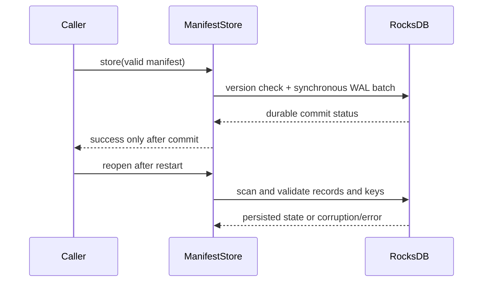

# Distributed Tensor Module Architecture

**Last Updated:** 2026-11-24
**Source level:** Level 1 — module implementation
**SOT domain:** architecture-governance
**Canonical references:** `src/distributed_tensor/CMakeLists.txt`, `include/distributed_tensor/*.h`, `include/sharding/shard_artifact_fragment_store.h`, `include/sharding/shard_rpc_server.h`, `src/sharding/shard_artifact_fragment_store.cpp`, `src/main_server.cpp`, `cmake/CMakeLists.txt`
**Related:** Issue #7341

<!--
AI_Used: true
AI_Models: unknown
AI_Contributor: GitHub Copilot Coding Agent
Human_Review: false
Human_Author: ThemisDB Team
Exact model backend not verifiable from final document text alone.
-->

## Kontext

The module's public contracts are in `include/distributed_tensor/`; its
implementation sources are listed in `src/distributed_tensor/CMakeLists.txt`.
That CMake file builds the static target `themis_distributed_tensor`, links
`themis_base`, and conditionally links `themis_core` and `themis_tensor` if
those targets are available. The project CMake default is C++20, but the module
target publicly requests `cxx_std_20`. The public
`tensor_storage_strategy.h` includes `` and exposes `std::span`, so C++20
is a public-header requirement. Consumers linking the CMake target inherit the
feature requirement; direct users of the installed headers must select C++20
themselves.

## Komponenten

| Area | Public interface | Implementation sources in the module target |
|---|---|---|
| Artifact classes and manifests | `tensor_artifact_classes.h`, `artifact_manifest.h` | `tensor_artifact_classes.cc`, `artifact_manifest.cc`, `src/artifact_manifest.cc` |
| Placement and retrieval | `shard_placement.h`, `distributed_planner.h` | `shard_placement.cc`, `distributed_planner.cc`, `src/distributed_planner.cc` |
| Integrity and recovery | `integrity_verification.h`, `recovery_manager.h` | `integrity_verification.cc`, `recovery_manager.cc` |
| Infrastructure and in-process training jobs | `tensor_infrastructure.h`, `tensor_training_coordinator.h` | `tensor_infrastructure.cc`, `tensor_training_coordinator.cc` |
| Storage strategy | `tensor_storage_strategy.h` | `src/tensor_storage_strategy.cc` |
| Update and coordination support | Private headers under `src/distributed_tensor/include/` | Delta log, RocksDB-backed manifest store, checkpoint, snapshot-update worker, shard-summary, artifact invalidation, exact-graph fallback, staleness, recovery, and lock-manager sources listed in CMake |
| Host fragment storage and RPC startup | `ShardArtifactFragmentStore`, `ShardRPCServer` | `src/sharding/shard_artifact_fragment_store.cpp`, opt-in composition in `src/main_server.cpp` |

This table highlights component groups; the CMake file is the authoritative
complete target source list.

The public declarations in `include/distributed_tensor/` remain in
`themis::distributed_tensor`. The colliding source-private manifest/class
definitions and summary-first planner model under
`src/distributed_tensor/include/` are isolated in
`themis::distributed_tensor::detail`; their `ArtifactManifest`,
`ArtifactClass`, planner, routing, retrieval, and fragment types are distinct
from the public API types.

## Schnittstellen

The module exposes placement, retrieval, integrity, recovery, manifest-store,
and training-coordinator interfaces described below. An optional ShardRPC
adapter provides bounded shard-payload transport; the module does not own
storage selection or distributed manifest consensus.

## Datenfluss

The public interfaces expose these composable steps; they do not establish an
end-to-end network execution pipeline:

1. A caller creates an `ArtifactManifest` and supplies metadata and shard
   placements.
2. `DefaultShardPlacementStrategy::compute_placement()` accepts artifact/shard
   sizes, node-capacity records, and placement constraints; it returns a
   `PlacementPlan`. The caller is responsible for applying any returned
   placements to a manifest.
3. `DefaultDistributedTensorPlanner::plan_tensor_retrieval()` validates
   manifest completeness, any invalid integrity receipt, lifecycle requirements,
   and dependencies, then returns a retrieval plan with shard IDs and estimates.
   It does not fetch shard data.
4. The separate `DistributedTensorPlanner` builds summary-first routing and
   exact-on-demand requests. Its manifest overload binds each request to the
   artifact ID, selected peer, shard digest, and response-size ceiling.
   `ShardRPCFragmentFetcher` implements the public `IFragmentFetcher` contract
   when both gRPC and sharding are enabled; it requires configured mTLS clients
   and verifies the returned bytes against the manifest SHA-256 before success.
   The shard server streams only through an explicitly configured storage-owner
   callback and rejects unbound identities, wrong local shard IDs, expired or
   oversized requests, incomplete streams, and invalid digests.
   `main_server.cpp` installs the RocksDB-backed reader only when
   `sharding.tensor_fragment_rpc.enabled` is true. The storage key is the
   versioned, principal-scoped tuple `(principal_id, shard_id, artifact_id)`;
   metadata and payload writes are atomic, replacement is immutable, and reads
   validate size before loading and verify SHA-256 afterward. Publishers must
   persist payloads under a tenant-bound principal before publishing their
   manifest placement. `GraphSummaryProjectionCodec` decodes only the
   versioned, bounded adapter-similarity format into `TensorLayerSummary`;
   arbitrary tensor bytes, unknown versions, malformed data, and conflicting
   fragment scopes fail closed. The planner merges these advisory candidates
   and calls `GraphTruthValidator`; transport success is not graph truth.
5. Integrity and recovery APIs operate on the supplied manifest/receipt and
   recovery request; they do not turn placement plans into network operations.
6. `ManifestStore` persists validated manifest metadata in the caller-provided
   RocksDB database. WAL-backed synchronous batches make acknowledged manifest
   writes durable across process restart; corrupt records fail store opening.
   The store does not replicate metadata across nodes, and does not persist
   shard payloads or provide a network recovery protocol.

Configuration is supplied through API values rather than a module configuration
file:

| Surface | Declared settings |
|---|---|
| `DistributedTensorPlanner::Config` | Summary TTL, minimum fragment success rate, fallback routing, fragment-load timeout, strict graph validation |
| `FragmentLoadRequest` / `ShardRPCFragmentFetcher::Config` | Manifest-selected peer and digest, positive timeout, per-fragment and aggregate response byte ceilings |
| `sharding.tensor_fragment_rpc` host config | Explicit enable flag, listen address, certificate/key/client CA, identity-to-principal bindings, maximum payload, chunk size, and maximum deadline |
| `sharding.tensor_projection_publisher` host config | Explicit opt-in; tenant-bound principal and tenant, operator snapshot label, node, query domain/model, and bounded top-k; requires the fragment RPC server and a matching identity binding |
| `StripeTransport` | Protocol, compression/encryption flags and algorithms, streams, timeout, retries, backoff |
| `StorageStrategyAssessor::Config` | Quantization constraints, NVMe, multi-consumer, mmap support, and page-lock availability |
| `ShardPlacementStrategy::compute_placement()` | Node capacities, optional factorization hints, and placement constraints |

The host-owned fragment store and opt-in server startup are implemented in
source, but they are not a `TensorNetworkStorageEngine` field mapping. When the
optional ShardRPC adapter is linked, `sharding.tensor_projection_publisher`
can opt into one startup publication from the configured tenant's persisted
adapter repository. Startup validates each loaded train, builds a
tenant-scoped fingerprint graph, then publishes using explicit principal,
source-snapshot label, node, and query settings. Its principal must be present
in the mTLS identity bindings. This is a one-time process-start snapshot; it
does not track later adapter writes or provide discovery, freshness, revocation,
or multi-shard coordination. Invalid configuration or publication failure
aborts startup. Focused storage regressions are registered but have not been
built or run. A Linux mTLS source test composes the local publisher, fragment
store, and adapter using a fixture summary; it does not exercise host config.

The module target compiles the root-level `integrity_verification.cc`, which
uses OpenSSL EVP SHA-256 when OpenSSL Crypto is found at configure time and
fails closed when it is unavailable. The engine accepts only SHA-256 and uses
versioned, length-prefixed receipt inputs with sorted shard IDs. Receipts bind
the artifact ID, manifest content hash and version, and declared shard
digests—not all manifest metadata or the shard bytes themselves. Callers must
use `verify_shard()` to check raw bytes. Neither operation authenticates the
producer. The separate nested
`src/integrity_verification.cc` implementation remains outside this target and
is compiled only into its EPIC-3 test/benchmark targets when OpenSSL is found.
`ArtifactManifest::compute_manifest_hash()` is a separate non-cryptographic
checksum and must not be used as an integrity or authenticity guarantee.

`TensorTrainingCoordinator::runNextJob()` calls registered
`ITensorTrainingWorker::processShard()` callbacks synchronously in-process.
No network transport or distributed training-worker protocol is implemented
by this coordinator.

## Integration surfaces established by source

- The public planner header includes tensor summary types and the graph-truth
  validator interface.
- The target's direct CMake dependency is `themis_base`; `themis_core` and
  `themis_tensor` are optional target dependencies.
- `cmake/CMakeLists.txt` conditionally adds the module and conditionally links
  selected benchmark targets to it.
- The `tests/distributed_tensor/` and `benchmarks/distributed_tensor/`
  directories each register their local module-focused sources. Separate
  `tests/epic3_distributed_tensor/` and
  `benchmarks/epic3_distributed_tensor/` CMake files are also added by their
  parent configurations. No distributed-tensor soak source is currently
  registered in `tests/integration/`; the former stub-only source was removed.
  The focused real mTLS fragment-transport tests are registered under
  `tests/sharding/`; one uses a test-only reader and another composes the
  local publisher, RocksDB store, and adapter with a fixture summary. The same
  `ShardTransferStoreTests` target now includes RocksDB-backed fragment-store
  source regressions, but neither the source regressions nor the production
  startup path has been built or run.

The earlier architecture text described a direct LLM-training pipeline and
overstated storage persistence and sharding integration. The current ShardRPC
path has a canonical principal/shard/artifact key mapping and opt-in production
server composition. A local publisher commits the fragment, local manifest and
remote-readable manifest record in order. An opt-in startup producer builds
its input graph from stored tenant adapters and publishes one projection. A
consumer with a trusted artifact ID can fetch that record via mTLS, but trusted
artifact discovery and freshness management remain unwired. There is no mapping
to `TensorNetworkStorageEngine` field keys.
The graph projection codec and planner path were built and exercised by the
focused Linux mTLS fixture test on 2026-11-24. The `themis_server` target also
compiled and linked with the adapter in an HTTP-server-disabled configuration;
the production host configuration and live startup have not been run.

## Sequenz (kritischer Ablauf)

**Kurzinterpretation:** The successful return follows a synchronous local
commit; startup rejects unreadable or invalid persisted records. Neither step
replicates state or shard payloads to another node.

## Fehlerpfade und Resilienz

An empty database path is rejected. Database-open failures and persisted
records that fail schema, manifest, or key validation prevent store creation.
Writes return failure on database read/commit errors, and malformed records
are not served by read paths. These guarantees are local to the configured
RocksDB instance.

## Nicht-Ziele

This module currently does not implement remote shard fetching, manifest
consensus, multi-node replication, or distributed training execution. Placement
plans must be applied by the caller, and RocksDB durability alone does not
establish cluster recovery.

## Verweise

Source registration is not evidence that tests passed or that the module is
enabled in a production workflow. See [`README.md`](README.md) for the current
test/benchmark inventory and [`ROADMAP.md`](ROADMAP.md) for phase planning.
