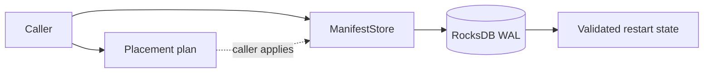

# Distributed Tensor Module

**Last Updated:** 2026-11-19
**Source level:** Level 1 — module implementation
**SOT domain:** module-behavior
**Canonical references:** `src/distributed_tensor/CMakeLists.txt`, `include/distributed_tensor/*.h`, `tests/CMakeLists.txt`, `tests/distributed_tensor/CMakeLists.txt`, `tests/epic3_distributed_tensor/CMakeLists.txt`, `tests/integration/CMakeLists.txt`, `benchmarks/CMakeLists.txt`, `benchmarks/distributed_tensor/CMakeLists.txt`, `benchmarks/epic3_distributed_tensor/CMakeLists.txt`
**Related:** Issue #7341

<!--
AI_Used: true
AI_Models: unknown
AI_Contributor: GitHub Copilot Coding Agent
Human_Review: false
Human_Author: ThemisDB Team
Exact model backend not verifiable from final document text alone.
-->

## Zweck

The module provides C++ interfaces and implementations for distributed tensor
artifacts, manifests, shard placement, integrity verification, recovery,
retrieval planning, infrastructure coordination, in-process training-job
coordination, and storage-strategy assessment. Its exact build source list is
maintained in [`CMakeLists.txt`](CMakeLists.txt); this README does not imply
production readiness or measured performance.

## Scope

The public header directory currently contains contracts for artifact classes,
manifests, shard placement, integrity verification, recovery, distributed
planning, tensor infrastructure, in-process training-job coordination, and
storage strategy.
The module target is the static library `themis_distributed_tensor`. The
`include/distributed_tensor/tensor_storage_strategy.h` includes `` and
exposes `std::span`, so the public API requires C++20. The target declares
`cxx_std_20` as a `PUBLIC` compile feature so CMake consumers linking the target
inherit the requirement. Direct users of the installed headers must also
compile as C++20. The source CMake file links `themis_base` and conditionally
links `themis_core` and `themis_tensor` when those targets exist.

The module target's `integrity_verification.cc` uses an FNV-1a demonstration
hash in `simple_sha256_hash()`. The separately present nested
`src/integrity_verification.cc` contains SHA-256 calls but is not in this
target's source list. Thus the default module target does not provide
cryptographic SHA-256; Merkle-shaped receipt/tree structures are not a
cryptographic security guarantee.

## Quickstart (Build/Run)

- The module is added by `cmake/CMakeLists.txt` when its module CMake file exists.
- Build the configured module target with
  `cmake --build <build-dir> --target themis_distributed_tensor`.
- Run the focused manifest durability test with
  `ctest --test-dir <build-dir> -R ManifestStorePhaseATests --output-on-failure`.
- `tests/distributed_tensor/CMakeLists.txt` registers three focused test
  executables from `test_tensor_allocation.cpp`, `test_tensor_operations.cpp`,
  and `test_tensor_performance.cpp`. Their existence and registration do not
  establish that they were built or passed.
- `tests/epic3_distributed_tensor/CMakeLists.txt` separately registers the
  EPIC 3 contract/update test sources and an integrity benchmark test target;
  `tests/CMakeLists.txt` conditionally adds that directory. The integration
  test configuration also includes `test_distributed_tensor_soak.cpp` when
  present.
- `benchmarks/distributed_tensor/CMakeLists.txt` conditionally registers
  `bench_distributed_tensor_dedicated_gates.cpp` when
  `THEMIS_BUILD_BENCHMARKS` is enabled. That benchmark uses in-process stubs;
  it is not evidence of network, GPU, or production workload performance.
- `benchmarks/epic3_distributed_tensor/CMakeLists.txt` separately configures
  the placement, integrity, recovery, retrieval, partial-refit, and
  summary-first benchmark sources when benchmarks are enabled.

## API/CLI Einstieg

This module provides C++ APIs and no standalone CLI. `ManifestStore` is an
internal API; callers construct it with a persistent RocksDB directory and
check the `[[nodiscard]]` result of `store()`.

## Integrationsueberblick

**Kurzinterpretation:** Manifest metadata is durable on the local node;
placement plans are caller-applied and are not replicated by this module.

## Verification attempt (2026-10-31)

A diagnostic configure with tests and benchmarks enabled used CMake 3.31.6,
GNU 13.3.0, Debug mode, and an empty toolchain file. Configuration stopped at
`cmake/Dependencies.cmake:727` because the required `fmt` library was not
available; no build tree targets were generated. Consequently, no
distributed-tensor test or benchmark executable was built or run. A standalone
syntax check of `tensor_storage_strategy.h` passed with `-std=c++20` and was
rejected with `-std=c++17` at `std::span`, as expected.

## Verweise

| Area | Public interface | Implementation source(s) |
|---|---|---|
| Artifact classes and manifests | `tensor_artifact_classes.h`, `artifact_manifest.h` | `tensor_artifact_classes.cc`, `artifact_manifest.cc`, `src/artifact_manifest.cc` |
| Placement and retrieval | `shard_placement.h`, `distributed_planner.h` | `shard_placement.cc`, `distributed_planner.cc`, `src/distributed_planner.cc` |
| Integrity and recovery | `integrity_verification.h`, `recovery_manager.h` | `integrity_verification.cc`, `recovery_manager.cc` |
| Infrastructure and in-process training jobs | `tensor_infrastructure.h`, `tensor_training_coordinator.h` | `tensor_infrastructure.cc`, `tensor_training_coordinator.cc` |
| Storage strategy | `tensor_storage_strategy.h` | `src/tensor_storage_strategy.cc` |

Additional implementation sources, including delta-log, manifest-store,
checkpoint, snapshot-update, and shard-summary components, are listed directly
in the module CMake file. This table is an orientation aid, not a complete source
inventory.

## Manifest persistence guarantees

The internal `ManifestStore` uses the project's RocksDB-backed
`RocksDBWrapper`; callers must provide a non-empty database directory. It does
not maintain an in-memory-only production mode. Manifest updates and eviction
batches are written through the RocksDB WAL with synchronous commits, so a
successful write is acknowledged only after the commit is synced. On open, all
stored manifest records are parsed, validated, and checked against their
storage keys; database-open or record-validation errors fail construction
closed. Read and eviction paths also fail closed rather than serving malformed
records.

The durable metadata includes manifest identity, version, placement, integrity
fields, and creation time used by freshness decisions. This is local persistent
metadata, not shard-payload replication: the module still has no built-in
network transport or multi-node recovery protocol. The nightly coverage
workflow runs the tests labelled `distributed_tensor`, publishes module-level
summaries and LCOV reports, and enforces 70% line / 60% branch coverage on
`manifest_store.cpp` and `src/artifact_manifest.cc`.
The workflow emits per-path coverage evidence; no measured pass result or
path-specific exception is claimed here.

## Known Limitations

`TensorTrainingCoordinator` runs worker callbacks synchronously in-process; it
does not provide networked or distributed worker execution. The source and
headers establish implementation surfaces, but the attempted configure did not
establish module test pass status, production enablement, cross-module
deployment, or benchmark outcomes. Representative-hardware performance and
production sign-off remain unverified. Historical EPIC 3 plans and evidence
records remain historical; consult the current source, build registration, and
[`ROADMAP.md`](ROADMAP.md) before making status claims.
