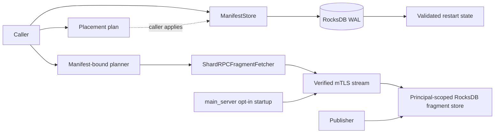

# Distributed Tensor Module

**Last Updated:** 2026-11-23
**Source level:** Level 1 — module implementation
**SOT domain:** module-behavior
**Canonical references:** `src/distributed_tensor/CMakeLists.txt`, `include/distributed_tensor/*.h`, `include/sharding/shard_artifact_fragment_store.h`, `include/sharding/shard_rpc_server.h`, `src/main_server.cpp`, `proto/sharding/shard_rpc.proto`, `tests/CMakeLists.txt`, `tests/distributed_tensor/CMakeLists.txt`, `tests/epic3_distributed_tensor/CMakeLists.txt`, `tests/integration/CMakeLists.txt`, `tests/sharding/CMakeLists.txt`, `tests/sharding/test_shard_transfer_store.cpp`, `tests/sharding/test_shard_transfer_grpc.cpp`, `benchmarks/CMakeLists.txt`, `benchmarks/distributed_tensor/CMakeLists.txt`, `benchmarks/epic3_distributed_tensor/CMakeLists.txt`
**Related:** Issue #7341

<!--
AI_Used: true
AI_Models: unknown
AI_Contributor: GitHub Copilot Coding Agent
Human_Review: false
Human_Author: ThemisDB Team
Exact model backend not verifiable from final document text alone.
-->

## Zweck

The module provides C++ interfaces and implementations for distributed tensor
artifacts, manifests, shard placement, integrity verification, recovery,
retrieval planning, infrastructure coordination, in-process training-job
coordination, and storage-strategy assessment. Its exact build source list is
maintained in [`CMakeLists.txt`](CMakeLists.txt); this README does not imply
production readiness or measured performance.

## Scope

The public header directory currently contains contracts for artifact classes,
manifests, shard placement, integrity verification, recovery, distributed
planning and graph-summary projection, tensor infrastructure, in-process
training-job coordination, and storage strategy.
The module target is the static library `themis_distributed_tensor`. The
`include/distributed_tensor/tensor_storage_strategy.h` includes `` and
exposes `std::span`, so the public API requires C++20. The target declares
`cxx_std_20` as a `PUBLIC` compile feature so CMake consumers linking the target
inherit the requirement. Direct users of the installed headers must also
compile as C++20. The source CMake file links `themis_base` and conditionally
links `themis_core` and `themis_tensor` when those targets exist.

The module target's root-level `integrity_verification.cc` uses OpenSSL EVP
SHA-256 when OpenSSL Crypto is available at configure time and fails closed
when it is not. The engine supports only SHA-256; versioned receipt digests
bind artifact identity, manifest version, and sorted shard IDs, but hashing
does not authenticate the producer. Receipts from the former demonstration
hash are incompatible and must be recomputed. The separate nested
`src/integrity_verification.cc` remains outside the module target.
Its private EPIC-3 test and benchmark compile it separately only when OpenSSL
Crypto is found.
`ArtifactManifest::compute_manifest_hash()` remains a non-cryptographic
checksum and is not an integrity or authenticity guarantee.

## Quickstart (Build/Run)

- The module is added by `cmake/CMakeLists.txt` when its module CMake file exists.
- Build the configured module target with
  `cmake --build <build-dir> --target themis_distributed_tensor`.
- Run the focused manifest durability test with
  `ctest --test-dir <build-dir> -R ManifestStorePhaseATests --output-on-failure`.
- `tests/distributed_tensor/CMakeLists.txt` registers three focused test
  executables from `test_tensor_allocation.cpp`, `test_tensor_operations.cpp`,
  and `test_tensor_performance.cpp`. Their existence and registration do not
  establish that they were built or passed.
- `tests/epic3_distributed_tensor/CMakeLists.txt` separately registers the
  EPIC 3 contract/update test sources and an integrity benchmark test target;
  `tests/CMakeLists.txt` conditionally adds that directory. No distributed
  tensor soak test is registered under `tests/integration`: its former
  in-process stub-only source was removed because it did not exercise a real
  shard transport. A focused mTLS fragment-fetch test is registered in
  `tests/sharding/test_shard_transfer_grpc.cpp`; it exercises the real
  ShardRPC stream and a test-only storage reader, but has not been run. An
  additional source case publishes a fixture summary through the local
  publisher, reopens RocksDB, and fetches it over mTLS using a manifest-bound
  planner; it also checks
  graph validation when the query and LLM module targets exist. It does not
  cover the host startup or an automatic publisher, and has not been run. The
  existing `ShardTransferStoreTests` target now also registers RocksDB-backed
  fragment-store regressions for principal/shard isolation, immutable replay,
  digest/size checks, and restart persistence; those sources have not been
  built or run. Production server startup is opt-in through
  `sharding.tensor_fragment_rpc`; see the runbook and `src/sharding/API.md` for
  required mTLS configuration and the canonical storage mapping.
- `benchmarks/distributed_tensor/CMakeLists.txt` conditionally registers
  `bench_distributed_tensor_dedicated_gates.cpp` when
  `THEMIS_BUILD_BENCHMARKS` is enabled. That benchmark uses in-process stubs;
  it is not evidence of network, GPU, or production workload performance.
- `benchmarks/epic3_distributed_tensor/CMakeLists.txt` separately configures
  the placement, integrity, recovery, retrieval, partial-refit, and
  summary-first benchmark sources when benchmarks are enabled.

## API/CLI Einstieg

This module provides C++ APIs and no standalone CLI. `ManifestStore` is an
internal API; callers construct it with a persistent RocksDB directory and
check the `[[nodiscard]]` result of `store()`.

The manifest-bound planner overload and ShardRPC adapter are additive C++ APIs,
but public struct additions require consumers to rebuild against matching
headers; mixed-version binary ABI compatibility is not claimed. Strict graph
validation accepts only the versioned adapter-similarity projection defined by
`GraphSummaryProjectionCodec`; arbitrary tensor bytes and unknown formats
remain fail-closed.
Host publishers persist each fragment through `ShardArtifactFragmentStore`
using `(principal_id, shard_id, artifact_id)` before advertising the matching
manifest placement. This dedicated keyspace is not a `TensorFieldKey` mapping,
and no automatic host publisher is currently installed. `LocalProjectionPublisher`
provides a single-shard local publisher and persistent public-manifest reader.
`publishFromGraph()` builds the summary from a tenant-checked fingerprint
graph query and requires query metadata and candidate keys to match the tenant.
Its `loadRemote()` reads an immutable manifest record over the existing mTLS
fragment transport, for an artifact ID supplied by the caller, and verifies the
referenced projection's digest, scope and candidate keys before returning. The caller must
supply authenticated tenant/principal and authoritative placement, verify
summary provenance, establish peer-to-node trust, and obtain a fresh artifact
ID through a trusted channel. There is no discovery or authorization service.

## Graph-summary projection

`GraphSummaryProjectionCodec` uses a versioned `TSPJ` binary envelope
(`themis.tensor.adapter-similarity/v1`) rather than serializing C++ object
layouts. The big-endian header carries version, zero-valued flags, and a
candidate count. Length-prefixed UTF-8 fields carry one scope key and, per
candidate, adapter key, domain, base-model ID, and an IEEE-754 binary32 cosine
score.

The codec caps payloads at 16 MiB, each text field at 4096 bytes, and each
summary at 1024 candidates. It rejects invalid UTF-8/control characters,
non-finite or out-of-range scores, duplicate/non-canonical candidates,
unknown versions or flags, truncation, and trailing bytes. Merge requires one
identical scope; duplicate adapter IDs must agree on domain and base model,
then retain the highest score. Encoding accepts only non-federated Adapter or
FingerprintSummary summaries with Adapter ANN scope. This format carries
advisory adapter candidates only, not arbitrary tensor weights or graph
assertions.

The planner requires complete request/result identity and a manifest-bound
digest reported as verified by the fetcher before decoding. It merges the
decoded candidates and invokes `GraphTruthValidator`; strict validation passes
only when every evidence item is validated, meets the configured graph-score
threshold, and has supporting graph nodes. Missing, malformed, conflicting, or
unsupported projections fail closed. The local publisher encodes this format
and persists its manifest after the fragment; automatic producer and host
integration are not implemented. The codec, publisher, and planner changes have not been
built or run.

This integration applies to the public
`themis::distributed_tensor::DistributedTensorPlanner`. The separate
source-private `detail::DistributedTensorPlanner` remains fail-closed and is
covered by its internal contract test; it is not the public planner entry point.

## Integrationsueberblick

**Kurzinterpretation:** Manifest metadata is durable on the local node;
placement plans remain caller-applied. The host can explicitly enable the
gRPC/mTLS server; fragment storage uses a versioned, principal/shard/artifact
key and verifies stored size and SHA-256. Publishers still own the write and
manifest-publication sequence. The codec projects only the explicit
adapter-similarity payload; the adapter does not replicate metadata, and the
publisher must produce the supported payload format.

`DistributedTensorPlanner::validateAgainstGraphTruth()` decodes and merges the
explicit projection format before calling `GraphTruthValidator`.
Fragment-load success alone remains insufficient: identity, digest metadata,
projection validity, and graph-backed evidence are all required.

## Verification attempt (2026-10-31)

A diagnostic configure with tests and benchmarks enabled used CMake 3.31.6,
GNU 13.3.0, Debug mode, and an empty toolchain file. Configuration stopped at
`cmake/Dependencies.cmake:727` because the required `fmt` library was not
available; no build tree targets were generated. Consequently, no
distributed-tensor test or benchmark executable was built or run. A standalone
syntax check of `tensor_storage_strategy.h` passed with `-std=c++20` and was
rejected with `-std=c++17` at `std::span`, as expected.

## Verweise

| Area | Public interface | Implementation source(s) |
|---|---|---|
| Artifact classes and manifests | `tensor_artifact_classes.h`, `artifact_manifest.h` | `tensor_artifact_classes.cc`, `artifact_manifest.cc`, `src/artifact_manifest.cc` |
| Placement and retrieval | `shard_placement.h`, `distributed_planner.h` | `shard_placement.cc`, `distributed_planner.cc`, `src/distributed_planner.cc` |
| Integrity and recovery | `integrity_verification.h`, `recovery_manager.h` | `integrity_verification.cc`, `recovery_manager.cc` |
| Infrastructure and in-process training jobs | `tensor_infrastructure.h`, `tensor_training_coordinator.h` | `tensor_infrastructure.cc`, `tensor_training_coordinator.cc` |
| Storage strategy | `tensor_storage_strategy.h` | `src/tensor_storage_strategy.cc` |

Additional implementation sources, including delta-log, manifest-store,
checkpoint, snapshot-update, and shard-summary components, are listed directly
in the module CMake file. This table is an orientation aid, not a complete source
inventory.

## Manifest persistence guarantees

The internal `ManifestStore` uses the project's RocksDB-backed
`RocksDBWrapper`; callers must provide a non-empty database directory. It does
not maintain an in-memory-only production mode. Manifest updates and eviction
batches are written through the RocksDB WAL with synchronous commits, so a
successful write is acknowledged only after the commit is synced. On open, all
stored manifest records are parsed, validated, and checked against their
storage keys; database-open or record-validation errors fail construction
closed. Read and eviction paths also fail closed rather than serving malformed
records.

The durable metadata includes manifest identity, version, placement, integrity
fields, and creation time used by freshness decisions. This remains local
manifest metadata, separate from shard payloads. The host fragment store
persists payload and SHA-256 metadata atomically in a separate RocksDB
keyspace; the server starts only under explicit mTLS configuration. Payload
publication and multi-node manifest recovery remain caller responsibilities.
The nightly coverage
workflow runs the tests labelled `distributed_tensor`, publishes module-level
summaries and LCOV reports, and enforces 70% line / 60% branch coverage on
`manifest_store.cpp` and `src/artifact_manifest.cc`.
The workflow emits per-path coverage evidence; no measured pass result or
path-specific exception is claimed here.

## Known Limitations

`TensorTrainingCoordinator` runs worker callbacks synchronously in-process; it
does not provide networked or distributed worker execution. The source and
headers establish implementation surfaces, but the attempted configure did not
establish module test pass status, production enablement, cross-module
deployment, or benchmark outcomes. Representative-hardware performance and
production sign-off remain unverified. Historical EPIC 3 plans and evidence
records remain historical; consult the current source, build registration, and
[`ROADMAP.md`](ROADMAP.md) before making status claims.
