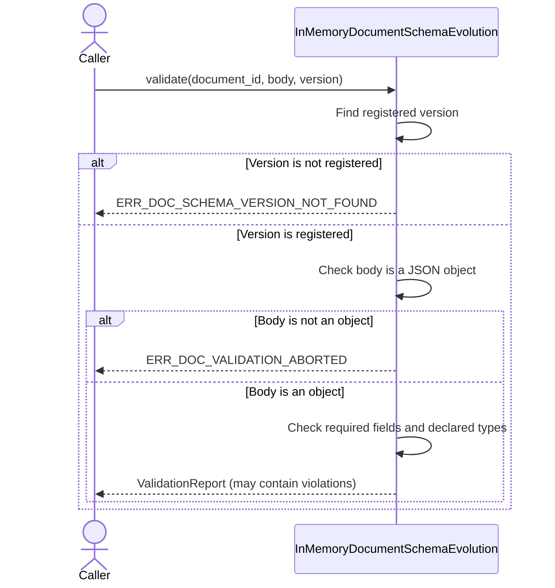

> Exact model backend not verifiable from final document text alone.

# Architecture — Document Module

<!-- Status: current | source review: 2026-11-19 -->
<!-- Links: README.md · ROADMAP.md · FUTURE_ENHANCEMENTS.md -->

## Kontext

The module is header-first. Its public contracts are in `include/document/`; the only module-local `.cpp` implementation is `src/document/round_trip_editor.cpp`. Reference implementations use in-memory state. `IDocumentStore` is an abstraction that callers may implement; this module does not bind it to a particular durable storage engine.

## Komponenten

| Plane | Implementation evidence | Behavior |
|---|---|---|
| Store and manager | `document_store.h`, `document_manager.h` | Collection/ID operations; in-memory reference store is mutex-protected; manager dispatches lifecycle hooks |
| Lifecycle and schema | `document_lifecycle.h`, `document_schema_evolution.h` | Synchronous hook callbacks; schema registration, sealing, and validation against field descriptors |
| Diff and merge | `document_diff_merge.h` | Loads documents through `IDocumentStore`; reports field changes and supports `OURS_WINS`, `THEIRS_WINS`, and `FAIL` |
| Exchange | `xdomea_connector.h` | XDOMEA import/export and repository operations; in-memory XML handling is not XSD validation |
| Round-trip snapshots | `round_trip_editor.h`, `round_trip_editor.cpp` | Stores relay/index records through `IDocumentStore`; propagates store errors |
| Diagnostics and entity helpers | `document_diagnostics.h`, `encrypted_entities.h`, `document_manager.h` | Classifies/formats error codes; in-memory re-encryption records a key ID but does not transform stored bytes |

## Schnittstellen

`IDocumentStore` is the persistence boundary used by store-backed diff/merge and round-trip code. `IDocumentSchemaEvolution::validate()` checks a document against one registered schema version. Lifecycle hooks are synchronous, and their methods are declared `noexcept`. Shared utility/error and encryption types are dependencies, not document-owned integrations.

## Datenfluss

A caller selects the registry key and explicitly submits a document to schema validation. The registry does not infer migrations or run as part of storage writes. For object bodies, validation returns a report containing any required-field or declared-type violations; an invalid structure or unregistered version returns an error.

## Sequenz (kritischer Ablauf)

**Kurzinterpretation:** Version lookup precedes body validation; successful object validation returns a report, while missing versions and non-object bodies fail with explicit errors.

## Fehlerpfade und Resilienz

- Store/manager, schema, diff/merge, and round-trip APIs expose `Result` return values; absent reads are represented as `std::optional`.
- The in-memory store and schema registry protect their own state with mutexes. The interface does not prescribe thread-safety for third-party `IDocumentStore` implementations.
- Lifecycle hooks are invoked synchronously in registration order. Hook methods are declared `noexcept`; `afterDelete` is dispatched even when store removal reports failure.
- `InMemoryDocumentDiffMerge` reports missing documents and merge conflicts through errors. Non-object JSON payloads do not receive field-level diff/merge processing.
- Schema validation rejects non-object JSON with `ERR_DOC_VALIDATION_ABORTED`; schema versions are independently registered keys, with no implicit migration, ordering, retry, fallback, or recovery behavior.
- `ERR_DOC_SCHEMA_TRANSITION_INVALID` is defined in the shared taxonomy, but no transition API or transition check is implemented by this module.
- The module has no degraded-mode contract. Store failures are surfaced through `Result`; an adapter or caller must define observable, bounded recovery behavior rather than assuming it is provided here.

## Nicht-Ziele

- Schema versions are registry keys, not migration steps; the module does not transform documents between versions.
- CRUD and round-trip persistence do not automatically validate schemas.
- In-memory store, manager, and XDOMEA implementations do not provide durable storage or XSD validation.
- Encrypted-entity helpers do not establish encryption of stored document bytes or key rotation.
- The module does not define a retry, fallback, degraded-mode, or recovery policy for callers or adapters.
- The reviewed module sources do not establish a direct metadata-module schema registry, a specific server consumer, or a stable-ABI guarantee.

## Verweise

- [Module README](README.md), [roadmap](ROADMAP.md), [future enhancements](FUTURE_ENHANCEMENTS.md), and [security boundaries](SECURITY.md)
- [Schema contract](../../include/document/document_schema_evolution.h), [round-trip implementation](round_trip_editor.cpp), and [focused tests](../../tests/document/test_document_schema_hardening_focused.cpp)
- [Benchmark release gates](../../benchmarks/document/RELEASE_GATES.md)

## Verification basis

Reviewed the public headers, round-trip implementation, focused test sources, and CMake definitions on 2026-11-19. This page describes source-level structure, not a claim that the full module or external integrations were built or executed.