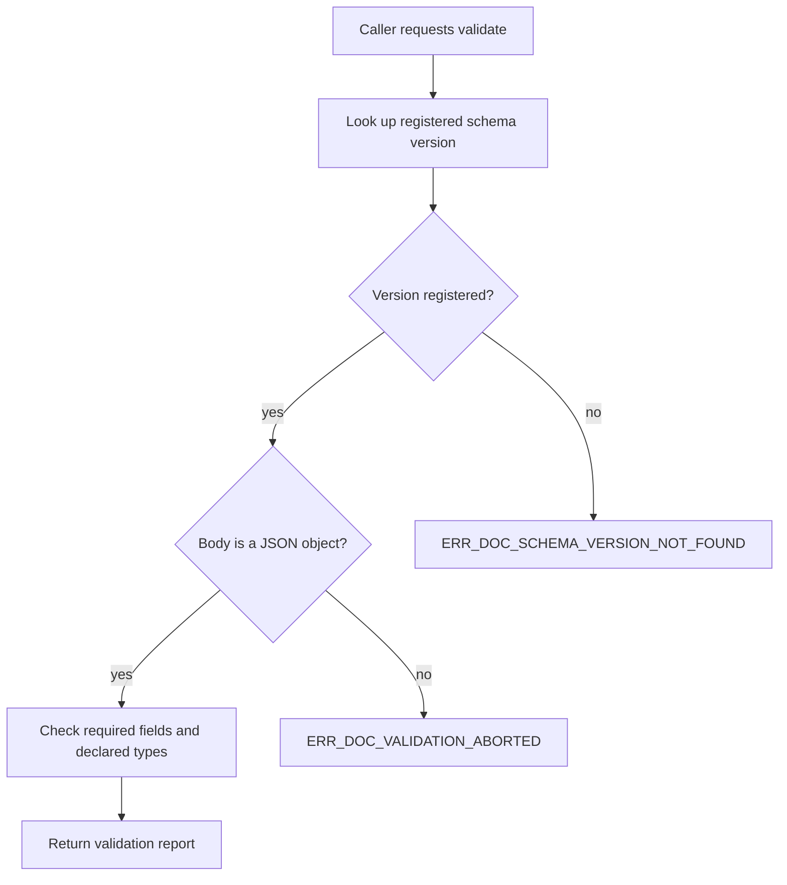

> Exact model backend not verifiable from final document text alone.

# ThemisDB Document Module

<!-- Status: current | source review: 2026-11-19 -->
<!-- Links: ARCHITECTURE.md · ROADMAP.md · FUTURE_ENHANCEMENTS.md · SECURITY.md -->

## Zweck

The document module defines C++ interfaces and in-memory reference implementations for document storage and management, lifecycle hooks, schema validation, field-level diff/three-way merge, encrypted-entity helpers, XDOMEA exchange, and round-trip snapshots. The public headers are predominantly inline; `src/document/round_trip_editor.cpp` supplies the store-backed round-trip implementation. The presence of `IDocumentStore` does not itself provide a durable backend.

## Scope

The module owns the contracts and reference implementations listed below. Most storage, manager, schema-registry, and XDOMEA behavior is in-memory; persistence depends on an `IDocumentStore` supplied by an integration. Schema validation is explicit and is not automatically invoked by CRUD or round-trip operations.

## API/CLI Einstieg

The module exposes C++ interfaces; it does not define a document-module CLI.

| Source | Responsibility |
|---|---|
| `include/document/document_store.h` | `IDocumentStore` contract and mutex-protected `InMemoryDocumentStore` |
| `include/document/document_manager.h` | `IDocumentManager`, in-memory CRUD orchestration, lifecycle dispatch, and encrypted-entity factory |
| `include/document/document_lifecycle.h` | `IDocumentLifecycleHook` and CRUD lifecycle events |
| `include/document/document_schema_evolution.h` | In-memory schema-version registry, sealing, and field validation |
| `include/document/document_diff_merge.h` | Store-backed field diff and three-way merge strategies |
| `include/document/document_diagnostics.h` | Error classification/formatting and in-memory diagnostic counts |
| `include/document/xdomea_connector.h` | XDOMEA connector contract and in-memory XML/repository implementation |
| `include/document/round_trip_editor.h`, `src/document/round_trip_editor.cpp` | Store-backed relay snapshots and interaction lookup |
| `include/document/encrypted_entities.h` | JSON helpers for entities containing `EncryptedField<T>` values |

## Integrationsueberblick

Callers provide an `IDocumentStore` to store-backed diff/merge and round-trip components. The in-memory manager dispatches lifecycle hooks synchronously, while schema validation must be requested explicitly. These interfaces do not establish a durable adapter, caller authorization policy, or integration-level recovery behavior.

## Known Limitations

- Store and manager operations use `Result<T>` and optional results for reads; the XDOMEA in-memory connector also has methods that throw for invalid or duplicate stored IDs.
- `InMemoryDocumentStore`, `InMemoryDocumentManager`, the schema reference implementation, and `InMemoryXDOMEAConnector` are in-memory implementations, not durable production backends.
- `SchemaVersion` is an opaque `uint32_t` registry key, not an ordered migration sequence. The registry accepts `0`, rejects duplicate versions, and can be sealed; it does not migrate documents or enforce compatibility between versions.
- Schema validation requires an object body and returns `ERR_DOC_VALIDATION_ABORTED` for null, scalar, or array JSON. For object bodies, it checks only registered required fields and JSON types; unknown fields are accepted and defaults are informational. An unregistered version returns `ERR_DOC_SCHEMA_VERSION_NOT_FOUND`.
- `ERR_DOC_SCHEMA_TRANSITION_INVALID` is present in the shared error taxonomy, but the schema registry exposes no transition operation and does not infer migrations or compatibility from version numbers.
- Validation is explicit; CRUD and round-trip persistence do not invoke schema validation automatically.
- `MergeStrategy::FAIL` returns a conflict error; the other merge strategies select the configured branch's value for conflicts.
- Snapshot IDs are formed from the relay ID and interaction index. Store errors are propagated by the round-trip implementation.
- No module-level retry, fallback, degraded-mode, or recovery loop exists. Calls return or propagate failures; callers and concrete integrations must define any retry policy and keep it bounded.
- `InMemoryEncryptedEntity::reencrypt()` records a key ID only; it does not re-cipher document bytes.
- `InMemoryDocumentManager::createEncrypted()` stores the supplied JSON body in its in-memory store and returns an in-memory handle; it does not encrypt that body.
- The in-memory XDOMEA parser is not an XSD validator. See [SECURITY.md](SECURITY.md) for security boundaries.
- Generated `PRODUCTION-READY` annotations in public-header maturity blocks are not deployment or release sign-off; the implementation limits and missing evidence above remain authoritative for this module.

## Quickstart (Build/Run)

Configure and build with the repository's documented Linux release preset:

```sh
cmake --preset linux-release -DTHEMIS_AUTO_BOOTSTRAP_DEPS=ON -DTHEMIS_BUILD_TESTS=ON
cmake --build --preset linux-release --target module_document_test_document_schema_hardening_focused_focused
ctest --preset linux-release -R '^test_document_schema_hardening_focused_document_FocusedTests$' --output-on-failure
```

### Installation

The document module is built with the repository; use the root `linux-release` preset above to configure its dependencies.

### Usage

Call `IDocumentSchemaEvolution::validate(document_id, document_body, version)` explicitly to obtain a validation report or an error. CRUD and round-trip persistence do not invoke this operation automatically.

`tests/document/CMakeLists.txt` registers focused unit-test targets with a 120-second timeout; the high-cardinality test receives additional stress labels. `benchmarks/document/CMakeLists.txt` conditionally registers four benchmark executables. Registration is not evidence that a build, test, or benchmark run passed.

The schema validation path is explicit:



**Kurzinterpretation:** The validator checks one registered schema when called; it rejects non-object bodies and does not migrate or persist documents.

## Verification basis

Reviewed public headers, `src/document/round_trip_editor.cpp`, `tests/document/*.cpp`, `tests/document/CMakeLists.txt`, and `benchmarks/document/` plus its CMake registration on 2026-11-19. Source registration is not execution evidence; actual test/benchmark results and release-gate consumption must be recorded before sign-off. Current planning is in [ROADMAP.md](ROADMAP.md); prior snapshots are historical.

## Verweise

- [Architecture](ARCHITECTURE.md), [roadmap](ROADMAP.md), [future enhancements](FUTURE_ENHANCEMENTS.md), and [security boundaries](SECURITY.md)
- [Schema API](../../include/document/document_schema_evolution.h), [focused tests](../../tests/document/test_document_schema_hardening_focused.cpp), and [benchmark release gates](../../benchmarks/document/RELEASE_GATES.md)