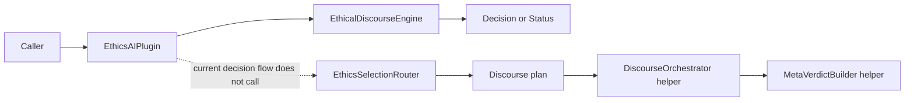
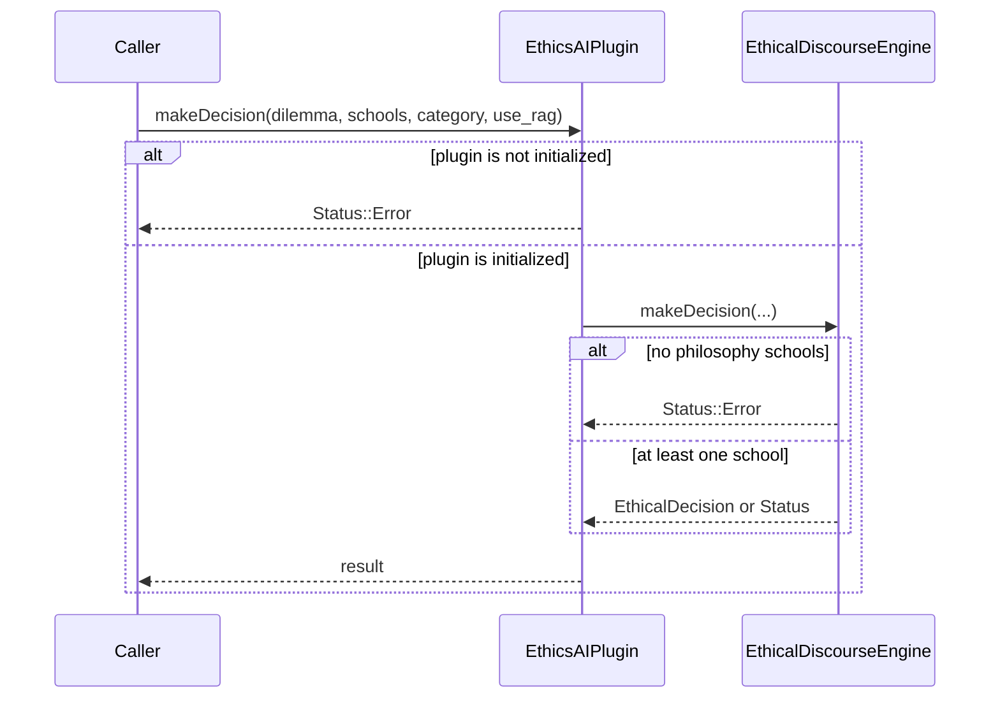

Exact model backend not verifiable from final document text alone.

# Architecture - Ethics AI Module

<!-- Status: current | source review: 2026-11-19 -->
<!-- Links: README.md · ROADMAP.md · FUTURE_ENHANCEMENTS.md -->
<!-- Research: docs/research/ethics_discourse_process_equality.md -->

## Kontext

The ethics_ai module composes philosophy profile ingestion, argument persistence, discourse orchestration, context assembly, evaluation, and plugin lifecycle wiring into a coherent ethics reasoning runtime for ThemisDB.

`RouterConfig` defaults to `SELECTION_ONLY`; `EthicsSelectionRouter::route()` is the existing selection path. The source also exposes `LAYERED_FULL` and `LAYERED_FAST` planning/helper paths. They are not wired into the plugin decision flow: `ethics_ai_plugin.cpp` and `discourse_engine.cpp` do not call the LDM helper APIs. The LDM design rationale is in `FUTURE_ENHANCEMENTS.md` and `docs/research/ethics_discourse_process_equality.md`.

Root `ROADMAP.md` designates the external `plugins/themisdb_ethic_ai/` submodule as the canonical plugin implementation. This architecture description is scoped to the in-tree source path and is not a statement about that external implementation.

The fixed `ETHICS_AI_SOURCES` list compiles 12 translation units, including the LDM helper implementations; compilation does not imply runtime wiring. `EthicsAIPlugin` delegates to `EthicalDiscourseEngine`, and the plugin decision flow does not call `EthicsSelectionRouter`, `DiscourseOrchestrator`, `MetaVerdictBuilder`, or `MirrorSchoolHandler`. Without an injected inference callback, the orchestrator ignores dilemma text and produces deterministic synthetic output from `school_id.size() % 3` (the source comment describes this as hash-based); the mirror helper also has a deterministic fallback. Ebene-2 creates cluster summaries and tension-axis records without the described multi-round cluster dialogue, and `MetaVerdictBuilder` ignores its cluster-position input and uses unit vote counts. The current plugin entrypoint does not inject a real LLM callback or legal retriever. The source directory contains additional `.cpp` files outside the fixed target list and does not contain `cluster_discourse_engine.cpp`.

## Komponenten

### 1. Profile and Configuration Plane
- profile loading, validation, and registry/index operations
- philosophy selection and routing across school sets
- **LDM extension:** `DiscourseMode` selection; `DiscourseOrchestratorPlan` generation
  assigning all N schools to Ebene-1 with equal initial weight `w₀ = 1/N`

### 2. Discourse and Synthesis Plane
- debate initialization/continuation and decision generation
- cross-school tension resolution and synthesis support
- **LDM extension (Ebene-1):** parallel equal-weight initial scoring for all N schools;
  `verdict ∈ {PROHIBIT, PERMIT, CONDITIONAL, ABSTAIN}` per school
- **LDM extension (Ebene-2):** taxonomy-class cluster discourse (K≤6 clusters)
  along four structural tension axes; O(K²·R) instead of O(N²·R)
- **LDM extension (Ebene-3):** convergence-counting `MetaVerdict` with
  `cross_cultural_flag`, `minority_dissent[]`, and positivrechtlichem Legal-DB-Grounding

### 3. Memory/Context Plane
- argument and decision storage/retrieval contracts
- RAG context assembly, prior-round compression, and matrix synthesis
- **LDM extension:** `ClusterPosition` persistence per Ebene-2 cluster;
  `EpisodicMemoryEntry` for inter-cluster tension outcomes

### 4. Evaluation and Operations Plane
- ethics scoring and metrics emission
- plugin lifecycle integration and runtime observability behavior
- **LDM extension:** MetaVerdict audit fields (`participating_schools`, `convergence_score`,
  `discourse_mode`) for EU AI Act Art. 13 transparency compliance

### 5. Cultural Self-Reflection Helper (LDM)
- helper activation is represented by `MirrorSchoolPolicy`; runtime use depends on caller wiring
- supplied mirror outputs are copied to `MetaVerdict.minority_dissent`
- default inference is deterministic stub output, not a live LLM call

## Schnittstellen

| Contract | Behavior |
|---|---|
| profile contract | explicit profile validation/load and lookup behavior |
| discourse contract | deterministic debate and decision orchestration semantics |
| LDM planning contract | non-`SELECTION_ONLY` planning enumerates registry results and computes `1/N` initial weight |
| MetaVerdict input contract | `MetaVerdictBuilder` lists every supplied Ebene-1 result, including ABSTAIN; it cannot guarantee every loaded school was supplied |
| context contract | bounded argument memory and context retrieval behavior |
| evaluation/ops contract | explicit scoring, metrics, and plugin lifecycle surfaces |
| legal grounding input | `MetaVerdictBuilder` accepts a caller-supplied `LegalGrounding`; it does not retrieve legal documents itself |

## Datenfluss

Kurzinterpretation: The solid path is the current in-tree plugin decision flow. The lower path represents separately available LDM planning/helpers; the dotted edge records that these helpers are not integrated into the plugin decision path.

## Sequenz (kritischer Ablauf)

Kurzinterpretation: The plugin rejects calls before initialization; the engine rejects an empty school list. Successful calls follow `EthicalDiscourseEngine`; this sequence does not invoke the LDM helpers.

## Fehlerpfade und Resilienz

- invalid profile or school selection paths fail with structured status/error states.
- missing storage/context inputs produce explicit non-silent failure behavior.
- lifecycle misuse (uninitialized plugin paths) fails deterministically.
- **LDM:** `runEbene1()` rejects empty/duplicate school IDs and invalid/non-equal `initial_weight` before inference starts.
- **LDM:** The positive per-school wait threshold maps a late callback result to `ABSTAIN`, but does not cancel the callback. With `std::async`, destroying an unfinished future may block until its task completes, so this is not a hard deadline or bounded recovery guarantee.
- **LDM:** a caller-supplied unavailable `LegalGrounding` results in empty grounding and an unavailable flag; no retrieval occurs in the builder.
- **LDM:** All N schools ABSTAIN → `DISSENT` MetaVerdict; never silently promoted to `SELECTION_ONLY`.

## Nicht-Ziele

- This in-tree reference architecture does not establish behavior of the canonical external plugin in `plugins/themisdb_ethic_ai/`.
- The existing helper APIs and deterministic fixtures do not establish production LLM inference, legal retrieval, or a full multi-round LDM pipeline.
- Source-defined benchmark targets are not measured performance evidence or proof of a release threshold.

## Verweise

Root [`ROADMAP.md`](../../ROADMAP.md) owns aggregate maturity status; module [`ROADMAP.md`](ROADMAP.md), [`FUTURE_ENHANCEMENTS.md`](FUTURE_ENHANCEMENTS.md), and [`PERFORMANCE_EXPECTATIONS.md`](PERFORMANCE_EXPECTATIONS.md) describe in-tree evidence and open validation gates.

- Verified files:
  - src/ethics_ai/ethics_ai_plugin.cpp
  - src/ethics_ai/discourse_engine.cpp
  - src/ethics_ai/argument_store.cpp
  - src/ethics_ai/philosophy_loader.cpp
  - src/ethics_ai/rag_context_engine.cpp
  - src/ethics_ai/ethics_evaluator.cpp
  - src/ethics_ai/ethics_profile_registry.cpp
  - src/ethics_ai/ethics_selection_router.cpp
  - src/ethics_ai/discourse_orchestrator.cpp (DiscourseMode + DiscourseOrchestratorPlan)
  - src/ethics_ai/meta_verdict_builder.cpp (MetaVerdict assembly from supplied inputs)
  - src/ethics_ai/mirror_school_handler.cpp (mirror helper; deterministic fallback)
- Verified architecture claims:
  - explicit profile/discourse/context/evaluation planes
  - bounded deterministic failure behavior in lifecycle and profile paths
  - LDM helper paths; production inference/legal-retrieval integration is not established by this review

## Module Dependencies

### Direct Upstream Dependencies (source-level interfaces)
| Module | Interface / File | Purpose |
|--------|-----------------|---------|
| llm | `include/llm/` | LLM-facing types/integration surfaces; current LDM helper runtime does not inject a live inference function |
| observability (utils) | `include/utils/tracing.h`, `audit_logger.h` | Audit trail for ethics decisions and discourse outcomes |
| utils | `include/utils/` | Logging and thread services |

### Downstream consumers
| Module | Via | Notes |
|--------|-----|-------|
| llm | `include/ethics_ai/` | Header-level integration surface; current source evidence for runtime invocation is not established by this module review |

## Integration Points

### Plugin decision flow and LDM helpers
**Files:** `src/ethics_ai/ethics_ai_plugin.cpp`, `discourse_engine.cpp`, `discourse_orchestrator.cpp`, `meta_verdict_builder.cpp`.
**Observed boundary:** the plugin decision flow delegates to `EthicalDiscourseEngine`; these entrypoint files do not call `DiscourseOrchestrator` or `MetaVerdictBuilder`. `DiscourseOrchestrator` stores mutable callback/configuration state without an internal mutex, and its header does not promise concurrent cross-thread calls.

### Critical Integration: RAG Context Engine
**Files:** `src/ethics_ai/rag_context_engine.cpp` ↔ `rag/` (indirect, via LLM context pipeline)
**Observed behavior:** the context engine provides retrieval/context assembly methods used by module runtime code. This review does not establish a general thread-safety guarantee across its backing store or other dependencies.