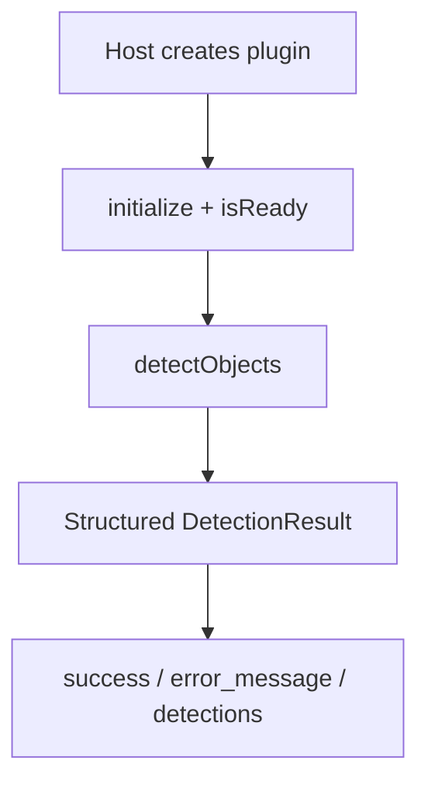

# Image Analysis Module — Architecture

**Author:** ThemisDB Contributors
**Created:** 2026-10-31
**Last Updated:** 2026-10-31
**Status:** active
**AI_Used:** true
**AI_Models:** unknown
**AI_Contributor:** GitHub Copilot
**Human_Review:** false
**Human_Author:** ThemisDB Contributors

Exact model backend not verifiable from final document text alone.

<!-- Status: plugin architecture | source reviewed: 2026-10-31 -->
<!-- Source level: level 1 | SOT domain: module-behavior -->

## Kontext

The image-analysis source directory contains two plugin implementations against the shared contract in `include/plugins/image_analysis_interface.h`. Its local `CMakeLists.txt` defines optional plugin targets, but the root CMake files do not currently add `src/image_analysis/` or declare its `THEMIS_PLUGIN_IMAGE_YOLOV8` / `THEMIS_PLUGIN_IMAGE_TESSERACT` options. The manager API is declared in `include/plugins/image_analysis_manager.h`; the module CMake file does not build an `ImageAnalysisManager` implementation.

## Design Principles

1. **Plugin abstraction:** backend implementations use `IImageAnalysisBackend`; manager APIs are declared separately in `image_analysis_manager.h`.
2. **Optional dependency gating:** the plugin targets are optional; Tesseract and ONNX Runtime support is compiled only when found.
3. **OpenCV is independently optional:** without OpenCV, input bytes are not decoded as encoded images (OCR expects raw grayscale bytes; YOLO uses a zero-filled tensor).
4. **Structured outcomes:** unsupported operations and missing-runtime inference paths return structured failure results.
5. **Source-first validation:** the checked-in performance benchmarks are synthetic and do not establish OCR/detection performance.

## Architecture Diagram

```
┌──────────────────────────────────────────────────────────────┐
│ Host / PluginConfig                                            │
│ • creates/configures a backend through the shared contract    │
└──────────────────────────────┬───────────────────────────────┘
                              │
                              ▼
                   ┌──────────────────────────────┐
                   │ IImageAnalysisBackend        │
                   │ declared in include/plugins/ │
                   └──────────────┬───────────────┘
                                  │
                 ┌────────────────┼────────────────┐
                 │                │                │
                 ▼                ▼                ▼
      ┌────────────────────┐ ┌────────────────────┐ ┌────────────────────┐
      │ TesseractOCRPlugin  │ │ YOLOv8OnnxPlugin    │ │ Future plugin(s)    │
      │ OCR + layout boxes  │ │ detection + NMS     │ │ adapter expansion   │
      └────────────────────┘ └────────────────────┘ └────────────────────┘
                                  │
                                  ▼
                   DetectionResult (implemented operation)
                   EmbeddingResult (unsupported by these plugins)
```

## Komponenten

### ImageAnalysisManager declaration

`include/plugins/image_analysis_manager.h` declares a manager API for plugin discovery, loading, capability selection, and convenience operations. The `src/image_analysis/CMakeLists.txt` builds no corresponding manager implementation, so this module documentation does not claim that those operations are available in the module's built targets.

### Backend build targets

When configured directly with its plugin options, `src/image_analysis/CMakeLists.txt` can build `themis_image_yolov8` and `themis_image_tesseract`. It also defines `themis_image_analysis_test_lib` when test builds are enabled. ONNX Runtime, Tesseract, and OpenCV are discovered independently. The root test tree separately auto-discovers `tests/image_analysis/CMakeLists.txt`; this does not add the plugin shared-library targets to the root build.

### OCR Backend (Tesseract)

**Purpose:** Extract OCR text and word-level bounding boxes from input images.

**Actual implementation:**
- `src/image_analysis/tesseract_ocr_plugin.cpp`
- `include/plugins/tesseract_ocr_plugin.h`

**Behavior:**
- when `HAVE_TESSERACT` is defined, real OCR runs with Tesseract API
- without the dependency, return a well-formed failure result with an explanatory error message
- without OpenCV, the input vector is interpreted as raw grayscale pixel bytes rather than decoded from JPEG/PNG

### Object Detection Backend (YOLOv8 ONNX)

**Purpose:** Run YOLOv8 detection and return normalised bounding boxes with confidence scores.

**Actual implementation:**
- `src/image_analysis/yolov8_onnx_plugin.cpp`
- `include/plugins/yolov8_onnx_plugin.h`

**Behavior:**
- when `HAVE_ONNXRUNTIME` is defined, model inference runs with ONNX Runtime
- otherwise, the plugin reports a controlled failure rather than failing the process
- with ONNX Runtime but without OpenCV, preprocessing supplies a zero-filled tensor and does not use the encoded image bytes

## Schnittstellen

- `include/plugins/image_analysis_interface.h` defines the canonical backend contract.
- `include/plugins/image_analysis_manager.h` declares discovery, registration, and capability-routing APIs; this module build contains no manager implementation.
- `src/image_analysis/CMakeLists.txt` gates optional Tesseract / ONNX Runtime dependencies.

## Datenfluss

### Plugin-driven analysis flow



Kurzinterpretation: Der Host konfiguriert ein Plugin direkt ueber den gemeinsamen Vertrag. Der Manager-Header beschreibt zusaetzliche APIs, deren Implementierung hier nicht gebaut wird.

## Sequenz (kritischer Ablauf)

1. Der Host erstellt und initialisiert ein Plugin mit `PluginConfig`.
2. Das Plugin meldet Bereitschaft und Backend-Informationen.
3. Der Host ruft `detectObjects()` auf.
4. Das Plugin gibt ein strukturiertes Ergebnis oder einen Fehler zurueck.

## Performance Characteristics

The numerical values in `PERFORMANCE_EXPECTATIONS.md` are unverified proposals. The three checked-in benchmark programs use mock/synthetic plugins and do not measure Tesseract or YOLOv8. Only two are registered under benchmark module `image_analysis`; `benchmark_image_analysis` is registered under `benchmark_image`. No real-backend performance result is asserted here.

## Fehlerpfade und Resilienz

### Graceful Degradation

1. **Tesseract unavailable** → plugin inference reports a structured error
2. **ONNX Runtime unavailable** → detection reports a structured error
3. **OpenCV unavailable** → OCR expects raw grayscale bytes; YOLO's preprocessing uses a zero tensor, not the supplied encoded image
4. **Invalid/undecodable image with OpenCV** → preprocessing reports failure where checked
5. **Backend startup failure** → plugin initialization can return false; manager recovery is not established by this module build

### Error Codes / failures

The operational contract is the plugin interface's structured result types and the concrete overrides in the two plugin implementations.

## Nicht-Ziele

- Kein stilles Fallback auf ungepruefte Backends ohne explizite Fehleroberflaeche.
- Keine implizite Erzwingung optionaler Laufzeitabhaengigkeiten zur Build-Zeit.
- Keine Umgehung der Plugin-Vertragsgrenzen durch modulspezifische Sonderpfade.

## Verweise

- [`README.md`](README.md) — module overview and current status
- [`ROADMAP.md`](ROADMAP.md) — implementation phases and open items
- [`FUTURE_ENHANCEMENTS.md`](FUTURE_ENHANCEMENTS.md) — planned module enhancements
- [`../../include/plugins/image_analysis_interface.h`](../../include/plugins/image_analysis_interface.h) — canonical contract
- [`../../CMakeLists.txt`](../../CMakeLists.txt) and [`../../cmake/CMakeLists.txt`](../../cmake/CMakeLists.txt) — root build integration check
- [`../../tests/CMakeLists.txt`](../../tests/CMakeLists.txt) and [`../../benchmarks/CMakeLists.txt`](../../benchmarks/CMakeLists.txt) — test and benchmark registration

---

### Direct Downstream Consumers

| Module | Via | Notes |
|--------|-----|-------|
| `onnx_clip` | `include/plugins/image_analysis_interface.h` | Separate implementation of the shared contract |
| Other callers | shared interface | Direct integration with the two backends is not asserted by this module build |
