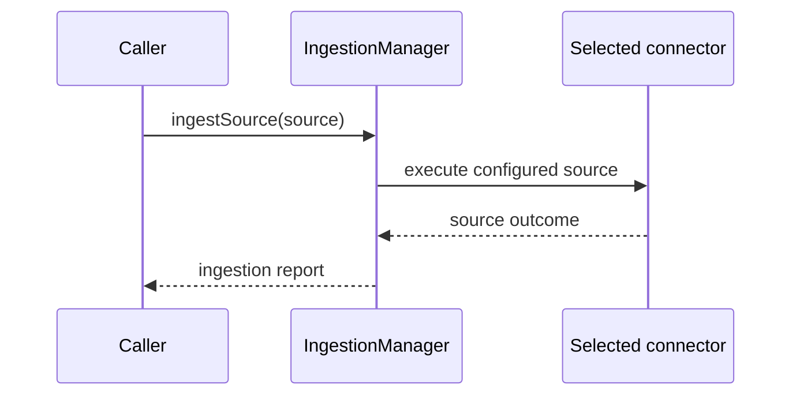

# Architecture - Ingestion Module

<!-- Status: current | validated: 2026-10-31 | RAG integration source review: 2026-11-13 -->
<!-- Links: README.md · API.md · IMPLEMENTATION.md · ROADMAP.md -->

> Exact model backend not verifiable from final document text alone.

## Kontext

This document describes module boundaries and verified runtime paths for
maintainers and integrators. Public declarations live in `include/ingestion/`;
implementations live in `src/ingestion/`. Connector-specific limits,
persistence, and security properties must be checked at the concrete call site.

## Komponenten

1. Source selection and connector intake
- `IngestionManager` stores `SourceConfig` and selects a connector by
  `SourceType`; connectors report their own availability and errors.
- Current types cover filesystem, API, database, Kafka, object storage,
  HuggingFace, web crawler, CDC, and plugin sources. Do not infer a protocol
  variant or shared option support from the enum alone.

2. Manager and coordination
- Manager APIs support per-source execution, aggregate `ingestAll()`, optional
  retry/rate-limit/checkpoint/quarantine configuration, and in-process control.
- `IngestionCoordinator` partitions configured sources across worker nodes and
  aggregates returned reports. Its default shared checkpoint/leader-election
  components are in-memory.

3. Validation and quality
- Schema and semantic validation plus optional quality-judge evaluation are
  distinct operations; their behavior depends on configuration and backend
  availability.

4. Workflow and output adapters
- `WorkflowEngine` executes an ordered step list over `ExtractionContext` and
  returns assembled entities.
- Graph/vector/document/tensor sink interfaces are separate adapters. The
  filesystem workflow branch currently increments processed counters without
  handing the returned entity set to a sink.

### RAG bridge integration (path-specific source evidence; 2026-11-13)

The [RAGIngestionBridge](../rag/rag_ingestion_bridge.cpp) constructs an
`ExtractionContext` for the workflow but does not set
`ctx.manifest.file_id` before execution. The [chunk embedding step](steps/chunk_embed_step.cpp)
forms chunk IDs from `manifest.file_id` and the chunk sequence. If no earlier
workflow step supplies that ID, chunks from distinct documents can receive
the same IDs. The fallback path creates IDs from `doc_id + "#0"`; it is a
separate path and does not repair IDs already produced by the workflow.

The bridge stamps `source_file_id` after the workflow, which does not repair
the chunk ID. It also logs vector-write failures but returns a successful
`IndexResult`; graph-writer results are discarded. Therefore that result does
not prove all configured sinks completed. Separately,
`IngestionSinkBundle::writeAll()` is ordered and fail-fast, but the inspected
implementation does not roll back earlier sink writes. These observations
apply to the inspected call paths, not to every ingestion workflow.

## Schnittstellen

| Contract | Behavior |
|---|---|
| connector contract | source-specific intake and structured outcomes; capability varies |
| control contract | configurable retry/rate/checkpoint/quarantine behavior; defaults and durability vary |
| quality contract | configured validation/judge outcomes; unavailable inference may leave a score unevaluated |
| workflow contract | ordered step execution returning extraction/entity data; sink delivery is not implied |

## Datenfluss

- `IngestionManager` selects and invokes a configured source connector; reports
  retain per-source outcomes and may represent partial success.
- When enabled, the workflow engine executes its ordered steps and returns
  extraction/entity data. Sink delivery is a separate adapter boundary.
- The filesystem workflow branch currently increments processed counters
  without handing the returned entity set to a sink.
- `IngestionCoordinator` partitions configured sources across workers and
  aggregates returned reports; its default shared checkpoint/leader-election
  components are in-memory.

## Sequenz (kritischer Ablauf)

**Kurzinterpretation:** This sequence shows the per-source dispatch boundary.
Workflow execution, sink writes, and coordinator behavior are optional or
separate paths; a returned report alone does not establish persistence.

## Fehlerpfade und Resilienz

- invalid input/schema/connectors fail with explicit structured outcomes.
- reports can contain partial success and must be checked per source.
- admin control is in-process; caller owns network exposure and authorization.
- the default coordinator stores are not durable or shared across processes.

## Evidence

Verified against `include/ingestion/ingestion_manager.h`,
`include/ingestion/ingestion_coordinator.h`,
`include/ingestion/workflow_engine.h`, `include/ingestion/ingestion_sinks.h`,
`src/ingestion/ingestion_manager.cpp`, and
`src/ingestion/ingestion_coordinator.cpp`, plus the RAG bridge and chunk
embedding call paths described above. Focused behavior tests are registered
through `tests/ingestion/CMakeLists.txt`; see [`MODULE_GUIDE.md`](./MODULE_GUIDE.md).

## Nicht-Ziele

- This architecture page does not certify durability, end-to-end atomicity,
  production capacity, or shared multi-host checkpoint behavior.
- It does not claim that every successful report resulted in persisted data.
- It does not establish server/RAG call sites or integration ownership without
  caller-side source evidence.

## Verweise

- [Module README](README.md) · [API contract](API.md) ·
  [Implementation notes](IMPLEMENTATION.md) · [Module guide](MODULE_GUIDE.md)
- [`ingestion_manager.h`](../../include/ingestion/ingestion_manager.h) ·
  [`ingestion_coordinator.h`](../../include/ingestion/ingestion_coordinator.h) ·
  [`workflow_engine.h`](../../include/ingestion/workflow_engine.h) ·
  [`ingestion_sinks.h`](../../include/ingestion/ingestion_sinks.h)
- Focused behavior tests are registered through
  [`tests/ingestion/CMakeLists.txt`](../../tests/ingestion/CMakeLists.txt).