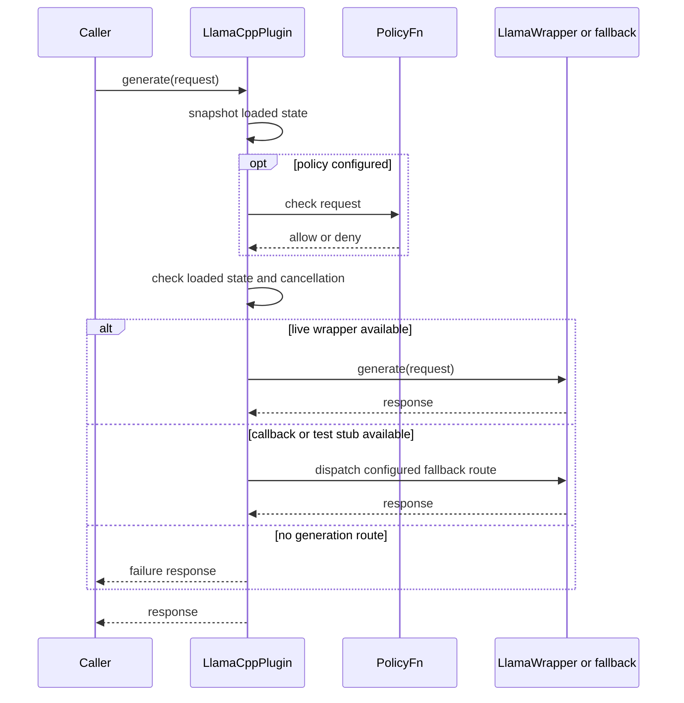

> Exact model backend not verifiable from final document text alone.

# llama_cpp Plugin — Architecture Guide

This page describes the module boundaries and runtime paths implemented in
`src/llama_cpp/`. The public contracts are in
[`../../include/llama_cpp/llama_cpp_plugin.h`](../../include/llama_cpp/llama_cpp_plugin.h)
and [`../../include/llm/llm_plugin_interface.h`](../../include/llm/llm_plugin_interface.h).

## Kontext

`LlamaCppPlugin` adapts `ILLMPlugin` to an optional `LlamaWrapper` backend. The module
CMake target is a static C++17 library; the `THEMIS_LLM_PLUGIN()` export macro
provides C-linkage entry points when plugin export support is enabled.

## Komponenten

| Component | Responsibility |
|---|---|
| `llama_cpp_plugin.cpp` | Model state, generation, RAG assembly, embeddings, LoRA operations, statistics, and export entry points |
| `llama_cpp_registrar.cpp` | Creates the plugin/adapter and registers it with `LLMPluginManager` |
| `llama_cpp_plugin_validation_gates.cpp` | Separate model-validation helpers and C-linkage validator exports |
| `LlamaWrapper` | Optional real inference implementation, compiled in when the parent build enables `THEMIS_ENABLE_LLM` (`THEMIS_LLM_ENABLED` in this module) |

Model training, transport, caller authentication, and authorization are outside
this module. The validator helpers are not automatically called by `loadModel()`.

## Modelllebenszyklus

`loadModel(path, config)` records the supplied path and context length. It forwards
`n_gpu_layers`, `n_ctx` or `context_length`, `n_batch`, and `n_threads` to
`LlamaWrapper` when the real backend is compiled in and the path is non-empty.
Response caching and continuous batching are disabled for the wrapper instance.
An optional `verify_model_digest` / `expected_model_digest` comparison is performed
only after wrapper loading succeeds; the current digest is FNV-64, not a
cryptographic integrity or authenticity check.

Wrapper construction/load exceptions are caught. If no wrapper is installed and
the digest check has not failed, `loadModel()` still sets `model_loaded_` and
returns `true`. Therefore the loaded flag, `getModelInfo()`, and the return value
are not proof of usable model inference. Production readiness requires a real
inference probe against the deployed model.

`unloadModel()` clears the plugin state, LoRA registry, and wrapper. Registrar
startup is a no-op success when no non-empty `llm.model_path` is configured;
otherwise it creates and registers the plugin.

## Schnittstellen

The public plugin contract is `themis::llamacpp::LlamaCppPlugin` implementing
`themis::llm::ILLMPlugin`. The registrar exposes plugin/adapter creation,
`registerWithLLMManager()`, and `initFromServerConfig()`. Configuration keys
include `model_path`, `context_length` or `n_ctx`, `n_gpu_layers`, `n_batch`,
`n_threads`, and the optional digest-check settings.

## Datenfluss

### Generation

`generate()` snapshots the model-loaded flag, then evaluates an installed
`PolicyFn`, checks that the plugin is marked loaded, and checks a supplied
cancellation token before dispatch. Backend selection is:

1. `LlamaWrapper::generate()` when a live wrapper exists.
2. The injected `GenerateFn`, when configured.
3. Synthetic echo/tool output only when `THEMIS_LLAMA_CPP_STUB_MODE` is defined.
4. A failure response when no route is available.

The policy callback is optional and is not authentication or authorization by
itself. The test stub and injected callback are not model inference.

### RAG

`generateRAG()` snapshots model state and context length, converts input documents
to retrieved chunks, and uses `RAGContextAssembler` to fit context and response
budgets. The default mode concatenates selected chunk content with the request.
`tensor_hybrid` and `tensor_prefix` compact high-relevance chunks into bounded
memory slots; these are prompt-assembly modes, not a separate model or retriever.
The augmented request is dispatched through `generate()`.

### Embeddings

`embed()` returns an empty vector when the plugin is not marked loaded. Otherwise
it tries the wrapper and then an injected `EmbedFn`; absent a non-empty result, it
returns 384 zeroes. The zero-vector path is a fallback contract, not a semantic
embedding. Capability flags do not indicate that a usable embedding backend is
active.

### LoRA

`loadLoRA()` replaces/adds `{id, path, scale}` metadata in the plugin registry;
that operation alone does not activate weights. `importLoRA()` rejects data below
8 bytes, above 2 GiB, or without GGUF magic before delegating to a live wrapper.
Without a wrapper, validation success does not load adapter weights. `exportLoRA()`
returns an empty result if no wrapper is available.

## Sequenz (kritischer Ablauf)



Kurzinterpretation: generation follows a policy/state/cancellation check before
dispatch; only a live wrapper performs real model inference, while callback and
test-stub routes have distinct behavior.

## Fehlerpfade und Resilienz

- Digest mismatch returns `false` and leaves the plugin unloaded.
- Wrapper initialization/load failure may leave no real wrapper while
  `loadModel()` reports success; confirm readiness with actual inference.
- An unloaded plugin, policy denial, pre-dispatch cancellation, or unavailable
  generation route returns a failure response. Test-only synthetic output
  requires `THEMIS_LLAMA_CPP_STUB_MODE` and does not bypass earlier state checks.
- Embedding failure falls through to the injected callback and then a zero vector;
  callers must reject fallback vectors before production indexing.
- The independent validation helpers do not establish that checks ran during
  normal loading.
- `generateBatch()` invokes `generate()` sequentially and preserves request order.

## Nicht-Ziele

The plugin does not own model training, retrieval ranking, transport,
authentication, tenant authorization, admission control, cryptographic model
attestation, or deployment rollback. Its static capability flags and model-loaded
flag are not production readiness probes.

## State, concurrency, and observability

The mutex protects selected lifecycle, registry, callback, and wrapper operations.
It is not a blanket guarantee that every public method or backend call is
serialized; generation dispatch and some state reads occur outside a held lock.
Performance counters (`inference_count`, `error_count`, and
`stream_retry_count`) are atomic. `getCapabilities()` advertises static interface
support and is not a readiness probe; statistics expose counters and model
metadata, not latency histograms.

## Validation and tests

Focused module tests are defined by
[`../../tests/llama_cpp/CMakeLists.txt`](../../tests/llama_cpp/CMakeLists.txt);
they exercise contract and test-stub behavior, not production model quality.
The repository validation entry points are:

```bash
ctest --preset windows-release -R 'llama_cpp' --output-on-failure
python scripts/check_module_direct_doxygen.py --module llama_cpp
```

## Verweise

See [`README.md`](README.md), [`ROADMAP.md`](ROADMAP.md), and
[`PRODUCTION_REQUIREMENTS.md`](PRODUCTION_REQUIREMENTS.md) for user-facing usage,
delivery status, and deployment gates.
