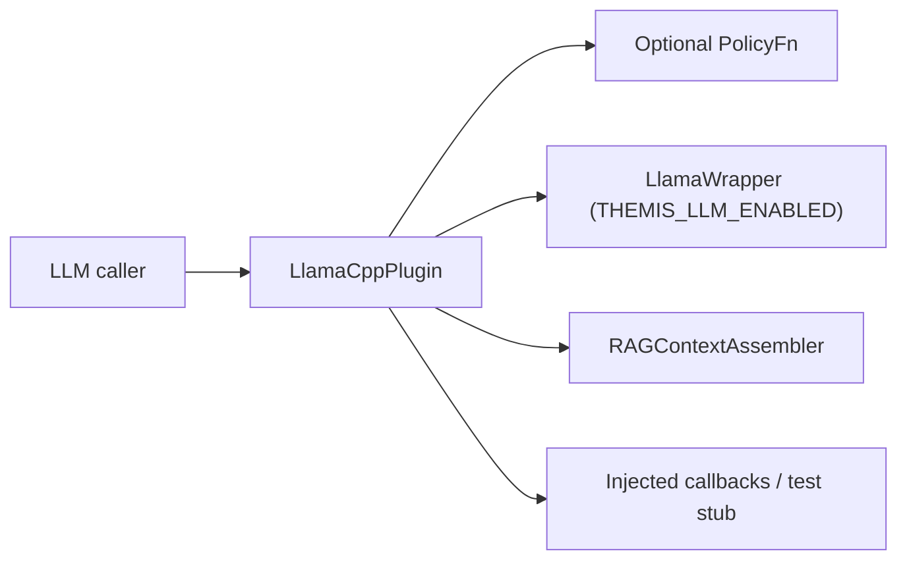

> Exact model backend not verifiable from final document text alone.

<!-- Links: ARCHITECTURE.md · ROADMAP.md · FUTURE_ENHANCEMENTS.md -->

# llama_cpp LLM Backend Plugin

LLM backend plugin for ThemisDB implementing the `ILLMPlugin` interface. The module
target is a static C++17 library; the plugin export macro supplies C-linkage entry
points when the plugin is built with export support.

## Zweck

`LlamaCppPlugin` adapts the optional `LlamaWrapper` backend to the plugin interface.
It exposes generation, RAG prompt assembly, embeddings, LoRA metadata/import-export,
capability reporting, and performance counters. A synthetic generation path is
compiled only for focused tests; it is not a production model backend.

## Scope

**In scope:** Plugin lifecycle (`loadModel`/`unloadModel`), text generation (`generate`),
RAG-augmented generation (`generateRAG`), sentence embeddings (`embed`), LoRA adapter
management (`loadLoRA`/`unloadLoRA`/`listLoRAs`), capabilities reporting, performance stats.

**Out of scope:** Model weight training (handled by `training` module), KV-cache paging
(handled by `InferenceEngineEnhanced`), gRPC/REST transport (handled by `api` module).

## Relevant Interfaces

- `include/llm/llm_plugin_interface.h` — `ILLMPlugin`, `THEMIS_LLM_PLUGIN()`
- `include/llama_cpp/llama_cpp_plugin.h` — `LlamaCppPlugin`
- `include/llama_cpp/llama_cpp_registrar.h` — registration helpers and hot-reload callback type
- `src/llama_cpp/llama_cpp_plugin.cpp` — plugin implementation and dynamic loading entry points
- `src/llama_cpp/llama_cpp_registrar.cpp` — registrar factory/registration helpers

## Current Delivery Status

**Readiness:** Real inference is available when the build enables
`THEMIS_LLM_ENABLED` and a usable `LlamaWrapper` has loaded a model. Test-only
fallbacks and advertised capability flags are not evidence of production readiness.
In particular, `loadModel()` can return `true` after wrapper initialization or load
failure; run a real-backend inference probe before admitting traffic.

## Quickstart (Build/Run)

Build and run the focused module tests with the repository preset:

```bash
cmake --preset windows-release
cmake --build --preset windows-release
ctest --preset windows-release -R 'llama_cpp' --output-on-failure
python scripts/check_module_direct_doxygen.py --module llama_cpp
```

The focused targets use test fixtures and compile-time stub mode; they do not
validate loading a production model or its output quality. Use an approved model
artifact and an LLM-enabled build for real-backend validation.

### C++ example

```cpp
#include "llama_cpp/llama_cpp_plugin.h"

// Load a concrete model path and config before generating.
themis::llamacpp::LlamaCppPlugin plugin;
const nlohmann::json cfg = {
    {"model_path", "/models/demo.gguf"},
    {"n_ctx", 4096},
    {"n_gpu_layers", 20}
};
plugin.loadModel("/models/demo.gguf", cfg);

themis::llm::InferenceRequest req;
req.prompt = "Was ist ThemisDB?";
auto resp = plugin.generate(req);
if (!resp.success) {
    // Handle the backend error; do not treat loadModel() returning true
    // as proof that a real model is available.
}

// Dynamic loading
auto* p = themis_llm_create();
// ... use p as ILLMPlugin* ...
themis_llm_destroy(p);
```

## API/CLI Einstieg

The public plugin and registrar declarations are in
[`../../include/llama_cpp/llama_cpp_plugin.h`](../../include/llama_cpp/llama_cpp_plugin.h)
and [`../../include/llama_cpp/llama_cpp_registrar.h`](../../include/llama_cpp/llama_cpp_registrar.h).
There is no standalone command-line interface; server startup uses
`LlamaCppPluginRegistrar::initFromServerConfig()`.

## Integrationsueberblick



Kurzinterpretation: the plugin applies its optional policy gate and dispatches
requests to the configured wrapper, RAG assembler, or explicitly injected/test
routes; the caller remains responsible for production readiness and access policy.

## Architecture Overview

```
┌────────────────────────────────────────┐
│         ILLMPlugin                     │  (include/llm/llm_plugin_interface.h)
└──────────────────┬─────────────────────┘
                   │ implements
       ┌───────────▼───────────────┐
       │     LlamaCppPlugin        │
       │  ┌───────────────────┐    │
       │  │  LoRA registry    │    │  vector<LoRAEntry>
       │  └───────────────────┘    │
       │  ┌───────────────────┐    │
       │  │  std::mutex       │    │  thread-safe load/unload
       │  └───────────────────┘    │
       └───────────────────────────┘
```

## Dependencies

| Dependency | Required | Purpose |
|---|---|---|
| `nlohmann_json` | ✅ | config, stats, and policy metadata |
| `llama.cpp` | ✅ when `THEMIS_LLM_ENABLED` is on | real inference backend via `LlamaWrapper` |
| `spdlog` | ✅ | operational logging for RAG and inference paths |

## Runtime Configuration Surfaces

`loadModel(model_path, config)` and registrar helpers consume JSON configuration:

| Key | Type | Behavior |
|---|---|---|
| `model_path` | string | Non-empty path triggers `LlamaWrapper` initialization when LLM backend is compiled in |
| `context_length` | number | Context window override (fallback key) |
| `n_ctx` | number | Preferred context window key forwarded to wrapper config |
| `n_gpu_layers` | number | GPU layer offload hint for llama.cpp |
| `n_batch` | number | Batch-size hint forwarded to wrapper |
| `n_threads` | number | CPU thread hint forwarded to wrapper |

## Known Limitations

- `loadModel()` reads context settings from `context_length` or `n_ctx`. With `THEMIS_LLM_ENABLED` and a non-empty path it attempts wrapper initialization. A caught wrapper failure can leave `wrapper_` empty while `model_loaded_` becomes true and the method returns true; readiness requires a real inference probe.
- `generate()` applies an installed policy callback, checks plugin state and pre-dispatch cancellation, then uses the wrapper, an injected `GenerateFn`, or the test-only stub path. Without a usable route it returns `success=false`; the test stub is enabled by `THEMIS_LLAMA_CPP_STUB_MODE`.
- `generateRAG()` assembles bounded context with `RAGContextAssembler` and dispatches through `generate()`. Its optional tensor modes compact retrieved chunks; they do not provide model training or retrieval ranking.
- `embed()` returns an empty vector when the plugin is not marked loaded. Otherwise it tries the wrapper and injected `EmbedFn`, then returns a 384-element zero vector if neither provides a result. The zero vector is not a semantic embedding.
- `generateBatch()` is sequential and preserves request order; it is not a parallel batch backend.
- `loadLoRA()` stores/replaces registry metadata; it does not activate adapter weights. `importLoRA()` checks minimum size, a 2 GiB maximum, and GGUF magic before optional wrapper delegation. Without a wrapper, validated bytes do not load weights.
- The optional model-digest comparison uses FNV-64, not a cryptographic hash or authenticity check. The separate validation-gate helpers are not automatically invoked by `loadModel()`.

## Dynamic Loading Entry Points

| Symbol | Signature |
|---|---|
| `themis_llm_create` | `ILLMPlugin* ()` |
| `themis_llm_destroy` | `void (ILLMPlugin*)` |

The registrar helper `LlamaCppPluginRegistrar::initFromServerConfig()` is the startup integration point and registers the plugin under the `llama_cpp` name when a non-empty `llm.model_path` is configured.

## Installation

This module is built as part of ThemisDB. See the root `CMakeLists.txt` for build configuration.

## Usage

The implementation files in this module are compiled into the ThemisDB library.
See [`../../include/llama_cpp/README.md`](../../include/llama_cpp/README.md) for the public API.

## Troubleshooting

- **`generate()` returns "model not loaded"**: call `loadModel()` and provide a valid non-empty model path.
- **Output stays in fallback mode**: verify the build enables `THEMIS_LLM_ENABLED` and that model loading succeeds.
- **Embedding quality is always zero/flat**: ensure real backend embedding path is active (wrapper or injected `EmbedFn`).
- **Registrar hot-reload does not activate model**: pass `config["model_path"]` when using `LlamaCppPluginRegistrar`.
- **Short/trimmed RAG responses**: tune `n_ctx` / `context_length`, `request.max_tokens`, and `rag_context.response_budget_tokens`.

## Verweise

- [`ARCHITECTURE.md`](ARCHITECTURE.md)
- [`ROADMAP.md`](ROADMAP.md)
- [`FUTURE_ENHANCEMENTS.md`](FUTURE_ENHANCEMENTS.md)
- [`SECURITY.md`](SECURITY.md)
- [`PRODUCTION_REQUIREMENTS.md`](PRODUCTION_REQUIREMENTS.md)
- [`PERFORMANCE_EXPECTATIONS.md`](PERFORMANCE_EXPECTATIONS.md)
- [`../../docs/en/llama_cpp/index.md`](../../docs/en/llama_cpp/index.md)
- [`../../docs/de/llama_cpp/index.md`](../../docs/de/llama_cpp/index.md)
