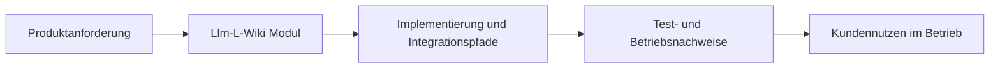

# Llm-L-Wiki in ThemisDB

## Ueberblick
Das Modul llm_l_wiki ist in den vorhandenen Modulquellen als eigenstaendiger Verantwortungsbereich innerhalb der ThemisDB-Plattform beschrieben. Im Modulkontext werden Aussagen nur aus den verfuegbaren modulnahen Quellen uebernommen. Im Betrieb sind dabei insbesondere [Latenz](https://en.wikipedia.org/wiki/Latency_(engineering)), [Observability](https://en.wikipedia.org/wiki/Observability) und [Determinismus](https://en.wikipedia.org/wiki/Deterministic_algorithm) relevante Qualitaetskriterien. Fuer Querschnittskontext wird das Modul mit den relevanten Stellen im [Compendium](./../../docs/compendium/docs/index.md) verknuepft.

## Kern-Features im Detail
Die erste Kernfaehigkeit ist **Stabile Integrations- und Fehlerpfade fuer angrenzende Komponenten**. Das beschreibt einen konkreten, in den Modulquellen referenzierten Verantwortungsbereich.

Die zweite Kernfaehigkeit ist **Nachvollziehbare Laufzeitgrenzen fuer Tests, Betrieb und Incident-Analyse**. Dadurch bleiben Integrationspfade zwischen Modulgrenzen reproduzierbar und operativ auswertbar.

Die dritte Kernfaehigkeit ist **Verifizierbare Grundlage fuer Release- und Abnahmeentscheidungen im Modulkontext**. Das unterstuetzt stabile Abnahme- und Aenderungsprozesse entlang der Modul-Roadmap.

## Kundennutzen und Abgrenzung
Kundinnen und Kunden erhalten damit vor allem besser planbares Systemverhalten, kuerzere Eingrenzungszeiten bei Stoerungen und transparentere Release-Risiken. Diese Seite ist ein fachlich-kommunikativer Ueberblick; normative API-, Compliance- und Freigabeaussagen verbleiben in den kanonischen Modulquellen.

## Einordnung und Quellen
Primaere modulnahe Quellen: Keine modulnahen kanonischen Dateien gefunden. Sekundaere Querschnittsquellen: [Compendium Index](./../../docs/compendium/docs/index.md). Aussagen wurden auf diese Quellenbasis begrenzt; bei fehlenden Modulquellen werden keine weitergehenden Produktclaims ergänzt.
