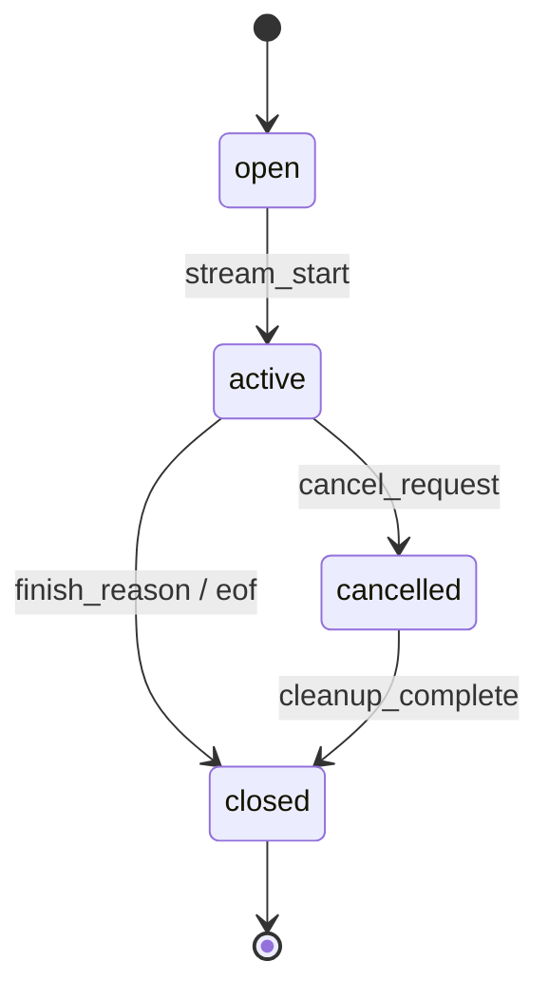
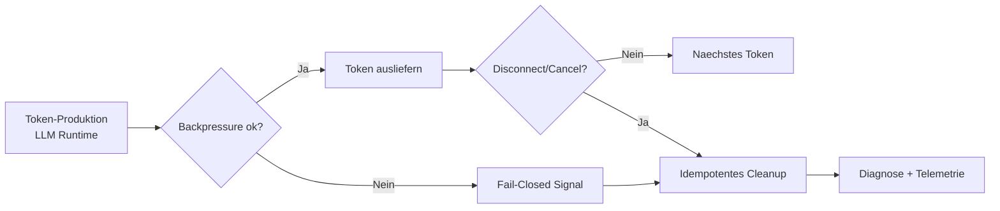

# LLM-Streaming in ThemisDB

Streaming ist fuer [Large Language Models (LLMs)](https://en.wikipedia.org/wiki/Large_language_model) nicht nur ein Komfortmerkmal, sondern ein Kernprinzip fuer nutzbare KI-Interaktion. Die grundsätzliche Idee ist einfach: statt erst am Ende einer langen Generierung die gesamte Antwort zu liefern, werden [Token](https://en.wikipedia.org/wiki/Lexical_analysis#Token) schrittweise ausgegeben. Das verbessert die wahrgenommene [Latenz](https://de.wikipedia.org/wiki/Latenz_(Kommunikation)) unmittelbar, macht Teilergebnisse schon während der Berechnung verwertbar und erlaubt eine saubere Kontrolle von Abbruch, Kosten und Betriebsrisiko. In produktiven Systemen ist genau diese Steuerbarkeit entscheidend, weil Antwortzeit, Token-Kosten, Benutzererfahrung und Systemstabilität gleichzeitig beeinflusst werden.

In ThemisDB wird dieses allgemeine Prinzip als plattformweiter Vertragsrahmen konkretisiert. LLM-Laufzeit, [Server](./../server/FEATURES.md), Query- und [RAG](https://en.wikipedia.org/wiki/Retrieval-augmented_generation)-Orchestrierung sowie die Client-Protokolle teilen dieselben Regeln für Lebenszyklus, Reihenfolge, Fehlerbehandlung und Diagnose. Die Architektur ist damit nicht nur „LLM-geeignet“, sondern in ein umfassenderes System aus Datenfluss, Streaming-Events und Operator-Visibility eingebettet. Das zeigt sich etwa in den AQL- und RAG-Pfaden, die in [LLM-Integration](./../../docs/compendium/docs/chapter_17_llm_integration.md#171-llm-funktionen-in-aql) beschrieben werden, sowie in den stream-orientierten Real-time-Prinzipien aus [CDC- und Event-Semantik](./../../docs/compendium/docs/chapter_11_realtime.md#112-cdc-architektur-und-datenmodell). Die Auslieferung selbst erfolgt protokollnah über [gRPC-Streaming](https://en.wikipedia.org/wiki/GRPC) und [Server-Sent Events (SSE)](https://en.wikipedia.org/wiki/Server-sent_events), sodass interaktive Antworten über unterschiedliche Client-Arten konsistent steuerbar bleiben.

Das ist in ThemisDB besonders wichtig, weil LLM-Anwendungen selten isoliert laufen. Sie bilden sich meist aus Retrieval, Kontextanreicherung, Prompt-Logik und nachgelagerter Verarbeitung zusammen. Wenn ein Stream ausfällt, kippt nicht nur eine einzelne Antwort, sondern auch die Verbindung von Nutzererwartung, Systemlast und operationaler Diagnose. Deshalb behandelt ThemisDB Streaming als Betriebs- und Qualitätskonzept, nicht nur als UI-Feature.

Die Kernfähigkeit ist ein deterministischer Stream-Lebenszyklus. Jeder Stream wird explizit geöffnet, aktiv betrieben und sauber beendet oder abgebrochen. Das verhindert uneindeutige Zustandswechsel, reduziert race-condition-ähnliche Übergänge und macht Cleanup-Vorgänge reproduzierbar. Die Abbildung zeigt den allgemeinen Ablauf: Start, aktive Auslieferung, kontrollierter Abschluss oder klarer Abbruch.

Die zweite Kernfähigkeit ist tokengenaue Auslieferung mit Reihenfolgegarantie pro Stream. Das ist keine rein technische Feinheit, sondern ein Qualitätsmerkmal für verständliche und nachvollziehbare Antworten. Wenn Sequenzen kippen, geraten Kontextaufbau, Zwischenstände und UI-Verhalten auseinander. Deshalb werden Reihenfolgeverletzungen als explizite Fehler behandelt, diagnostiziert und nicht still überdeckt. Diese Logik folgt den gleichen Grundprinzipien wie geordnete Event-Verarbeitung in [Change Data Capture](https://en.wikipedia.org/wiki/Change_data_capture)- und [Event-Sourcing](https://en.wikipedia.org/wiki/Event_sourcing)-Systemen.

Die dritte Kernfähigkeit ist kontrolliertes Last- und Fehlerverhalten. [Backpressure](https://en.wikipedia.org/wiki/Back_pressure_(computer_science)), Buffer-Grenzen, Disconnects und Cancel-Signale werden als Fail-Closed-Pfade modelliert: Ein Problem führt zu einem klaren Zustand, messbarer Telemetrie und definiertem Cleanup statt zu stiller Degradation. In ThemisDB bedeutet das konkret, dass Stream-Sessions über `stream_id` operativ nachvollzogen werden und Störbilder über konsistente Signalnamen sichtbar bleiben, etwa `[LLM_STREAM:BufferOverflow]`, `[LLM_STREAM:GenerationStall]`, `[LLM_STREAM:BackpressureCascade]` oder `[LLM_STREAM:TokenOrderViolation]` (siehe [RUNBOOK_LLM_STREAMING.md](./../../docs/operability/RUNBOOK_LLM_STREAMING.md)). Dadurch können Support- und Plattformteams nicht nur Symptome sehen, sondern Ursachenpfade entlang von Produktion, Transport und Konsument reproduzierbar eingrenzen.

Gerade für RAG-Workflows ist diese Verbindlichkeit zentral, weil Retrieval, Kontextanreicherung und Generierung eng gekoppelt sind und ein Streaming-Fehler unmittelbar die fachliche Verwertbarkeit der Antwort beeinträchtigen kann (vgl. [RAG-Ablauf](./../../docs/compendium/docs/chapter_17_llm_integration.md#173-rag-retrieval-augmented-generation)). Stabiler Stream-Vertrag bedeutet hier direkt stabilere Antwortqualität.

Für Kundinnen und Kunden entsteht daraus vor allem planbare interaktive KI im Betriebsalltag: Antworten sind früher sichtbar, Sitzungen bleiben auch unter Last steuerbar, und Incident-Situationen können anhand klarer Zustands- und Telemetriesignale schneller eingegrenzt werden. Das verbessert die Time-to-Value in Assistenz-, Analyse- und Support-Szenarien und reduziert zugleich das Risiko schwer reproduzierbarer Live-Probleme in produktionsnahen Umgebungen. Wirtschaftlich bedeutet das kürzere Wartezeiten in nutzerführenden Prozessen, besser kontrollierbare Token-Kosten durch frühe Abbruchfähigkeit und stabilere Service-Qualität bei Lastspitzen.

Gleichzeitig ist die Abgrenzung bewusst transparent: [FEATURES.md](./FEATURES.md) beschreibt den fachlich-kommunikativen Vertragsrahmen, während normative Implementierungs- und Release-Evidenz in den owning Pfaden und den zugehörigen Governance-Artefakten liegt (insbesondere [README.md](./README.md), [ARCHITECTURE.md](./ARCHITECTURE.md), [ROADMAP.md](./ROADMAP.md), [PRODUCTION_REQUIREMENTS.md](./PRODUCTION_REQUIREMENTS.md)). Diese Trennung sorgt dafür, dass Produktversprechen, technische Nachweise und operative Runbooks konsistent zusammenpassen, statt sich über Dokumentebenen zu widersprechen.

Die textliche Grundlage dieser Seite stammt primär aus den modulnahen Quellen und wird nachgeordnet durch die operativen und narrativen Querschnittsdokumente ergänzt: [RUNBOOK_LLM_STREAMING.md](./../../docs/operability/RUNBOOK_LLM_STREAMING.md), [Kapitel 11 Realtime & Streaming](./../../docs/compendium/docs/chapter_11_realtime.md), [Kapitel 17 LLM-Integration](./../../docs/compendium/docs/chapter_17_llm_integration.md), [Kapitel 43 Voice & Streaming Interface](./../../docs/compendium/docs/chapter_43_voice_streaming.md) und [Incident Runbooks](./../../docs/compendium/docs/appendix_e_incident_runbooks.md). Verwendete Quellenbasis: **src + docs**.
