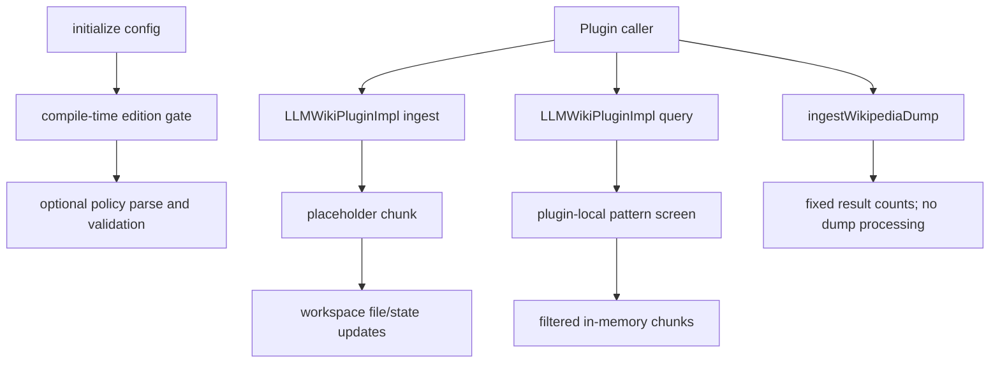

# LLM Wiki Architecture

## Kontext

The LLM Wiki module is a C++ plugin/core library, not a standalone user, ACL, or multi-backend wiki service. The public contract is `themis::plugins::llm_wiki::ILLMWikiPlugin` in [`include/llm_wiki/llm_wiki_plugin_interface.h`](../../include/llm_wiki/llm_wiki_plugin_interface.h). The module implementation and CMake target live under `src/llm_wiki/`.

The root [`ROADMAP.md`](../../ROADMAP.md) owns project-level release status. This architecture page documents current source behavior and must not be used as evidence that release or production gates have passed.

## Komponenten

| Component | Source | Current responsibility |
|---|---|---|
| Plugin contract | `include/llm_wiki/llm_wiki_plugin_interface.h`, `llm_wiki_status.h` | Typed request/result structures, plugin lifecycle and operation declarations |
| Plugin implementation | `src/llm_wiki/wikipedia/llm_wiki_plugin_impl.cpp` | Edition check, configuration parsing, current ingest/query behavior, optional policy load/reload |
| Workspace orchestrator | `src/llm_wiki/wikipedia/wiki_workspace_orchestrator.cpp` | Workspace files, page/state/log updates, basic lint and statistics |
| Edition gate | `src/llm_wiki/edition_gate.cpp` | Compile-time Enterprise/Community decision and feature checks |
| Guardrail utilities | `src/llm_wiki/guardrail_patterns.h` and a separate local matcher in the plugin implementation | Pattern screening; the plugin path uses only its local fixed-string list |
| Workspace state manager | `src/llm_wiki/workspace_state_manager.cpp`, public declaration in `include/llm_wiki/workspace_state_manager.h` | Separate JSON state persistence, checksum comparison, and attempted log recovery |
| Process policy manager | `src/llm_wiki/process_policy_manager.cpp` | YAML parsing, schema validation, and semantic invariant checks |
| Knowledge-sphere design artifacts | `src/llm_wiki/schema/knowledge_spheres.schema.json`, `process/knowledge_spheres_policy.yaml`, `runtime/knowledge_spheres.runtime.json` | Static schema/configuration examples; no current plugin loader, registry, or migration path consumes them |
| Optional RocksDB wrapper | `src/llm_wiki/rocksdb_wiki_store.cpp`, public declaration in `include/llm_wiki/rocksdb_wiki_store.h` | Low-level key/value operations when a RocksDB target is available |

There is no `WikiContextManager`, result-cache component, runtime identity provider, or plugin router in this module's current source tree.

## Schnittstellen

The public interface declares lifecycle, ingestion, query, workspace, statistics, and Wikipedia dump operations. The current implementation does not fulfill every declared behavior; see [`API.md`](API.md). `WikiContextManager`, an access-control service, a result cache, and a plugin router are not interfaces in this module.

## Datenfluss



**Kurzinterpretation:** The diagram traces current initialization, placeholder ingestion, in-memory query filtering, and the unimplemented dump operation.

The diagram describes actual source behavior and intentionally calls out incomplete operations.

## Sequenz (kritischer Ablauf)

```mermaid
sequenceDiagram
    participant C as Caller
    participant P as LLMWikiPluginImpl
    participant E as EditionGate
    participant W as WorkspaceOrchestrator
    C->>P: initialize(config_json)
    P->>E: check compile-time edition
    E-->>P: allow or deny
    opt process_policy_path is configured
        P->>P: parse, schema-validate, check invariants
    end
    C->>P: ingest(source_path, options)
    P->>W: write source reference and supplied placeholder chunk
    W-->>P: workspace operation result
    C->>P: query(text, options)
    P->>P: filter in-memory chunks; options unused
    P-->>C: filtered in-memory results
```

**Interpretation:** This sequence shows the plugin's current calls and explicitly distinguishes its in-memory query path from workspace index retrieval.

## Fehlerpfade und Resilienz

- Edition denial returns `PermissionDenied` during initialization.
- Invalid JSON or invalid configured policy produces a non-`Ok` initialization status. A failed hot reload retains the prior in-memory policy.
- Ingest before initialization and policy reload errors produce an ingestion error result; other filesystem failures can be logged while the workspace operation continues.
- Query before initialization or after policy reload failure returns an empty result. An unsafe query is empty unless `fail_open` is true.
- The workspace manager's checksum is non-cryptographic, and recovery behavior differs by parse/checksum failure; see [`RUNBOOK.md`](RUNBOOK.md).
- Plugin synchronization does not match the public thread-safety contract; details follow. `WorkspaceStateManager` callers must serialize access separately.

### Synchronization and thread-safety contract

The public interface header says all methods are thread-safe after initialization
and concurrent `query()` calls are lock-free. The implementation does not
support treating those statements as verified guarantees:

- `initialize()`, `shutdown()`, `ingest()`, `query()`, and `wikiInit()` take an
  exclusive plugin `unique_lock`; `wikiIngest()` and `wikiQuery()` delegate to
  the locked methods. In particular, queries serialize rather than run
  lock-free.
- `wikiLint()` and `stats()` access plugin members without the plugin mutex.
  Their calls into the workspace orchestrator take its separate mutex, but
  that does not protect the plugin's `workspace_` pointer or `workspace_root_`
  from concurrent lifecycle or other plugin calls.

The API/source contract remains unresolved because this task is
documentation-only. Callers should serialize all plugin calls, including
`wikiLint()` and `stats()`, until the contract and implementation are aligned.

### Initialization

`LLMWikiPluginImpl::initialize(config_json)` checks the compile-time edition gate, parses JSON settings, and loads a process policy only when `process_policy_path` is supplied. Optional hot reload checks the file timestamp and keeps the previous in-memory policy if a candidate fails validation. An empty JSON string returns `Ok` before setting `initialized_`; callers should provide the expected non-empty configuration and check the returned status.

The policy manager validates policy structure and selected invariants. Although the YAML describes process stages, schedules, telemetry, and rollout, the current plugin does not implement that complete orchestration/ML control plane in its request paths.

### Ingestion

`ingest()` takes the plugin's exclusive mutex, rejects use before initialization or after policy reload failure, and creates a generic placeholder chunk when the configured glob matches. The workspace orchestrator copies the source file when possible and writes a Markdown page containing the supplied chunks, updates workspace metadata/state, rebuilds the index file, and appends a log entry. The current plugin does not read and split the source file into content chunks; filesystem copy failure is logged but does not itself prevent page creation.

### Query

`query()` also takes the exclusive plugin mutex. It runs the plugin-local fixed-string check against the query; a flagged query returns no candidates unless `fail_open` is enabled. If a workspace exists, it filters the in-memory chunk vector and returns the remaining chunks. The implementation does not use `top_k`, `min_score`, `save_as_page`, or `workspace_root`, and it does not invoke an index reader for retrieval.

The workspace orchestrator has a separate query method that accepts an `IWikiIndexReader`, applies top-k/min-score, and can save query results. That method is not the path used by `LLMWikiPluginImpl::query()` in this checkout.

### Wikipedia operation

`ingestWikipediaDump()` currently ignores its arguments and returns a result with fixed counts. The public declaration and availability checks must not be mistaken for an operational dump-import path.

## Persistence and policy boundaries

The workspace orchestrator stores human-readable pages and JSON workspace metadata beneath its configured root. `WorkspaceStateManager` is a distinct state representation; its checksum routine uses 64-bit FNV-1a despite the `sha256:` label, and its methods require caller-side synchronization. Neither mechanism provides cryptographic integrity or authenticated provenance.

`RocksDbWikiStore` is optional at configure/build time. CMake adds its compile definitions and linkage when it finds a supported RocksDB target, an explicit `THEMIS_ROCKSDB_TARGET`, or a recognized RocksDB package/library result. Do not infer end-to-end plugin persistence from the presence of the wrapper or a build definition alone.

## Nicht-Ziele

The current source does not establish semantic embeddings, content parsing, production query ranking, multi-backend federation, a cache, background scheduling, adaptive ML updates, production audit telemetry, a knowledge-sphere registry/migration runtime, or a release performance guarantee. Future designs in [`FUTURE_ENHANCEMENTS.md`](FUTURE_ENHANCEMENTS.md) remain planned work until code and tests demonstrate them.

## Verweise

- [`README.md`](README.md) — module scope and limitations
- [`ROADMAP.md`](ROADMAP.md) — implementation status and acceptance gates
- [`SECURITY.md`](SECURITY.md) and [`TRUST.md`](TRUST.md) — security boundaries
- [`PRODUCTION_REQUIREMENTS.md`](PRODUCTION_REQUIREMENTS.md) — release-readiness requirements
- [`PERFORMANCE_EXPECTATIONS.md`](PERFORMANCE_EXPECTATIONS.md) — performance evidence requirements

> Exact model backend not verifiable from final document text alone.
