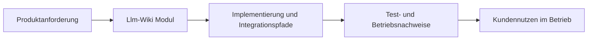

# Llm-Wiki in ThemisDB

## Ueberblick
The LLM Wiki module is a standalone ThemisDB core module for semantic wiki retrieval, provenance tracking, and guardrail-enforced knowledge access. It is directly connected to the llm module for orchestration and prompt planning and to llama_cpp for local inference-backed retrieval and summarization flows. It integrates Wikipedia data ingestion with prompt injection detection, workspace state isolation, and edition-based access control for secure multi-tenant deployment. Im Modulkontext werden Aussagen mit [Architekturgrenzen](./ARCHITECTURE.md), [Release-Planung](./ROADMAP.md), [Produktionsanforderungen](./PRODUCTION_REQUIREMENTS.md) abgeglichen. Im Betrieb sind dabei insbesondere [Latenz](https://en.wikipedia.org/wiki/Latency_(engineering)), [Observability](https://en.wikipedia.org/wiki/Observability) und [Determinismus](https://en.wikipedia.org/wiki/Deterministic_algorithm) relevante Qualitaetskriterien. Fuer Querschnittskontext wird das Modul mit den relevanten Stellen im [Compendium](./../../docs/compendium/docs/index.md) verknuepft.

## Kern-Features im Detail
Die erste Kernfaehigkeit ist **based Q&A with safe knowledge retrieval**. Das beschreibt einen konkreten, in den Modulquellen referenzierten Verantwortungsbereich.

Die zweite Kernfaehigkeit ist **category guardrail patterns)**. Dadurch bleiben Integrationspfade zwischen Modulgrenzen reproduzierbar und operativ auswertbar.

Die dritte Kernfaehigkeit ist **Phase 3 error handling + partial Phase 4 test suite complete**. Das unterstuetzt stabile Abnahme- und Aenderungsprozesse entlang der Modul-Roadmap.

## Kundennutzen und Abgrenzung
Kundinnen und Kunden erhalten damit vor allem besser planbares Systemverhalten, kuerzere Eingrenzungszeiten bei Stoerungen und transparentere Release-Risiken. Diese Seite ist ein fachlich-kommunikativer Ueberblick; normative API-, Compliance- und Freigabeaussagen verbleiben in den kanonischen Modulquellen.

## Einordnung und Quellen
Primaere modulnahe Quellen: [README.md](./README.md), [ARCHITECTURE.md](./ARCHITECTURE.md), [ROADMAP.md](./ROADMAP.md), [FUTURE_ENHANCEMENTS.md](./FUTURE_ENHANCEMENTS.md), [PRODUCTION_REQUIREMENTS.md](./PRODUCTION_REQUIREMENTS.md), [SECURITY.md](./SECURITY.md). Sekundaere Querschnittsquellen: [Compendium Index](./../../docs/compendium/docs/index.md). Aussagen wurden auf diese Quellenbasis begrenzt; bei fehlenden Modulquellen werden keine weitergehenden Produktclaims ergänzt.
