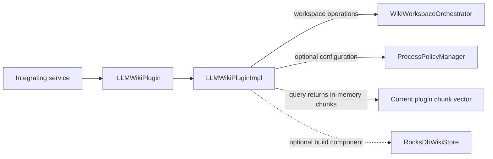

# LLM Wiki Module

## Zweck

`llm_wiki` provides a public plugin contract, a core plugin implementation, workspace files, guardrail checks, edition gating, process-policy validation, and an optional RocksDB key-value wrapper. This page describes the behavior present in this repository; it does not claim that every declared SDK operation is fully implemented or production-ready.

The program-level release posture remains governed by the root [`ROADMAP.md`](../../ROADMAP.md). Module-level implementation details and open work are in [`ARCHITECTURE.md`](ARCHITECTURE.md), [`ROADMAP.md`](ROADMAP.md), and [`MODULE_GAPS.md`](MODULE_GAPS.md).

## Scope

| Area | Canonical path |
|---|---|
| Public plugin contract and request/result types | [`include/llm_wiki/llm_wiki_plugin_interface.h`](../../include/llm_wiki/llm_wiki_plugin_interface.h) |
| Core library, edition gate, workspace manager, policy manager, plugin implementation | `src/llm_wiki/` |
| Entity and process-policy schemas | `src/llm_wiki/schema/` |
| Process-policy example | `src/llm_wiki/process/llm_wiki_process_policy.yaml` |
| Knowledge-sphere design artifacts (not loaded by the plugin) | `src/llm_wiki/schema/knowledge_spheres.schema.json`, `src/llm_wiki/process/knowledge_spheres_policy.yaml`, and `src/llm_wiki/runtime/knowledge_spheres.runtime.json` |
| Tests | `tests/llm_wiki/`, `tests/llm/`, and `tests/integration/test_llm_wiki_soak.cpp` |
| Benchmarks | `benchmarks/llm_wiki/` |

The module CMake file defines the `themis_llm_wiki` static library. RocksDB compile definitions and linkage are added when CMake finds a supported RocksDB target, an explicit `THEMIS_ROCKSDB_TARGET`, or a recognized RocksDB package/library result.

## Quickstart (Build/Run)

Configure and build using a repository CMake preset that supports the desired edition and optional dependencies. Then run the focused tests from the configured build:

```sh
cmake --preset windows-debug
cmake --build --preset windows-debug --target themis_llm_wiki
ctest --preset windows-debug -R 'llm_wiki' --output-on-failure
```

Select the appropriate test-enabled preset for the host. The repository's `windows-release` configure preset sets `THEMIS_BUILD_TESTS=OFF` by default, so CTest must use a test-enabled configuration. A CTest invocation that reports “No tests were found” is not test-pass evidence.

## API/CLI Einstieg

The public entry point is `ILLMWikiPlugin` in [`include/llm_wiki/llm_wiki_plugin_interface.h`](../../include/llm_wiki/llm_wiki_plugin_interface.h). The module does not provide a current standalone CLI entry point. See [`API.md`](API.md) for the declared SDK operations and implementation differences.

## Integrationsueberblick



**Kurzinterpretation:** The plugin delegates workspace work, optionally loads policy, and returns filtered in-memory chunks; the optional store is not shown as wired into the query path.

The diagram shows current component calls, not production-quality indexed retrieval. In particular, plugin query does not call an index reader.

## Known Limitations

- Plugin initialization checks `THEMISDB_LLM_WIKI_ENTERPRISE_ENABLED`. The current gate maps that compile-time switch to Enterprise or Community; it does not independently verify a runtime license.
- A configured process policy is parsed, schema-validated, and checked for invariants. Supplying a policy path is optional, and hot reload is separately opt-in. The current plugin request paths do not implement the policy's full scheduling, extraction, synthesis, or ML rollout model.
- `ingest()` creates a generic placeholder chunk for a matching path and delegates workspace-file handling. It does not parse the source file into content chunks.
- `query()` uses a small plugin-local substring filter and returns the current in-memory chunks. It ignores `WikiQueryOptions` and does not perform index retrieval. With `fail_open=true`, a flagged query is allowed to continue.
- `ingestWikipediaDump()` currently returns fixed result counts without reading the supplied dump.
- Knowledge-sphere schema, policy, and runtime JSON files are static design/configuration artifacts; the plugin and process-policy loader do not currently load or enforce them.
- The public header declares thread-safe methods and lock-free concurrent queries, but implementation locking does not meet that claim: `query()` takes an exclusive lock, while `wikiLint()` and `stats()` access plugin state without the plugin mutex. Serialize plugin calls externally until the API/source contract is reconciled; see [`API.md`](API.md).
- Workspace pages and state/log files are managed by the workspace orchestrator. `WorkspaceStateManager` is a separate persistence component; its checksum is 64-bit FNV-1a formatted with a `sha256:` prefix and is not cryptographic integrity protection.
- `RocksDbWikiStore` is an optional low-level store. Its presence does not by itself prove that the plugin's ingest/query path uses RocksDB.

## Verweise

- [`ARCHITECTURE.md`](ARCHITECTURE.md) — source-backed component and data-flow map
- [`ROADMAP.md`](ROADMAP.md) — implementation work and readiness gates
- [`API.md`](API.md) — SDK and implementation differences
- [`TRUST.md`](TRUST.md) — trust boundaries
- [`RUNBOOK.md`](RUNBOOK.md) — source-available operational checks
- [`AUDIT.md`](AUDIT.md) — source review and validation results

> Exact model backend not verifiable from final document text alone.
