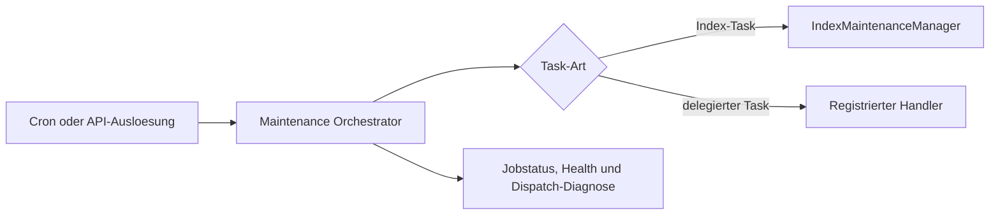

Exact model backend not verifiable from final document text alone.

# Maintenance in ThemisDB

## Ueberblick
Das Maintenance-Modul koordiniert Zeitplaene, Jobs, Task-Dispatch, optionale Zeitplan-Persistenz und Gesundheitsmeldungen. Es implementiert nicht selbst die delegierten Wartungsoperationen oder eine Transaktion ueber mehrere Tasks. Aussagen zu Laufzeitverhalten und Grenzen werden mit [Architektur](./ARCHITECTURE.md), [Implementierung](./IMPLEMENTATION.md) und [Betriebsanforderungen](./PRODUCTION_REQUIREMENTS.md) abgeglichen.

## Kern-Features im Detail
Die erste Kernfaehigkeit ist **Zeitplan- und Job-Orchestrierung**: CRUD, Cron-Registrierung, Ad-hoc-Ausloesung und Jobstatus.

Die zweite Kernfaehigkeit ist **optionale Zeitplan-Persistenz**: Ein konfigurierter `IStorageEngine` speichert Zeitplaene; beim Laden werden gueltige JSON-Eintraege wiederhergestellt und fehlerhafte Eintraege einzeln uebersprungen.

Die dritte Kernfaehigkeit ist **Task-Dispatch und Diagnose**: ausgewaehlte Index-Tasks verwenden `IndexMaintenanceManager`; andere Tasks benoetigen registrierte Handler. Health-Probes und ein begrenzter Dispatch-Ringpuffer stellen Diagnoseinformationen bereit.

## Kundennutzen und Abgrenzung
Die Orchestrierung macht Zeitplaene und Jobausgaenge zentral sichtbar. Sie garantiert weder erfolgreiche Ausfuehrung delegierter Arbeit noch Rollback bereits abgeschlossener Task-Effekte. Diese Seite ist ein Ueberblick; normative API-Aussagen verbleiben in den Headern und der [API-Dokumentation](./API.md).

## Einordnung und Quellen
Primaere Quellen: [include/maintenance/database_maintenance_orchestrator.h](../../include/maintenance/database_maintenance_orchestrator.h), [database_maintenance_orchestrator.cpp](database_maintenance_orchestrator.cpp), [maintenance_schedule_store.cpp](maintenance_schedule_store.cpp), [ARCHITECTURE.md](./ARCHITECTURE.md) und [API.md](./API.md). [Production requirements](./PRODUCTION_REQUIREMENTS.md) beschreibt normative Anforderungen, nicht den Nachweis ihrer Durchsetzung im Code.
