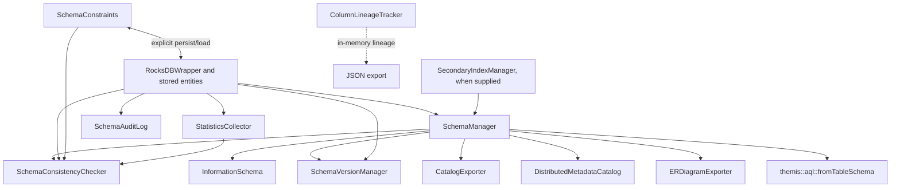

# Architecture — Metadata Module

**Author:** ThemisDB Contributors  
**Created:** 2026-10-31  
**Last Updated:** 2026-10-31  
**Status:** review  
**AI_Used:** true  
**AI_Models:** unknown  
**AI_Contributor:** GitHub Copilot coding agent / ThemisDB documentation orchestrator  
**Human_Review:** false  
**Human_Author:** ThemisDB Contributors  
**Source level:** level1 — module-local  
**SOT domain:** architecture-governance  
**Canonical source references:** [metadata public headers](../../include/metadata/), [metadata implementations](./), [build source registration](../../cmake/CMakeLists.txt), [module tests](../../tests/metadata/CMakeLists.txt)  
**Related issue / milestone:** [#7362](https://github.com/makr-code/ThemisDB/issues/7362) · DOC-WEEKLY-2026-W44

> Exact model backend not verifiable from final document text alone.

## Boundary and runtime flow

`include/metadata/` declares the public contracts; `src/metadata/` implements
the compiled module. The module describes and operates on schema/catalog
metadata. It does not own general entity storage, query execution, or embedding
generation.

- `SchemaManager` discovers table prefixes and samples stored entities to infer
  property metadata. It can obtain index descriptions from the optional index
  manager, caches schema views, and exposes explicit refresh and mutation APIs.
- `InformationSchema` constructs metadata rows from a `SchemaManager`; it is a
  read view, not an independent schema store.
- `StatisticsCollector` samples entities, caches results behind a
  `std::shared_mutex`, and persists collected statistics. Its refresh worker is
  managed through `setRefreshInterval()` / `stopRefresh()`.
- `SchemaConsistencyChecker::runCheck()` reports orphan key prefixes and, when
  collaborators are supplied, stale statistics and missing constraint
  definitions. Its orphan scan is capped at 5,000 keys; it reports findings and
  does not repair them.
- `SchemaVersionManager`, `SchemaAuditLog`, and `SchemaConstraints` are separate
  state/persistence surfaces. Constraint persistence is explicit; version
  history and audit entries are not interchangeable.
- `ColumnLineageTracker` is an in-memory, thread-safe tracker. Its JSON export
  does not itself persist lineage.
- `CatalogExporter` publishes Atlas/DataHub payloads over HTTP.
  `IMetadataExportPolicy` is a separate interface and is not accepted by the
  current exporter API.
- `DistributedMetadataCatalog` delegates through a non-owning
  `MetadataShardRouter` reference. `InMemoryMetadataSnapshotStore` is explicitly
  in-memory, not durable.

## Synchronization and failure boundaries

Thread-safety is per interface, not a module-wide guarantee. `SchemaManager`
uses a shared mutex for cache access; `StatisticsCollector` uses a shared mutex
for cache reads/writes. `SchemaVersionManager` and `SchemaConstraints` require
external synchronization. `SchemaConsistencyChecker::runCheck()` is thread-safe,
but its background start/stop calls must not race each other. Consult each
owning header for other classes' guarantees and non-owning dependencies.

Malformed input, missing records, storage errors, and external-service failures
have API-specific outcomes (`bool`, `std::optional`, typed result objects,
`PublishResult`, or exceptions). Callers must preserve these distinctions; a
failed or empty result is not a general health signal.

## Build and test registration

- The standard source list registers metadata implementation files in
  [`cmake/CMakeLists.txt`](../../cmake/CMakeLists.txt). In the modular build,
  distributed-catalog compilation is registered with the sharding components
  in [`cmake/ModularBuild.cmake`](../../cmake/ModularBuild.cmake).
- Focused test targets are registered in
  [`tests/metadata/CMakeLists.txt`](../../tests/metadata/CMakeLists.txt), which
  is discovered by the test CMake module scan. The registration file is the
  authority for target names, labels, and timeouts.
- Optional benchmarks are registered by
  [`benchmarks/metadata/CMakeLists.txt`](../../benchmarks/metadata/CMakeLists.txt)
  when the benchmark build is enabled. Benchmark source presence is not evidence
  that a run or release gate passed.

For symbol-level contracts, see [`API.md`](./API.md); for code ownership and
test mapping, see [`IMPLEMENTATION.md`](./IMPLEMENTATION.md).
