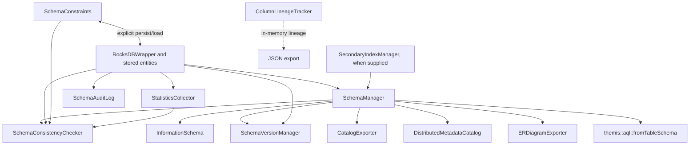
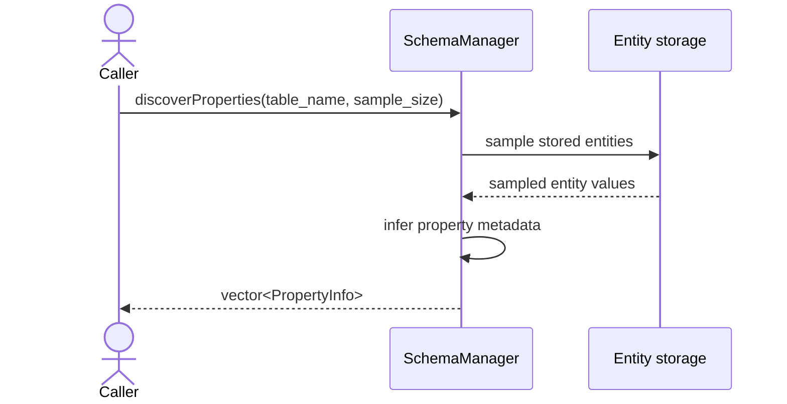

# Architecture — Metadata Module

**Author:** ThemisDB Contributors  
**Created:** 2026-10-31  
**Last Updated:** 2026-11-01
**Status:** review  
**AI_Used:** true  
**AI_Models:** unknown  
**AI_Contributor:** GitHub Copilot coding agent / ThemisDB documentation orchestrator  
**Human_Review:** false  
**Human_Author:** ThemisDB Contributors  
**Source level:** level1 — module-local  
**SOT domain:** architecture-governance  
**Canonical source references:** [metadata public headers](../../include/metadata/), [metadata implementations](./), [build source registration](../../cmake/CMakeLists.txt), [module tests](../../tests/metadata/CMakeLists.txt)  
**Related issue / milestone:** [#7362](https://github.com/makr-code/ThemisDB/issues/7362) · DOC-WEEKLY-2026-W44

> Exact model backend not verifiable from final document text alone.

## Kontext

`include/metadata/` declares the public contracts; `src/metadata/` implements
the compiled module. The module describes and operates on schema/catalog
metadata. It does not own general entity storage, query execution, or embedding
generation.

## Komponenten

- `SchemaManager` discovers tables and sampled properties, maintains cached
  schema views, and exposes explicit refresh and mutation APIs.
- `InformationSchema` constructs metadata rows from a `SchemaManager`; it is a
  read view, not an independent schema store.
- `StatisticsCollector` samples entities, caches results, and persists
  collected statistics. Its refresh worker is managed by its lifecycle API.
- `SchemaConsistencyChecker` reports orphan key prefixes and, when supplied
  collaborators support it, stale statistics and missing constraint
  definitions. It does not repair the store.
- `SchemaVersionManager`, `SchemaAuditLog`, and `SchemaConstraints` are
  separate history, audit, and constraint-persistence surfaces.
- `ColumnLineageTracker` is an in-memory, thread-safe tracker; JSON export does
  not itself persist lineage.
- `CatalogExporter` publishes Atlas/DataHub payloads over HTTP.
  `DistributedMetadataCatalog` delegates through a non-owning router reference.

## Schnittstellen

Public interfaces are declared under [`include/metadata/`](../../include/metadata/).
The main entry points are `SchemaManager` for schema discovery and mutation,
`InformationSchema` for read-only metadata rows, and `SchemaConsistencyChecker`
for diagnostics. `StatisticsCollector`, `SchemaVersionManager`,
`SchemaConstraints`, `SchemaAuditLog`, `CatalogExporter`, and
`DistributedMetadataCatalog` expose separate contracts; their error,
ownership, and thread-safety guarantees are per interface.

`IMetadataExportPolicy` is a separate interface and is not accepted by the
current `CatalogExporter` API. Likewise,
`InMemoryMetadataSnapshotStore` is explicitly in-memory, not durable.

## Datenfluss

Kurzinterpretation: Stored entities feed schema discovery and statistics;
those results supply read views, consistency checks, exports, and adapters.
Lineage remains a separate in-memory path.

## Sequenz (kritischer Ablauf)

Kurzinterpretation: Property inference is based on the bounded entity sample
requested by the caller. The result describes observed properties and is not a
guarantee that unsampled records contain no additional fields.

## Fehlerpfade und Resilienz

Thread-safety is per interface, not a module-wide guarantee. `SchemaManager`
uses a shared mutex for cache access; `StatisticsCollector` uses a shared mutex
for cache reads/writes. `SchemaVersionManager` and `SchemaConstraints` require
external synchronization. `SchemaConsistencyChecker::runCheck()` is thread-safe,
but its background start/stop calls must not race each other. Consult each
owning header for other classes' guarantees and non-owning dependencies.

Malformed input, missing records, storage errors, and external-service failures
have API-specific outcomes (`bool`, `std::optional`, typed result objects,
`PublishResult`, or exceptions). Callers must preserve these distinctions; a
failed or empty result is not a general health signal.

`SchemaConsistencyChecker::runCheck()` caps its orphan-key scan at 5,000 keys
and reports findings without repairing data. Callers must treat this as a
bounded diagnostic, not a complete reconciliation or automatic recovery.

## Nicht-Ziele

- The metadata module does not own entity persistence or query execution.
- Schema sampling does not establish a complete inventory of all possible
  properties when records are not included in the sample.
- Export-policy declarations do not imply that `CatalogExporter` enforces them.
- An in-memory lineage tracker or snapshot store does not provide durable
  persistence.
- Module-wide thread-safety must not be inferred from individual synchronized
  classes.

## Verweise

- The standard source list registers metadata implementation files in
  [`cmake/CMakeLists.txt`](../../cmake/CMakeLists.txt). In the modular build,
  distributed-catalog compilation is registered with the sharding components
  in [`cmake/ModularBuild.cmake`](../../cmake/ModularBuild.cmake).
- Focused test targets are registered in
  [`tests/metadata/CMakeLists.txt`](../../tests/metadata/CMakeLists.txt), which
  is discovered by the test CMake module scan. The registration file is the
  authority for target names, labels, and timeouts.
- Optional benchmarks are registered by
  [`benchmarks/metadata/CMakeLists.txt`](../../benchmarks/metadata/CMakeLists.txt)
  when the benchmark build is enabled. Benchmark source presence is not evidence
  that a run or release gate passed.

For symbol-level contracts, see [`API.md`](./API.md); for code ownership and
test mapping, see [`IMPLEMENTATION.md`](./IMPLEMENTATION.md). Public contracts
are defined by the owning headers under
[`include/metadata/`](../../include/metadata/).
