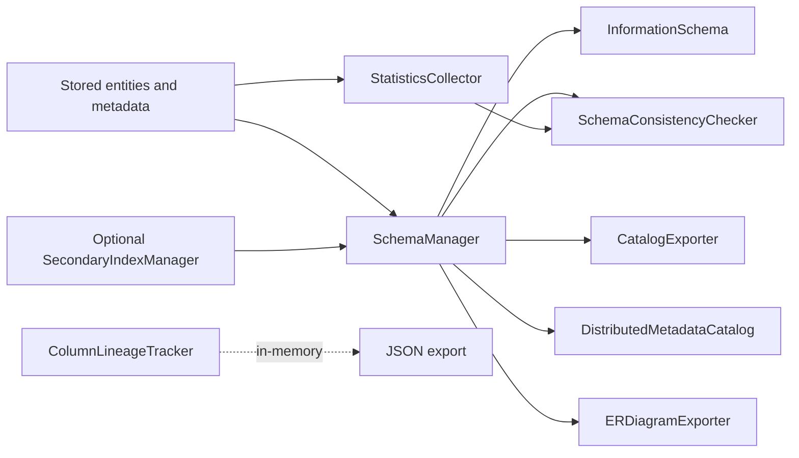

# ThemisDB Metadata Module

**Author:** ThemisDB Contributors  
**Created:** 2026-10-31  
**Last Updated:** 2026-11-01  
**Status:** review  
**AI_Used:** true  
**AI_Models:** unknown  
**AI_Contributor:** GitHub Copilot coding agent / ThemisDB documentation orchestrator  
**Human_Review:** false  
**Human_Author:** ThemisDB Contributors  
**Source level:** level1 — module-local  
**SOT domain:** module-behavior  
**Canonical source references:** [public metadata headers](../../include/metadata/), [metadata implementations](./), [focused test registration](../../tests/metadata/CMakeLists.txt), [module build source list](../../cmake/CMakeLists.txt)  
**Related issue / milestone:** [#7362](https://github.com/makr-code/ThemisDB/issues/7362) · DOC-WEEKLY-2026-W44

> Exact model backend not verifiable from final document text alone.

## Module Purpose

The metadata module provides schema discovery, metadata management, statistics surfaces, consistency tooling, and metadata export/integration behavior for ThemisDB.

## Scope

In scope:
- schema and table discovery, schema cache, and explicit schema mutations
- statistics, information-schema views, consistency diagnostics, and constraints
- schema version history, audit records, lineage, and catalog export

Out of scope:
- ownership of stored entities and the storage engine
- query execution and AQL runtime ownership
- durable lineage storage; `ColumnLineageTracker` is in-memory

## Quickstart (Build/Run)

The metadata module is linked into ThemisDB; it is not a standalone service.
From the repository root, configure and build the Linux release:

```bash
cmake --preset linux-release
cmake --build --preset linux-release
```

That preset requires vcpkg and disables tests. For focused tests, use a
tests-enabled build and the target registered in
[`tests/metadata/CMakeLists.txt`](../../tests/metadata/CMakeLists.txt):

```bash
cmake --build <build-dir> --target test_schema_manager_focused
ctest --test-dir <build-dir> --output-on-failure -R '^SchemaManagerFocusedTests$'
```

## API/CLI Entry Points

| Concern | Public contract | Implementation |
|---|---|---|
| Schema discovery, cache, overrides | [`SchemaManager`](../../include/metadata/schema_manager.h) | `schema_manager.cpp` |
| Statistics collection and refresh | [`StatisticsCollector`](../../include/metadata/statistics_collector.h) | `statistics_collector.cpp` |
| Read-only information-schema rows | [`InformationSchema`](../../include/metadata/information_schema.h) | `information_schema.cpp` |
| Version history and migration helpers | [`SchemaVersionManager`](../../include/metadata/schema_version_manager.h) | `schema_version_manager.cpp` |
| Durable schema audit | [`SchemaAuditLog`](../../include/metadata/schema_audit_log.h) | `schema_audit_log.cpp` |
| Consistency diagnostics and constraints | [`SchemaConsistencyChecker`](../../include/metadata/schema_consistency_checker.h), [`SchemaConstraints`](../../include/metadata/schema_constraints.h) | `schema_consistency_checker.cpp`, `schema_constraints.cpp` |
| Lineage and ER export | [`ColumnLineageTracker`](../../include/metadata/column_lineage.h), [`ERDiagramExporter`](../../include/metadata/er_diagram_exporter.h) | `column_lineage.cpp`, `er_diagram_exporter.cpp` |
| External catalog publication | [`CatalogExporter`](../../include/metadata/catalog_exporter.h) | `catalog_exporter.cpp` |
| Distributed catalog | [`DistributedMetadataCatalog`](../../include/metadata/distributed_catalog.h) | `distributed_catalog.cpp` |
| Index recommendations | [`IndexRecommender`](../../include/metadata/index_recommender.h) | `index_recommender.cpp` |

There is no metadata-specific command-line interface. Server-facing schema
routes are owned by the server module; metadata consumers use the C++ contracts
linked above. The public headers define the exact ownership, threading, and
error behavior.

## Integration Overview



Kurzinterpretation: `SchemaManager` ist die zentrale Sicht auf erkannte
Schemas; weitere Komponenten lesen diese Sicht oder verwalten abgegrenzte
Statistik-, Konsistenz-, Export- und Lineage-Aufgaben. Der optionale
Index-Manager ergänzt Indexinformationen, er ersetzt nicht die Schemaquelle.

## Known Limitations

- Schema discovery samples stored entities; inferred properties may omit fields
  not present in the sample. See `SchemaManager::discoverProperties()`.
- `SchemaConsistencyChecker` reports findings; its orphan-key scan is capped at
  5,000 scanned keys and it does not repair the store.
- `ColumnLineageTracker` is in-memory. JSON export does not imply durable
  persistence.
- Export-policy and security-provider interfaces are available as separate
  components; their existence does not prove that every caller or
  `CatalogExporter` is wired to use them. See [`TRUST.md`](./TRUST.md).
- Consult the owning public header for per-class thread-safety, ownership, and
  error contracts; the module has no single global concurrency guarantee.

## References

- Compiled metadata source files are registered in
  [`cmake/CMakeLists.txt`](../../cmake/CMakeLists.txt); modular build ownership
  for `distributed_catalog.cpp` is registered with sharding in
  [`cmake/ModularBuild.cmake`](../../cmake/ModularBuild.cmake).
- Focused test targets and their labels/timeouts are declared in
  [`tests/metadata/CMakeLists.txt`](../../tests/metadata/CMakeLists.txt). The
  top-level test CMake configuration discovers module `CMakeLists.txt` files.
- The optional metadata benchmarks are registered in
  [`benchmarks/metadata/CMakeLists.txt`](../../benchmarks/metadata/CMakeLists.txt).
  See [`benchmarks/metadata/README.md`](../../benchmarks/metadata/README.md);
  benchmark definitions alone do not establish measured results.

For runtime flow, see [`ARCHITECTURE.md`](./ARCHITECTURE.md); for API behavior
see [`API.md`](./API.md) and the owning headers under
[`include/metadata/`](../../include/metadata/). Current work and planning gaps
are tracked in [`ROADMAP.md`](./ROADMAP.md).