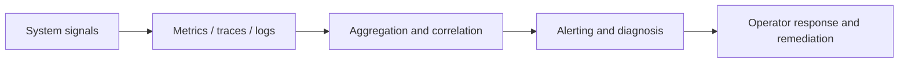

# Observability in ThemisDB

A database can be correct and still be unusable if nobody can explain what is happening under load. Observability is the layer that makes system behavior visible: it explains latency, failure modes, resource pressure, and the internal causes behind slow or unstable workloads. In ThemisDB, observability is therefore not a dashboard accessory; it is part of the platform's operational contract.

The general challenge is simple: once a system runs at production scale, operators need to answer not just whether something is failing, but where it is failing, why it is failing, and what the right intervention path is. ThemisDB addresses this through metrics, tracing, profiling, alerting, log correlation, and diagnostic workflows so that teams can reason about behavior instead of guessing from symptoms. That is the difference between a system that merely runs and a system that remains manageable under stress.

This module is tightly connected to the rest of the platform. It receives signals from storage, query, replication, sharding, security, and AI-related workflows and turns them into operational intelligence. The local module guidance in [README.md](./README.md) and the architecture framing in [ARCHITECTURE.md](./ARCHITECTURE.md) make clear that the goal is not only to display values, but to support real diagnosis and response. The same principle is reinforced by the wider systems overview in [docs/compendium/docs/index.md](./../../docs/compendium/docs/index.md).

The first core capability is metrics collection and aggregation. Reliable visibility starts with consistent measurement: request latency, queue pressure, resource consumption, error rates, and process health need to be captured in a standardized, queryable way. Without this, operators cannot distinguish normal variance from the early warning signs of an emerging incident.

The second core capability is distributed tracing and profiling. When a request spans multiple subsystems or a performance hot path emerges, teams need to see where time is spent and where failure boundaries are crossed. Tracing and profiling make that path visible, which is essential in systems that mix query execution, storage access, replication behavior, and AI orchestration in the same workload.

The third core capability is alerting and incident diagnosis. Metrics and traces are only useful when they lead to action. ThemisDB's observability layer supports rule-based alerting and diagnostic workflows so anomalies become actionable signals rather than vague reports. This improves response time, reduces false assumptions during incidents, and supports better SLO adherence in real production environments.

The practical value is substantial. For customers, better observability means lower mean time to resolve issues and fewer surprises during peak load or partially degraded states. For operators, it enables clear diagnosis of whether the problem originates in query execution, storage latency, replication lag, network constraints, or resource saturation. In enterprise deployment terms, that translates directly into higher trust, better uptime, and lower risk when production conditions change.

Observability is also a governance feature. Systems become operable not only when they are fast, but when teams can explain what is happening and where responsibility begins. ThemisDB therefore treats observability as a cross-cutting platform concern, not as a secondary monitoring add-on. It keeps the subsystem bounded: observability owns measurement, anomaly detection, metrics streams, and diagnostic surfaces, while the underlying subsystem logic remains in the owning module. That separation is crucial because the same symptom can be caused by storage, query, replication, or network behavior; visibility works best when ownership and diagnosis remain explicit.

The source basis for this page is primarily module-local and cross-checked against broader operational context: [README.md](./README.md), [ARCHITECTURE.md](./ARCHITECTURE.md), [ROADMAP.md](./ROADMAP.md), [FUTURE_ENHANCEMENTS.md](./FUTURE_ENHANCEMENTS.md), [PRODUCTION_REQUIREMENTS.md](./PRODUCTION_REQUIREMENTS.md), and [docs/compendium/docs/index.md](./../../docs/compendium/docs/index.md). These references explain the role of observability as a platform reliability feature without overstating the module contract beyond the repository’s verified documentation baseline.
