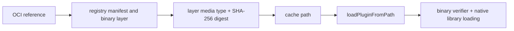

> Exact model backend not verifiable from final document text alone.

# Plugins module architecture

The module contains several related but distinct extension surfaces. Its
primary native path is the manifest-backed `PluginManager`; the typed
`PluginRegistry`, signed catalog, OCI client, health monitor, hot-plug monitor,
RPC registry, and optional WASM loader are separate components. Public
declarations are in [`../../include/plugins/`](../../include/plugins/).

## Native manifest load dataflow

```mermaid
flowchart LR
  A["plugin.json"] --> B["scanPluginDirectory / manifest parser"]
  B --> C["manager entry + dependency declarations"]
  C --> D["loadPlugin(name): dependency and edition/license checks"]
  D --> E["manifest and binary validation"]
  E --> F["platform loader: dlopen / LoadLibrary"]
  F --> G["createPlugin()"]
  G --> H["initialize(config)"]
  H --> I["loaded entry + frozen capability snapshot"]
  I --> J["manager-owned instance returned to caller"]
```

`PluginManager::loadPlugin(name)` is the manifest-backed route. It validates
the manifest name/schema and applicable policy before activation; dependencies
are loaded before the requested plugin. The plugin exports `createPlugin` and
`destroyPlugin` (normally via `THEMIS_PLUGIN_IMPL`). Initialization failure
rolls back the new instance; successful initialization captures the reported
capabilities. Capability negotiation and explicit escalation checks are
separate operations, not implicit per-call checks.

## Other surfaces and trust distinctions

- `loadPluginFromPath(path, config)` does not parse `plugin.json`; it therefore
  does not apply manifest edition/license rules.
- `loadPluginFromOci(...)` retrieves and digest-checks an OCI plugin layer, then
  uses the explicit-path loader. A digest check does not authenticate a
  publisher.
- `SignedPluginRepository` verifies catalog entries with pinned Ed25519 keys.
  This separate API is not automatically used by each manager load path.
- `PluginRegistry` stores typed factories; it is not the manager's
  manifest-backed loaded-instance map.
- `PluginHotPlugMonitor` maps filesystem events to manager operations.
  Monitoring is disabled by default; enabling it can cause automatic operations
  according to its configuration.
- `PluginHealthMonitor` tracks registered `ISelfHealingPlugin` pointers and may
  invoke recovery. The caller owns the pointer lifetime.
- `PluginMetricsCollector` takes and publishes a snapshot to an `IMetrics`
  sink; its caller controls collection cadence.
- `loadWasmPlugin()` checks its expected hash and runtime license gate. The
  loader supports a registered `WasmPluginLoadFn`; built-in Wasmtime/WasmEdge
  paths require their compile-time runtime support. These source facts do not
  establish a general sandbox or isolation guarantee.

For threat and signature semantics, see [`TRUST.md`](./TRUST.md); for function
signatures and return behavior, see [`API.md`](./API.md).

## Visible implementation dependencies

`plugin_manager.cpp` uses plugin-local interfaces, the acceleration
`PluginSecurityVerifier`, edition/runtime-license gates, utility logging and
tracing, JSON, OpenSSL, and platform shared-library APIs. OCI retrieval uses
libcurl, JSON, and OpenSSL. This is a source-visible dependency summary, not a
complete link graph.

**TODO — downstream integration inventory:** This source review did not
establish a complete set of server or domain-module callers of
`PluginManager`. Do not rely on older claims that transaction, LLM, or server
modules consume this manager through specific interfaces without verifying
their actual call sites.

## Build, test, and benchmark boundaries

- `tests/plugins/CMakeLists.txt` discovers `test_*.cpp` and registers focused
  unit-test targets when `THEMIS_BUILD_TESTS` and the test dependencies are
  enabled. See [`../../tests/plugins/README.md`](../../tests/plugins/README.md).
- `benchmarks/plugins/CMakeLists.txt` registers
  `bench_plugins_release_gates` when `THEMIS_BUILD_BENCHMARKS` is enabled. Its
  current cases measure error-code casts/dispatch and registration-descriptor
  allocation, not end-to-end plugin load latency. See
  [`PERFORMANCE_EXPECTATIONS.md`](./PERFORMANCE_EXPECTATIONS.md).
- Source presence or target registration does not establish a successful
  build, test run, benchmark result, or production-readiness status.
