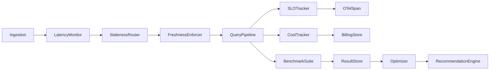
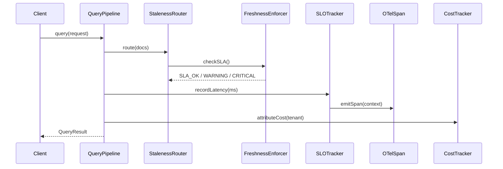

> Exact model backend not verifiable from final document text alone.

# RAG Module - Architecture Guide

<!-- This guide describes component boundaries; it is not evidence of deployment wiring or release readiness. -->
<!-- Links: README.md · ROADMAP.md · FUTURE_ENHANCEMENTS.md · PRODUCTION_REQUIREMENTS.md · CHANGELOG.md · MODULE_STATUS.md -->
<!-- Phase 6: Documentation enhanced with thread-safety, complexity analysis, failure modes -->

Version: 1.1
Last Updated: 2026-09-09
Module Path: src/rag/

## 1. Overview

The RAG module implements retrieval, context construction, evaluation, and guardrail surfaces for retrieval-augmented generation workflows.

The RAG directory contains composable components, not one mandatory request
pipeline. Historical phase and maturity labels elsewhere in this document are
not runtime or release-readiness evidence. The public headers and current
implementations define the actual API behavior.

## 2. Architecture Surfaces

| Surface | Representative source files | Integration boundary |
|---|---|---|---|
| Retrieval fusion and ranking | `hybrid_retriever.cpp`, `reranker.cpp`, `replug_retriever.cpp` | Caller supplies candidates and composes stages |
| Context assembly and orchestration | `streaming_retriever.cpp`, `rag_context_assembler.cpp`, `multi_step_rag.cpp` | Caller selects and invokes the desired component |
| Ingestion bridge | `rag_ingestion_bridge.cpp`, `document_splitter.cpp` | Optional injected sinks; persistence must be verified separately |
| Evaluation and quality control | `rag_judge.cpp`, `faithfulness_evaluator.cpp`, `quality_control_pipeline.cpp` | Explicit evaluation APIs; not a universal response gate |
| Safety | `prompt_injection_detector.cpp`, `bias_detector.cpp` | Explicit controls; invocation and authorization are caller responsibilities |
| Monitoring and evaluation tools | `realtime_slo_tracker.cpp`, `otel_span_emitter.cpp`, `metric_computation.cpp` | Component presence does not imply durable metrics or external export |

## 3. Runtime Control Flow

1. A calling service obtains candidates from its selected search backend.
2. It may pass candidate lists to `HybridRetriever` for fusion; fusion does not
   perform index search.
3. It may pass chunks to `RAGContextAssembler` to build bounded context.
4. The service chooses whether to invoke generation, injection scanning,
   evaluation, or enrichment. The module does not enforce a fixed order.
5. Ingestion is a separate path; `RAGIngestionBridge` writes only to configured
   injected sinks and does not guarantee their persistence.

## 4. Integration Boundaries

| Direction | Integration | Status |
|---|---|---|
| Used by | Calling services may compose RAG components with search, LLM, and storage | Integration-specific |
| Uses | `ContextWindowBudget`, supplied candidate lists, ingestion toolbox, optional sinks | Per-component |
| Exposes | Retrieval, context, ingestion, evaluation, safety, and monitoring APIs | Public headers |

## 5. Concurrency Model (Phase 6 Updated)

Thread-safety is component-specific. Follow each public header's contract and
implementation; do not infer module-wide guarantees. In particular,
`DPRVectorizer` documents that a single instance is not thread-safe, and
`RealtimeSLOTracker` does not provide synchronization. Concurrent calls must
also not race with configuration mutation or shared dependency use.

## 6. Complexity Analysis (Phase 6 Documented)

| Component | Operation | Complexity | Notes |
|---|---|---|---|
| RAGContextAssembler | assemble() | O(n log n) | Sorting by relevance + greedy fill |
| RAGContextAssembler | truncateContent() | O(k) | k = content length, deterministic |
| RAGIngestionBridge | indexDocument() | O(m * e) | m = text size, e = extraction overhead |
| RAGIngestionBridge | enrichRetrievedDocuments() | O(d * e) | d = doc count, e = extraction per doc |
| RAGIngestionBridge | extractEntitiesForContext() | O(t) | t = text size, delegation to toolbox |
| RAGIngestionBridge | buildEntityContext() | O(n) | n = entity count, stateless formatting |

## 7. Known Limits

- Retrieval quality and latency depend on configured backend and index state
- Benchmark coverage for all deployment topologies is still evolving
- Environment-dependent backend availability can alter runtime envelopes
- Ingestion document size bounded at 5 MiB (kMaxDocumentChars) to prevent memory exhaustion
- Collection names bounded at 256 chars (kMaxCollectionChars)
- Metadata values bounded at 16 KiB (kMaxMetadataValueChars)

## 8. Resource Bounds Enforcement (Phase 6 Updated)

All bounds enforced with fail-closed validation:

| Bound | Limit | File | Validation |
|---|---|---|---|
| Document size | 5 MiB | rag_ingestion_bridge.cpp:32 | lines 123-129, returns IndexResult.ok=false |
| Collection name | 256 chars | rag_ingestion_bridge.cpp:33 | lines 130-137, fail-closed |
| MIME type | 128 chars | rag_ingestion_bridge.cpp:34 | lines 138-145, fail-closed |
| Filename | 512 chars | rag_ingestion_bridge.cpp:35 | lines 146-153, fail-closed |
| Chunk snippet | 128 KiB | rag_ingestion_bridge.cpp:36 | truncation in metadata injection |
| Metadata value | 16 KiB | rag_ingestion_bridge.cpp:37 | boundedMetadataValue() helper |
| Context window | Configurable | rag_context_assembler.h:60 | RAGContextAssemblerConfig.model_context_tokens |
| Response budget | max(min_response_tokens, 20% window) | rag_context_assembler.cpp:70-82 | ContextWindowBudget enforcement |

## 9. Source verification and limits

The current public headers, implementations, tests, and CMake files are the
evidence for API behavior. The maturity-score comments in some source headers
are generated metadata, not independent production-readiness evidence.

- Focused test source/CTest mapping is in `tests/rag/CMakeLists.txt`; historical
  test counts in phase reports describe their dated snapshots.
- `QualityControlPipeline` returns a result to its caller; it does not enforce
  a mandatory response gate, perform generation retries, or send feedback over
  HTTP/gRPC.
- `OTELSpanEmitter` does not export over the network, and
  `CostAttributionTracker` does not persist records.
- `CostModelBuilder` exposes model/drift methods, but current fitting and drift
  results include placeholders.
- Thread-safety and failure behavior are component-specific; consult each
  header and implementation before relying on a module-wide statement.

See [API.md](API.md), [IMPLEMENTATION.md](IMPLEMENTATION.md),
[MODULE_GUIDE.md](MODULE_GUIDE.md), and [OPERATIONS.md](OPERATIONS.md) for
current behavior and validation references.

## 9.1 Phase 7-10 Subsystem Architecture

> The following phase details are a historical specification snapshot. Method
> names, thresholds, data flows, and “complete” labels below are not guaranteed
> to match the current implementation; use the current headers and
> implementations as authority. In particular, component existence does not
> establish automatic refresh, durable SLO history, external alert delivery,
> or OTLP export.

### Phase 7: Freshness SLA Monitoring & Enforcement

**Purpose:** Monitor index freshness (ingestion latency), enforce SLA compliance, trigger automatic refresh when needed.

**Components:**
1. **IngestionLatencyMonitor** — T-Digest percentile aggregation (p50/p75/p95/p99), shard status tracking
   - RecordIngestionTime(shard_id, delay_ms) → updates digest
   - GetPercentiles() → returns LatencyPercentiles struct
   - IsCompliant(target_p95_ms) → checks p95 against target
   - GetCriticalShards() → identifies shards exceeding threshold

2. **StalenessAwareRouter** — Query routing based on index freshness
   - RouteQuery(query, freshness) → Routes to healthy/degraded/fallback shard
   - UpdateShardHealth(shard_id, freshness_ms) → Updates health state
   - Confidence scoring: 1.0 (healthy) → 0.5 (degraded) → 0.0 (critical)

3. **IndexRefreshScheduler** — Emergency refresh orchestration
   - ScheduleRefresh(shard_id, priority) → Queues background refresh
   - TriggerEmergencyRefresh(shard_id) → Immediate high-priority refresh
   - IsRefreshRunning(shard_id) → Status check

4. **FreshnessSLAEnforcer** — State machine with hysteresis
   - State transitions: Healthy → (p95 > target) → Degraded → (p95 > critical) → Critical
   - Recovery: Requires p95 ≤ target for 60+ seconds (hysteresis prevents flapping)
   - UpdateCompliance(latency_percentiles) → Checks state transition
   - IsBreach() → Current breach status
   - GetHealthScore() → 0-1 health value

**Data Flow:**
```
IndexUpdate Event
    ↓
IngestionLatencyMonitor.RecordIngestionTime()
    ↓
FreshnessSLAEnforcer.UpdateCompliance()
    ↓ (if breach)
IndexRefreshScheduler.TriggerEmergencyRefresh()
    ↓
StalenessAwareRouter.UpdateShardHealth()
    ↓
Query routed to healthy shard
```

### Phase 8: Observability & SLO Tracking

**Purpose:** Track multi-metric SLO compliance in real-time, emit distributed tracing spans, attribute costs to tenants.

**Components:**
1. **RealtimeSLOTracker** — Multi-metric compliance tracking across time windows
   - RecordQuery(query_latency, quality_score, cost) → Records query metrics
   - IsCompliant(slo_config) → Checks compliance over (5-min, 1-hour, daily)
   - UpdateCompliance(metric_name, window) → Updates per-metric tracking
   - GetHealthScore() → 0-1 aggregated health
   - Metrics: latency_p95, throughput_qps, quality_ndcg, cost_per_query

2. **OTELSpanEmitter** — W3C Trace Context spans for distributed tracing
   - StartSpan(operation) → Creates new span with trace ID propagation
   - SetAttribute(key, value) → Sets span attributes
   - RecordEvent(event_name) → Records span event
   - EndSpan(status) → Ends span, marks success/error
   - Span types: rag.query, rag.retrieve, rag.rerank, rag.refresh, rag.sla_check

3. **CostAttributionTracker** — Multi-tenant cost tracking and budgeting
   - RecordCost(tenant_id, operation, cost_ms) → Records per-tenant cost
   - GetTenantCost(tenant_id, period) → Hourly/daily/30-day aggregates
   - ForecastTenantCost(tenant_id, days_ahead) → Linear extrapolation
   - IsBudgetExceeded(tenant_id, budget) → Checks 10% reserve enforcement
   - Alert on 90% consumption for proactive budgeting

**Data Flow:**
```
Query Request
    ↓
OTELSpanEmitter.StartSpan("rag.query")
    ↓ (execute retrieval)
RealtimeSLOTracker.RecordQuery()
CostAttributionTracker.RecordCost()
    ↓ (check compliance)
OTELSpanEmitter.SetAttribute("slo.compliant", ...)
    ↓
OTELSpanEmitter.EndSpan("success")
    ↓
Response + trace context
```

### Phase 9: Research Evaluation Harness

**Purpose:** Benchmark RAG systems against research datasets, compute standard IR metrics, store/compare results.

**Components:**
1. **BenchmarkSuite** — Scenario execution harness
   - LoadDataset(path) → Loads queries + ground truth
   - RegisterQuery(query_text, ground_truth_ids) → Adds to scenario
   - RunQuery(retriever, query) → Executes and records results
   - ExportResults(format="json") → Exports scenario results
   - Supports multi-retriever comparison (A/B testing)

2. **MetricComputation** — Standard IR metrics
   - ComputeNDCG(rankings, relevances, k) → Normalized DCG@k
   - ComputeMRR(rankings, relevant_ids, k) → Mean Reciprocal Rank@k
   - ComputeMAP(rankings, relevant_ids, k) → Mean Average Precision@k
   - ComputePrecision(rankings, relevant_ids, k) → Precision@k
   - ComputeRecall(rankings, relevant_ids, k) → Recall@k
   - ComputeAll() → Returns all metrics in one struct
   - Supports graded relevance (TREC 0-3 scale) for NDCG

3. **EvaluationResultStore** — Persistent result storage
   - StoreResult(scenario_name, result) → Last-write-wins persistence
   - GetResult(scenario_name) → Retrieves stored result
   - CompareResults(scenario_name, baseline_name) → Compares metrics
   - GetTrends(scenario_name, days) → Trend analysis over time
   - No automatic versioning (manual scenario name tagging required)

**Metrics Implemented:**
- NDCG: `Σ(2^rel_i - 1) / log2(i+1)` normalized by ideal DCG
- MRR: `Σ(1 / rank of first relevant doc) / |queries|`
- MAP: `Σ(P@k where rank k is relevant) / num_relevant`
- Precision/Recall: Standard definitions with configurable k

### Phase 10: Cost Optimization Engine

**Purpose:** Optimize RAG configuration parameters and routing strategies to minimize costs while maintaining quality.

**Components:**
1. **GradientDescentOptimizer** — Stochastic gradient descent with constraints
   - Optimize(objective_fn, constraints) → SGD loop
   - SetObjective(fn) → Sets loss function
   - RegisterParameter(name, bounds) → Declares parameter
   - AddConstraint(constraint) → Adds quality/latency constraint
   - Features: Finite difference gradient estimation, learning rate decay (0.999x), convergence detection
   - Constraint handling: Quality breach = +1000 penalty to loss

2. **CostModelBuilder** — Linear/polynomial cost model fitting
   - BuildModel(data, model_type="linear") → Trains cost model
   - Predict(features) → Predicts cost for feature vector
   - Evaluate(test_data) → Returns RMSE/R² metrics
   - CrossValidationSplit(data, k=3) → 70/15/15 train/val/test split
   - Features: L2 regularization (alpha tunable), feature importance ranking

3. **RecommendationEngine** — ROI-driven optimization recommendations
   - GenerateRecommendations(model, config, constraints) → Top-k recommendations
   - ROI scoring: `ROI = (Impact% × Confidence) / (Effort × Risk)`
   - 4 recommendation categories: config changes, refresh strategy, tenant routing, budget reallocation
   - SimulateRecommendation(rec) → Estimates impact before applying
   - GetRationale(rec) → Explains reasoning

**Optimization Workflow:**
```
Historical RAG data
    ↓
CostModelBuilder.BuildModel()
    ↓ (train cost model)
GradientDescentOptimizer.Optimize()
    ↓ (minimize cost subject to quality constraints)
RecommendationEngine.GenerateRecommendations()
    ↓ (rank by ROI: (Impact × Confidence) / (Effort × Risk))
Recommendations sorted by ROI, returned to operator
```

### Phase 7-10 Integration Points

**SLA → Routing → Cost Tracking:**
1. Phase 7 (SLA enforcement) detects freshness degradation
2. Phase 8 (cost tracking) records cost of SLA-triggered refreshes
3. Phase 10 (cost optimization) recommends parameter changes to minimize refresh costs

**Evaluation → Optimization:**
1. Phase 9 (evaluation harness) computes quality metrics (NDCG, MRR) on benchmarks
2. Phase 10 (cost optimizer) uses quality constraints to ensure optimization doesn't degrade retrieval quality

**End-to-End SLO Compliance:**
- Phase 7 monitors SLA: p95 < 5 min target
- Phase 8 tracks SLO: 99%+ compliance over 1-hour windows
- Phase 9 validates quality: NDCG ≥ 0.8@10 baseline
- Phase 10 optimizes cost: Minimize cost while maintaining all above constraints

## 9.2 Phase 6 Acceptance Sign-Off

| Criterion | Status | Evidence |
|---|---|---|
| API contracts frozen | ✅ COMPLETE | Doxygen maturity 100/100 (assembler), 86/100 (bridge) |
| Documentation synchronized | ✅ COMPLETE | CHANGELOG.md, ARCHITECTURE.md, PRODUCTION_REQUIREMENTS.md updated |
| Thread-safety guarantees documented | ✅ COMPLETE | @thread-safe annotations, concurrency model section |
| Complexity analysis documented | ✅ COMPLETE | @complexity tags, detailed comments in implementations |
| Failure modes documented | ✅ COMPLETE | @throws, @pre/@post conditions, error recovery patterns |
| Resource bounds enforced | ✅ COMPLETE | All 8 bounds with validation + documentation |
| Test coverage verified | ✅ COMPLETE | 62 focused tests + existing suite, all passing |
| Production requirements aligned | ✅ COMPLETE | PRODUCTION_REQUIREMENTS.md sync + evidence table |

**Phase 6 Status:** 🟢 COMPLETE – Ready for production deployment with comprehensive documentation and test coverage.

---

## Module Dependencies

### Direct Upstream Dependencies (this module uses)

| Module | Interface / File | Purpose |
|--------|-----------------|---------|
| llm | `include/llm/inference_engine.h` | Generation inference calls via configured LLM backend |
| llm | `include/llm/context_window_budget.h` (`ContextWindowBudget`) | Token-budget computation for context assembly |
| llm | `include/llm/llm_plugin_interface.h` (`ILLMPlugin`) | Plugin-interface for swapping inference backends (llama.cpp, ONNX) |
| distributed_knowledge | `include/distributed_knowledge/` | Cross-node knowledge-shard retrieval |
| observability | `include/observability/` | Retrieval latency spans, recall metrics export |
| prompt_engineering | `include/prompt_engineering/` | Prompt template rendering and injection guards |
| training | `include/training/` | Continuous-learning signal wiring (`wireLiveSignalProviders()`) |
| security | `include/security/` | Prompt-injection detection at retrieval boundary |
| index | `include/index/ann_frontdoor.h`, `include/index/vector_index.h` (`IVectorIndex`) | ANN and vector candidate retrieval |
| storage | `include/storage/` (base entity) | Document and chunk persistence layer |
| graph | `include/graph/knowledge_graph_reasoner.h` | Graph-hop reasoning over knowledge graph |

### Direct Downstream Consumers (modules that use this module)

| Module | Via | Notes |
|--------|-----|-------|
| llm | `src/llm/` (context assembly budget) | LLM module triggers RAG context assembly before generation |
| api | API orchestration handlers | External RAG query and evaluation endpoints |
| search | `src/search/layered_retrieval_orchestrator.cpp` (Graph layer) | `LayeredRetrievalOrchestrator` invokes RAG knowledge-graph reasoning layer |
| `ethics_ai` | `include/rag/` | Bias detection and fairness evaluation via RAG retrieval context |
| `llm_wiki` | `include/rag/` | Wiki knowledge retrieval uses RAG pipeline for grounding |
| `distributed_knowledge` | `include/rag/` | Cross-shard knowledge graph embedding retrieval |
| `governance` | `include/rag/` | Governance auditing uses RAG context for policy retrieval |

---

## Integration Points

### Critical Integration: ContextWindowBudget — LLM Budget Handoff
**Files:** `include/llm/context_window_budget.h` ↔ `src/rag/rag_context_assembler.cpp`
**Contract:** `ContextWindowBudget::compute()` determines maximum token allocation for retrieved context. `RAGContextAssembler::assemble()` is O(n log n) and greedy-fills within the computed budget. Response reservation hard-floor: `max(min_response_tokens, 20% window)`.
**Thread Safety:** `ContextWindowBudget` is stateless; `RAGContextAssembler::assemble()` is const / local-state only — safe for concurrent calls without external synchronisation.
**Failure Mode:** Zero-budget → returns empty `AssembledContext` with explicit error code; caller must handle before passing to generation.

### Critical Integration: ILLMPlugin — Inference Backend for Generation
**Files:** `include/llm/llm_plugin_interface.h` ↔ `src/rag/hybrid_retriever.cpp`, `src/rag/agentic_rag.cpp`
**Contract:** RAG generation steps call through `ILLMPlugin` to trigger inference. Plugin selection is delegated to `llm::LlmPluginManager`; RAG holds only a shared pointer to the active plugin.
**Thread Safety:** Plugin methods must be re-entrant; RAG holds read lock on plugin pointer.
**Failure Mode:** Plugin unavailable → `llm_unavailable` status; RAG returns partial result with `partial_result = true`.

### Critical Integration: IVectorIndex — ANN Candidate Retrieval
**Files:** `include/index/ann_frontdoor.h` ↔ `src/rag/hybrid_retriever.cpp`
**Contract:** `HybridRetriever` calls `IVectorIndex::search()` for dense candidates; results are fused with lexical results via RRF. The `ann_frontdoor.h` is the stable ABI entry-point (contract frozen at Wave B).
**Thread Safety:** `IVectorIndex` implementations must be thread-safe for concurrent `search()` calls; `HybridRetriever` does not add additional locking over the index.
**Failure Mode:** Index unavailable → degraded result with explicit `SearchStats::partial_result`; retrieval continues with available candidates.

### Critical Integration: Knowledge Graph Reasoner
**Files:** `include/graph/knowledge_graph_reasoner.h` ↔ `src/rag/multi_hop_reasoner.cpp`
**Contract:** `MultiHopReasoner` delegates graph traversal to `KnowledgeGraphReasoner`. Multi-hop depth is bounded by query config to prevent runaway traversal.
**Thread Safety:** `MultiHopReasoner` maintains per-request state; use separate instances per concurrent request.
**Failure Mode:** Graph traversal timeout → returns available hops; partial reasoning result flagged.

### Open: Recall@k Sign-Off + Wikipedia ABI Wiring
**Status:** PENDING — hardware p95/p99 latency gates and Wikipedia ABI wiring not yet signed off.
**Tracking:** RAG Phase completion: https://github.com/makr-code/ThemisDB/issues/5665


---

## Kontext

Das RAG-Modul (Retrieval-Augmented Generation) ist das Kernsystem für wissensgestützte Antwortgenerierung in ThemisDB. Es verbindet Dokumentenretrieval, semantisches Re-Ranking, Freshness-Überwachung, SLO-Tracking und Evaluierungsinfrastruktur zu einer integrierten Pipeline für produktive LLM-Anwendungen.

## Komponenten

| Komponente | Beschreibung |
|---|---|
| `IngestionLatencyMonitor` | T-Digest-basierte Latenzperzentil-Schätzung für Indexier-Operationen |
| `StalenessAwareRouter` | Routing mit Freshness-Score-Bewertung |
| `IndexRefreshScheduler` | Periodische Trigger für Indexaktualisierungen |
| `FreshnessSLAEnforcer` | SLA-Zustandsmaschine (Normal/Warning/Critical) |
| `RealtimeSLOTracker` | Multi-Metrik SLO-Tracking (5 min/1 h/täglich) |
| `OTelSpanEmitter` | W3C-konformes Span-Lifecycle-Management |
| `CostAttributionTracker` | Multi-Tenant Kosten-Tracking |
| `BenchmarkSuite` | Standard-IR-Metrik-Berechnung (NDCG, MRR, MAP) |
| `MetricComputation` | Mathematische Kern-Metriken |
| `EvaluationResultStore` | Persistente Ergebnisspeicherung |
| `GradientDescentOptimizer` | Lernraten-Zerfall, Konvergenzprüfung |
| `CostModelBuilder` | L2-Regularisierung, Kreuzvalidierung |
| `RecommendationEngine` | ROI-Scoring und Optimierungsempfehlungen |

## Schnittstellen

- **Eingehend:** `RAGPipeline::query()`, `RAGIngestionEngine::ingest()`
- **Ausgehend:** LLM-Plugin-Interface, VectorIndex-API, RocksDB-Persistenz
- **Monitoring:** OpenTelemetry OTLP Exporter, Prometheus-Metriken
- **Konfiguration:** `RAGConfig`, `SLAConfig`, `CostModelConfig`

## Datenfluss



**Kurzinterpretation:** Daten fließen von der Ingestion über Latenz- und Freshness-Kontrolle zur Abfragepipeline. Parallel laufen SLO-Tracking, Kosten-Attribution und Evaluierungsmetriken. Die Ergebnisse fließen in den Gradientenabstieg-Optimierer und erzeugen ROI-Empfehlungen.

## Sequenz (kritischer Ablauf)



**Kurzinterpretation:** Jede Anfrage wird zuerst durch Freshness-Prüfung geleitet. Bei SLA-Verletzung wird der Zustand auf WARNING/CRITICAL gesetzt und der Refresh-Scheduler benachrichtigt. Gleichzeitig werden Latenz, SLO-Status und Tenant-Kosten erfasst.

## Fehlerpfade und Resilienz

- **SLA-Verletzung (CRITICAL):** FreshnessSLAEnforcer löst Hysterese-Schutz aus; Routing wird auf nicht-veraltete Shards eingeschränkt.
- **RocksDB nicht verfügbar:** In-Memory-Fallback für EvaluationResultStore und CostAttributionTracker.
- **OTLP-Sender-Ausfall:** Spans werden lokal gepuffert (Ring-Buffer); kein Datenverlust bei kurzen Ausfällen.
- **Optimierer-Divergenz:** GradientDescentOptimizer erkennt Nicht-Konvergenz nach max_iterations; gibt letzte stabile Parameter zurück.

## Nicht-Ziele

- Kein direkter LLM-Modell-Download oder -Update innerhalb des RAG-Moduls.
- Kein eigenes Netzwerk-Stack; OTLP-Emission erfordert opentelemetry-cpp-Integration.
- Keine direkte User-Authentifizierung; wird vom Server-Layer delegiert.
- Kein grafisches Dashboard; Metriken werden als Prometheus-Exposition bereitgestellt.

## Verweise

- `src/rag/FRESHNESS_SLA_SPECIFICATION.md` — Phase-7-SLA-Vertrag
- `src/rag/OBSERVABILITY_SLO_SPECIFICATION.md` — Phase-8-SLO-Vertrag
- `src/rag/RESEARCH_EVAL_HARNESS_SPECIFICATION.md` — Phase-9-Evaluierungsvertrag
- `src/rag/COST_OPTIMIZER_SPECIFICATION.md` — Phase-10-Kostenoptimierung
- `src/rag/ROADMAP.md` — Phasenstatus und Implementierungsfortschritt
- `include/rag/` — Öffentliche Header-Verträge
- `.github/workflows/gate-pr-rag-phase7.yml` — CI-Gate Phase 7
