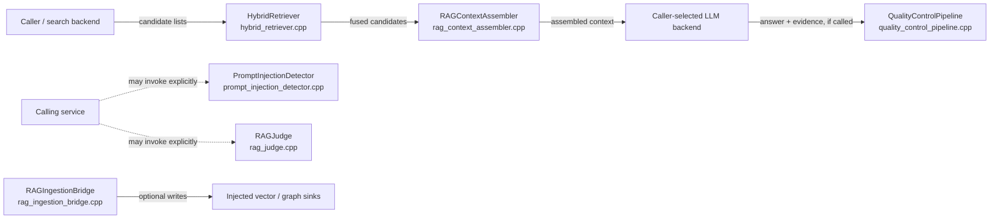

# ThemisDB RAG Module

AI provenance note: Exact model backend not verifiable from final document text alone.

<!-- Links: ARCHITECTURE.md · ROADMAP.md · FUTURE_ENHANCEMENTS.md -->

## Zweck

The RAG module provides retrieval-augmented generation runtime surfaces for ThemisDB:
document retrieval, context assembly, quality evaluation, and safety checks.
It combines hybrid BM25+vector retrieval, token-budget-aware streaming, multi-dimensional
evaluation gates, and prompt-injection safety controls into a single composable runtime layer.

## Scope

In scope:
- retrieval fusion (BM25 + vector), reranking, and context assembly
- RAG evaluation, quality gates, and judge integration
- ingestion bridge and retrieval enrichment
- prompt and retrieval safety controls (injection detection, sanitization)
- RAG-specific performance and reliability controls (adaptive depth, streaming)

Out of scope:
- core LLM backend lifecycle and model loading (see `src/llm/`)
- storage engine internals outside RAG ingestion integration
- non-RAG HTTP transport and server bootstrap details

## Quickstart (Build/Run)

RAG implementations are included through CMake source lists, but the main RAG
source group is conditional on `THEMIS_ENABLE_LLM`; individual components may
have separate or non-LLM wiring. The 100 files under `src/rag/` are not all
unconditionally compiled by every build configuration. A representative
configuration/build is:

```bash
cmake -S . -B build
cmake --build build
```

The focused tests are registered by `tests/rag/CMakeLists.txt`. For example:

```bash
ctest --test-dir build -R '^(test_rag_hybrid_retriever|test_rag_context_assembler|test_self_rag)_RagFocusedTests$' -V
```

There is no dedicated `test_rag_quality` or `test_llm_judge_integration` entry
in the RAG test directory. Use the actual registered test source/CTest name for
the behavior being changed; the module guide maps common changes to tests.

## API/CLI Einstieg

The module exposes the following core public headers:

**`include/rag/hybrid_retriever.h`** — `themis::rag::HybridRetriever`
```cpp
themis::rag::HybridRetrieverConfig config;
config.top_k = 10;
config.bm25_weight = 0.4;
config.vector_weight = 0.6;
themis::rag::HybridRetriever retriever(config);
auto result = retriever.fuse(bm25_candidates, vector_candidates);
```

**`include/rag/rag_context_assembler.h`** — `themis::rag::RAGContextAssembler`
```cpp
themis::rag::RAGContextAssemblerConfig config;
config.model_context_tokens = 4096;
themis::rag::RAGContextAssembler assembler(config);
auto context = assembler.assemble(chunks, system_prompt, query);
```

**`include/rag/quality_control_pipeline.h`** — `themis::rag::judge::QualityControlPipeline`
```cpp
themis::rag::judge::QualityControlPipeline pipeline;
auto verdict = pipeline.runQualityControl(query, generated_answer, documents);
if (verdict.status != themis::rag::judge::QualityGateStatus::PASSED) {
    // Apply the caller's retry, escalation, or rejection policy.
}
```

**`include/rag/prompt_injection_detector.h`** — `themis::rag::security::PromptInjectionDetector`
```cpp
themis::rag::security::PromptInjectionDetector detector;
auto result = detector.scan(user_input);
if (result.is_blocked()) {
    // Block or escalate according to the caller's policy.
}
```

## Integrationsueberblick

The following diagram shows how the RAG module integrates with the server, LLM, and storage layers:



**Interpretation:** This is a possible composition, not a guaranteed server
data flow. `HybridRetriever` fuses candidates supplied by its caller; it does
not query an index. Safety checks, generation, evaluation, authorization, and
sink persistence are caller/integration responsibilities.

## Current limitations and integration boundaries

- Runtime behavior varies with the configured retriever, evaluator, and LLM backend combination.
- The module does not provide a mandatory end-to-end request pipeline or
  automatically enforce authorization, injection scanning, or quality results.
- `CrossEncoderReranker` currently scores with its heuristic implementation;
  loading a model file does not run ONNX inference.
- Monitoring components are not evidence of durable storage, external alerting,
  or network telemetry export. See [operations](OPERATIONS.md).
- Performance and acceptance targets are not measurements. See the current
  benchmark registration notes in [research](RESEARCH.md).

## Verweise

| Interface / File | Role |
|---|---|
| `include/rag/hybrid_retriever.h` | Public API for BM25+vector fusion retrieval |
| `src/rag/hybrid_retriever.cpp` | Hybrid retrieval implementation |
| `include/rag/rag_context_assembler.h` | Public API for token-budget-aware context assembly |
| `src/rag/rag_context_assembler.cpp` | Deterministic context assembly under token limits |
| `include/rag/quality_control_pipeline.h` | Public API for retrieval and generation quality gates |
| `src/rag/quality_control_pipeline.cpp` | Quality gate pipeline implementation |
| `include/rag/prompt_injection_detector.h` | Public API for injection detection and sanitization |
| `src/rag/prompt_injection_detector.cpp` | Prompt-injection detection implementation |
| `src/rag/rag_judge.cpp` | Multi-dimensional evaluation orchestration |
| `src/rag/streaming_retriever.cpp` | Token-budget-aware context streaming |
| `src/rag/rag_ingestion_bridge.cpp` | Ingestion-to-retrieval bridge and enrichment |
| `src/rag/multi_step_rag.cpp` | Iterative and map-reduce style multi-step retrieval |
| `src/rag/adaptive_retrieval.cpp` | Complexity-aware retrieval depth control |
| `src/rag/delegate_evaluator.cpp` | Round-trip corruption benchmark support |
| `src/rag/self_rag.cpp` | Self-RAG retrieval controller with critic-based document refinement (Wave B B1) |

- [`ARCHITECTURE.md`](ARCHITECTURE.md) — component boundaries, data flow, and failure paths
- [Developer documentation guide](MODULE_GUIDE.md) — API, implementation, research, operations, and trust references
- [`ROADMAP.md`](ROADMAP.md) — delivery status, remaining gaps, and phased plan
- [`FUTURE_ENHANCEMENTS.md`](FUTURE_ENHANCEMENTS.md) — planned feature upgrades
- Wave B tracking issue: https://github.com/makr-code/ThemisDB/issues/5039
- Dependent Wave A issue: https://github.com/makr-code/ThemisDB/issues/5038
- Follow-on Wave C issue: https://github.com/makr-code/ThemisDB/issues/5040
