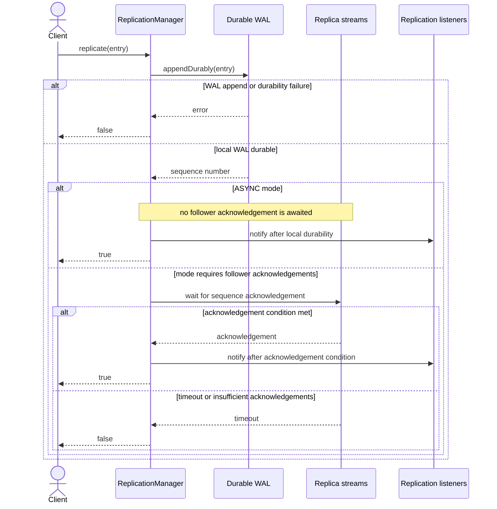

Exact model backend not verifiable from final document text alone.

# Replication Module Architecture

## Kontext

`src/replication/` owns replica coordination and promotion paths, logical replication slots/streams, asynchronous WAL shipping, conflict-resolution helpers, and replication status/lag reporting. It consumes storage log data and exposes replication events to its subscribers. Shard placement belongs to sharding; the underlying storage engine and network transport implementation are not owned here.

## Komponenten

| Component | Public interface | Source-backed responsibility |
|---|---|---|
| Manager and consensus | [`ReplicationManager`](../../include/replication/replication_manager.h), [`RaftV2`](../../include/replication/raft_v2.h) | Replication configuration, member/leader state, and Raft-v2 cluster configuration paths. |
| Logical stream and slots | [`LogicalReplicationManager`](../../include/replication/logical_replication.h), [`ReplicationSlotManager`](../../include/replication/replication_slot.h), [`ReplicationEventStream`](../../include/replication/event_stream.h) | Filterable logical changes, subscriber/slot lifecycle, and stream events. |
| WAL shipping | [`AsyncWalShipper`](../../include/replication/async_wal_shipper.h) | Bounded asynchronous segment queue, worker dispatch, lag accounting, and configured callbacks. |
| Conflict and status | [`ConflictResolution`](../../include/replication/conflict_resolution.h), [`LagAlertManager`](../../include/replication/lag_alert_manager.h), [`Observability`](../../include/replication/observability.h) | Conflict resolver choices, lag alerts, and replication health snapshots. |

`observability.h` declares `ReplicationObserver`; the table's `Observability` label is
the component, not a public class name. `kafka_change_stream.h` and
`multi_master_replication.h` have no same-named `.cpp` in this module directory. This
inventory does not establish whether their behavior is implemented elsewhere or wired
into the current runtime.

## Schnittstellen

- `ReplicationManager` and `RaftV2` manage the local replication and consensus state.
- `LogicalReplicationManager`, `ReplicationSlotManager`, and
  `ReplicationEventStream` expose logical change consumption and subscriber state.
- `AsyncWalShipper` accepts WAL segments and dispatches them through a configured
  handler; it does not own the transport implementation.
- Conflict-resolution and observability interfaces expose caller-invoked resolution,
  lag alerts, and health snapshots.

These interfaces are separate from shard placement and the underlying storage
recovery contract.

## Datenfluss

1. Replication configuration and membership are managed through the manager/consensus surfaces.
2. `ReplicationManager::replicate()` durably appends its WAL entry before exposing it
   to replication readers or returning a local acknowledgement.
3. Logical subscribers consume changes through slots/streams; the async shipper queues WAL segments and dispatches them through its configured handler.
4. Conflict resolver APIs can resolve competing writes when invoked by their caller; lag and health components expose state through separate APIs.

`ReplicationStream` does not currently have a network transport. It must not advance
the follower acknowledgement sequence based on local compression or serialization;
SYNC and SEMI_SYNC therefore fail to acknowledge until a transport returns a real
follower acknowledgement.

The manager includes `storage/wal_storage.h`; see [`replication_manager.cpp`](replication_manager.cpp), [`logical_replication.cpp`](logical_replication.cpp), and [`async_wal_shipper.cpp`](async_wal_shipper.cpp).

## Sequenz (kritischer Ablauf)

**Kurzinterpretation:** Local durability is required before replication readers and
listeners observe an entry. Modes requiring follower acknowledgements return success
only after their configured acknowledgement condition; the current stream has no
network transport to provide those acknowledgements.

## Fehlerpfade und Resilienz

- Replica heartbeat/election/ack timeouts and quorum requirements affect promotion or synchronous write acknowledgement according to configuration.
- A local durable WAL append is distinct from follower delivery. Compression and a successful local serialization are not follower acknowledgements.
- Replication startup uses the canonical `WALStorage` recovery result, validates the serialized entry checksum and sequence, and remains unready on corruption, timeout, or I/O failure; a truncated physical tail is reported distinctly after repair.
- A full async shipping queue returns `false` from `enqueueSegment()`; callers must handle this backpressure result and the shipper statistics.
- A paused replication slot retains its progress position; stale consumers can therefore constrain log retention.
- Ship-handler, schema-event, or conflict-resolver errors are separate component concerns. Exact propagation/retry semantics are not uniform; consult each public interface and implementation.

**TODO:** Verify whether the module-local test CMake file is included by the active top-level
configure path, and identify any out-of-module implementation/wiring for the two
header-only declarations noted above.

## Nicht-Ziele

- Owning the canonical durable-record framing, RocksDB lifecycle, or physical storage recovery; replication validates its application-level WAL payload and sequence on top of `WALStorage`.
- Choosing shard partitions, coordinating cross-shard transactions, or implementing client-facing admin endpoints.
- Guaranteeing a single consistency level independent of the configured mode, acknowledgement policy, and available peers.

## Verweise

| Boundary | Evidence and link |
|---|---|
| Storage WAL | `replication_manager.cpp` includes `storage/wal_storage.h`; see [storage architecture](../storage/ARCHITECTURE.md). |
| CDC/schema | `schema_cdc` is a replication-owned bridge; its public contract is [`schema_cdc.h`](../../include/replication/schema_cdc.h). |
| Shard ownership | Partitioning and routing are outside this module; see [sharding architecture](../sharding/ARCHITECTURE.md) for the separate owner. |

- [Module README](README.md) · [API notes](API.md) · [module roadmap](ROADMAP.md)
- [`replication_api_contract.h`](../../include/replication/replication_api_contract.h) · [`replication_manager.h`](../../include/replication/replication_manager.h) · [`async_wal_shipper.h`](../../include/replication/async_wal_shipper.h)
