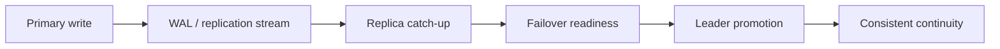

# Replication in ThemisDB

Availability and correctness are not the same thing. A database can be fast while still failing the moment a node disappears, a region goes offline, or a network partition appears. The replication module is the part of ThemisDB that turns isolated storage into a resilient platform by keeping data synchronized, making failover explicit, and preserving a recoverable view of the system under disruption.

The general challenge is straightforward: if a primary node fails, the system must continue with a clearly defined safety model. ThemisDB addresses this through leader-follower replication, failover orchestration, WAL shipping, conflict handling, and replication observability. These are not just operational niceties; they determine whether the system can recover safely after an outage or continue serving without silent divergence.

In practical terms, replication is about keeping the system honest across multiple nodes. Data moved from primary to replica must preserve ordering, remain recoverable under lag, and remain diagnosable when a replica falls behind. The module-level contract in [README.md](./README.md), the architecture context in [ARCHITECTURE.md](./ARCHITECTURE.md), and the broader systems view in [docs/compendium/docs/index.md](./../../docs/compendium/docs/index.md) all reinforce that this is an availability and correctness concern, not a niche transport topic.

The first core capability is safe data propagation. WAL shipping and replica synchronization ensure that durable changes are not only written locally, but also transmitted in a controlled way to followers or remote sites. This matters because a system that accepts writes without consistent replication is not resilient; it is merely optimistic in the face of failure.

The second core capability is failover and leadership continuity. When a primary is lost or degraded, the system must promote a suitable replica or move to a defined alternative path. That process depends on explicit topology state, health checks, and a deterministic promotion model. Without this, failover becomes guesswork and the system risks split-brain conditions or inconsistent reads.

The third core capability is conflict handling and explainable stream semantics. In distributed systems, update overlap, lag, and topology changes can create ambiguity. ThemisDB addresses this through explicit conflict resolution strategies, logical replication semantics, and observability of lag and health. The goal is not to pretend conflict does not exist, but to make it visible, rule-based, and repairable.

For customers and operators, the value is mission-critical: better availability, better disaster recovery, and less business risk from outages. A replication layer makes it possible to move from a single-point-of-failure deployment to a platform that remains operational under maintenance events, regional disruption, or partial node failure. It also improves operational trust because lag, topology, and promoted state become visible and can be acted on before the system enters a critical state.

ThemisDB keeps this subsystem properly bounded: replication owns the durability propagation and failover model, while storage, networking, access control, and application logic remain separate concerns. That boundary is essential because reliability problems are easier to fix when the precise failure domain is known. In other words, replication is not only about copying data — it is about preserving continuity and trust under disruption.

The source basis for this page is primarily module-local and then aligned with higher-level system context: [README.md](./README.md), [ARCHITECTURE.md](./ARCHITECTURE.md), [ROADMAP.md](./ROADMAP.md), [FUTURE_ENHANCEMENTS.md](./FUTURE_ENHANCEMENTS.md), [PRODUCTION_REQUIREMENTS.md](./PRODUCTION_REQUIREMENTS.md), and [docs/compendium/docs/index.md](./../../docs/compendium/docs/index.md). These references explain the operational reality of replication without substituting for the canonical module contract.
