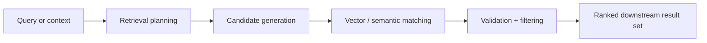

# Retrieval in ThemisDB

Retrieval is the bridge between raw data and useful downstream reasoning. In ThemisDB, the retrieval module is not a single feature but a layered stack: candidate generation, vector similarity, intermediate ranking, result validation, and governance-aware execution flow. This makes retrieval one of the most important systems for AI-driven, search-driven, and knowledge-centric workloads.

The core challenge is that retrieval quality is determined by more than just a similarity metric. A good system must combine recall, candidate selection, precision, latency control, and correctness checks while working across multiple data representations and runtime constraints. ThemisDB addresses this by placing retrieval as a structured execution layer rather than a loose set of ad hoc queries or feature-specific calls.

This module sits at the center of the platform’s knowledge and reasoning workflow. It links storage, search, vector behavior, governance controls, and downstream model usage. Its role is defined in [README.md](./README.md), [ARCHITECTURE.md](./ARCHITECTURE.md), and [ROADMAP.md](./ROADMAP.md), while the wider ecosystems context is connected through [docs/compendium/docs/index.md](./../../docs/compendium/docs/index.md).

The first core capability is candidate generation and retrieval planning. Before any ranking or final scoring happens, the system must choose which data items are relevant enough to be considered. This is where ANN-style front doors, vector search, and other retrieval strategies reduce the search space while preserving enough candidate quality to support later reasoning.

The second core capability is vector and semantic matching across intermediate layers. The retrieval module is responsible for bringing together vector-based relevance signals and the surrounding business context so that candidate items can be compared meaningfully. This is essential in AI workloads, where textual, structured, or semantic relevance is often a mixture of signals rather than a single literal match.

The third core capability is result validation and governance-aware execution. Retrieval results cannot be treated as inherently safe or correct just because they come from a fast index path. ThemisDB treats result validation, filtering, and governance-aware execution as part of the retrieval contract so that low-quality, unsafe, or relevant-but-invalid candidates do not flow unchecked into downstream model or agent logic.

For customers and operators, the value is direct: more relevant answers, lower downstream unnecessary computation, and better control over retrieval quality. In AI-heavy systems, retrieval quality is often the difference between a useful answer and a misleading one. This is why retrieval is treated as a platform capability with concrete quality constraints, not just as an implementation detail of a search or model layer.

ThemisDB keeps this boundary clear: retrieval owns the planning, candidate generation, semantic matching, validation, and downstream governance flow, while the underlying storage and search mechanics remain in their own subsystems. That separation matters because retrieval quality issues are often caused by the wrong layer: bad candidate selection, weak vector matching, poor ranking, or incorrect validation. The system must be able to diagnose those separately.

The source basis for this page is primarily module-local and then checked against the wider system context: [README.md](./README.md), [ARCHITECTURE.md](./ARCHITECTURE.md), [ROADMAP.md](./ROADMAP.md), [FUTURE_ENHANCEMENTS.md](./FUTURE_ENHANCEMENTS.md), [PRODUCTION_REQUIREMENTS.md](./PRODUCTION_REQUIREMENTS.md), and [docs/compendium/docs/index.md](./../../docs/compendium/docs/index.md). These references anchor the retrieval story in the verified platform contract rather than in vague conceptual statements.
