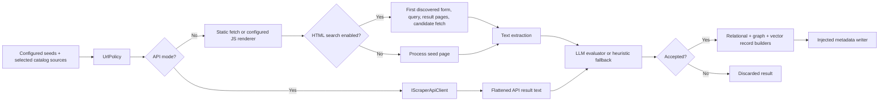

> Exact model backend not verifiable from final document text alone.

# Scraper in ThemisDB

## Overview

The scraper is a synchronous C++ ingestion plugin. Its runtime collects configured seeds and selected catalog sources, fetches or renders content, optionally searches through the first discovered HTML form, evaluates candidate text, and sends accepted records to an injected metadata writer. See [README.md](./README.md), [ARCHITECTURE.md](./ARCHITECTURE.md), and [IMPLEMENTATION.md](./IMPLEMENTATION.md).

## Data Flow

`ScraperPlugin` flushes the writer at the end of `scrape()`. Its default writer is in-memory; the vector record builder leaves the embedding empty. The standalone diagnostics, run-summary, robots, sitemap, and render-contract helpers are not automatically wired into the main loop.

## Configuration and Limits

- `UrlPolicy` permits only HTTP(S) URLs and applies blacklist-before-whitelist string-pattern matching. It is not complete SSRF/egress protection.
- HTML result pages use `search_options.max_result_pages`. `crawl_options.max_depth`, crawl `max_pages`, `respect_robots`, and `same_domain_only` are parsed but not enforced by the main loop.
- `api_options`, `search_options.results_per_page`, `llm_options.model_path`, and `llm_options.temperature` are parsed but not consumed by the current plugin path. API endpoint settings come from a catalog source or the API client configuration/defaults; the evaluator uses the default LLM plugin and a fixed request temperature.
- `request_delay_ms` is used on the HTML search path, not API pagination. The optional burst controller is disabled unless injected and is applied once per seed.
- `js_timeout_ms` is passed to the renderer command; the subprocess adapter does not independently terminate a hung renderer.

See [API.md](./API.md), [TRUST.md](./TRUST.md), and [OPERATIONS.md](./OPERATIONS.md) for contract, trust-boundary, and deployment details.

## Build and Tests

`src/scraper/CMakeLists.txt` defines the C++17 static `scraper_plugin` target and discovers YAML, HTML, and HTTP dependencies optionally. `tests/scraper/CMakeLists.txt` registers focused tests from `test_scraper_*.cpp`; see [MODULE_GUIDE.md](./MODULE_GUIDE.md) for target naming and test guidance.
