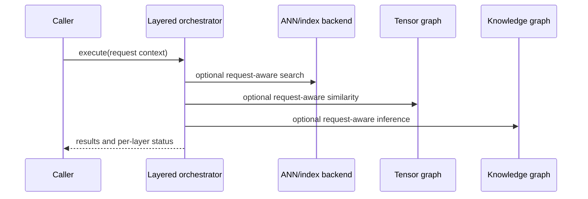

Exact model backend not verifiable from final document text alone.

# Search Module Architecture

## Kontext

`src/search/` owns search-side candidate composition, lexical/vector hybrid fusion, distributed result merging, ranking utilities, optional LLM-assisted rewriting/reranking, and result streaming. Index implementations, embedding generation, storage, and model inference are external boundaries.

## Komponenten

| Component | Public interface | Source-backed responsibility |
|---|---|---|
| Local hybrid search | [`HybridSearch`](../../include/search/hybrid_search.h) | Combine lexical/vector candidates and populate backend status, partial-result, and count stats; error-code enum integration remains TODO. |
| Distributed merge | [`DistributedHybridSearch`](../../include/search/distributed_hybrid_search.h) | Query local/remote shard paths and merge shard result sets. |
| Layered retrieval | [`LayeredRetrievalOrchestrator`](../../include/search/layered_retrieval_orchestrator.h) | Coordinate optional ANN, tensor, graph, and LLM stages with per-layer outcomes. |
| Ranking/utilities | [`LlmReranker`](../../include/search/llm_reranker.h), [`QueryExpander`](../../include/search/query_expander.h), [`FacetedSearch`](../../include/search/faceted_search.h) | Optional query expansion, reranking, facets, analytics, and related search operations. |
| Result delivery | [`SearchResultStream`](../../include/search/search_result_stream.h) | Cursor/page-based result access over a hybrid-search result source. |

## Schnittstellen

Public search contracts are declared in the component headers above. The
request-aware bounded retrieval contracts are summarized in the
[search API guide](API.md); this architecture page does not define HTTP or gRPC
wire behavior.

## Datenfluss

1. The caller configures and invokes local hybrid search; lexical and vector candidate sources feed a fusion/ranking step.
2. Optional filters, expansion, or LLM reranking can transform the query or candidate order.
3. Distributed search dispatches requests through the configured sharding remote executor and merges shard responses.
4. Layered retrieval runs its configured ANN/tensor/graph/LLM stages and records per-layer decisions; streaming exposes result pages where selected.

Evidence: [`hybrid_search.cpp`](hybrid_search.cpp), [`distributed_hybrid_search.cpp`](distributed_hybrid_search.cpp), [`layered_retrieval_orchestrator.cpp`](layered_retrieval_orchestrator.cpp), and [`llm_reranker.cpp`](llm_reranker.cpp).

## Sequenz (kritischer Ablauf)

Kurzinterpretation: The orchestrator runs optional layers inline, propagates
request context, and returns each layer's outcome to the caller.

## Fehlerpfade und Resilienz

- Missing, failed, or timed-out candidate backends can yield partial/degraded results or explicit layer decisions; inspect `SearchStats`/result metadata.
- ANN invalid distances and over-cardinality results are bounded and reported as
  `ANN_INVALID_BACKEND_RESULT`; an empty result after invalid candidates is
  fail-closed, not an ordinary no-match. Missing ANN backends currently do not
  run a flat scan: the nominal fallback is unavailable, returns no candidates,
  and is reported as `ANN_BACKEND_UNAVAILABLE` / `fail_closed`.
- A remote shard failure affects distributed merge completeness, not the local index's durable state.
- A missing/throwing optional reranker leaves a distinct rerank failure/fallback path; it is not evidence that the underlying LLM service recovered.
- Configuration and candidate limits constrain search work; stream/page failures are separate from candidate-generation failures.
- Layered retrieval runs inline without detached work. Cooperative layers poll
  cancellation and deadlines and discard partial output; synchronous ANN calls,
  tensor scoring operations, graph explain-store writes, and other non-polling
  backend calls may overrun until they return. QRY-07 remains open until all
  affected execution paths and the required slow-search cleanup trace are
  verified.

## Nicht-Ziele

- Implementing the index or persistence engine.
- Creating embeddings or owning the LLM backend lifecycle.
- Owning shard topology, transaction coordination, or query-language execution.
- Claiming performance/SLA values without the corresponding current benchmark evidence.

## Build and test evidence boundary

`cmake/ModularBuild.cmake` lists a subset of search implementation sources in `THEMIS_QUERY_SOURCES`; it is not evidence that every file in `src/search/` is present in every binary. `tests/CMakeLists.txt` auto-discovers eligible module test CMake files and adds `tests/search/` when tests are configured; that file declares focused targets and labels. Actual target generation, compilation, and execution were not verified for this update. The test sources establish test definitions only; no runtime pass is claimed by this architecture page.

## Verified cross-module references

| Boundary | Evidence and link |
|---|---|
| Index/ANN | `hybrid_search.cpp` includes index APIs and the layered orchestrator uses `index/advanced_vector_index.h`; see [index ANN header](../../include/index/ann_frontdoor.h). |
| Shard remote execution | Distributed search uses sharding remote-execution/topology interfaces; see [sharding architecture](../sharding/ARCHITECTURE.md). |
| LLM callback | Search has an injected LLM reranker/client boundary; see [LLM architecture](../llm/ARCHITECTURE.md). |
| Retrieval validator | Search result composition is distinct from the current [retrieval module architecture](../retrieval/ARCHITECTURE.md); no shared implementation is implied. |

## Verweise

- [Module README](README.md) · [API contract](API.md) · [layered retrieval notes](LAYERED_RETRIEVAL_ARCHITECTURE.md) · [module roadmap](ROADMAP.md)
- [`hybrid_search.h`](../../include/search/hybrid_search.h) · [`layered_retrieval_orchestrator.h`](../../include/search/layered_retrieval_orchestrator.h)
