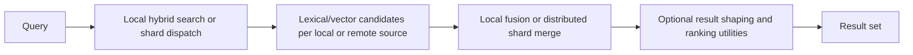

Exact model backend not verifiable from final document text alone.

# Search in ThemisDB

> Benefits such as improved recall, ranking quality, and latency are intended
> use-case outcomes, not measured guarantees. **TODO:** attach a reproducible
> evaluation before making comparative quality or performance claims.

Search is the layer that turns a broad, noisy data corpus into a usable and ranked result set. In ThemisDB, the search module combines lexical retrieval, vector similarity, hybrid fusion, and result shaping so that a query can return the most relevant items under real latency and cost constraints. This is one of the main places where retrieval quality becomes a product experience rather than a raw algorithmic detail.

The general challenge is that different retrieval strategies optimize for different things: lexical search is strong on exact or near-exact textual matches, vector search is strong on semantic similarity, and hybrid search is strongest when both signals are combined. ThemisDB treats search as a layered decision system in which candidate generation, ranking, filtering, and result merging are all part of the same platform contract. That is what makes it relevant for both operational use cases and AI-oriented discovery workloads.

The module sits in a central place in the platform. It is connected to query execution, vector retrieval, relevance scoring, and downstream LLM or agent workflows. The module contract is defined in [README.md](./README.md), [ARCHITECTURE.md](./ARCHITECTURE.md), and [ROADMAP.md](./ROADMAP.md), and the broader contextual framing is available in [docs/compendium/docs/index.md](./../../docs/compendium/docs/index.md).

The first core capability is hybrid retrieval. The engine can combine lexical matching with vector similarity so that the effective result set is not limited to one retrieval mode. In practice, this matters because real-world searches often require both exact matching and semantic similarity; a single retrieval method usually underperforms on at least one important dimension.

The second core capability is distributed result aggregation. In a scaled deployment, search requests can span multiple shards, partitions, or result sets. ThemisDB therefore needs to merge candidate results across internal boundaries without losing ranking quality or violating latency expectations. This is a critical operational capability, because search quality is often hidden behind a result fusion problem.

The third core capability is ranking, re-ranking, and result shaping. Search relevance is not just about matching candidate documents; it is also about knowing which candidate to surface first, how to filter low-value items, and how to collapse or expand results under runtime constraints. This is what turns retrieval from a raw index operation into a usable user-facing search experience.

For customers and operators, the practical value is significant: better recall, better ranking quality, and faster access to relevant information under mixed workload conditions. Search quality directly affects product usefulness, but it also affects operational efficiency because poorly ranked retrieval increases downstream compute, user frustration, and unnecessary model cost. In enterprise and AI-oriented workflows, that makes search a strategic capability rather than a basic utility.

ThemisDB keeps the boundary precise: the search module owns retrieval strategy, fusion behavior, ranking semantics, and aggregated result shaping, while storage, vector math, and distributed topology remain separate concerns. This separation matters because retrieval quality can be undermined by a weak index path, a poor merge strategy, or unstable latency control. The problem must be diagnosable at the correct layer.

The source basis for this page is primarily module-local and then cross-checked against the wider system context: [README.md](./README.md), [ARCHITECTURE.md](./ARCHITECTURE.md), [ROADMAP.md](./ROADMAP.md), [FUTURE_ENHANCEMENTS.md](./FUTURE_ENHANCEMENTS.md), [PRODUCTION_REQUIREMENTS.md](./PRODUCTION_REQUIREMENTS.md), and [docs/compendium/docs/index.md](./../../docs/compendium/docs/index.md). These references explain search as a production-grade retrieval capability without over-claiming beyond the verified module contract.
